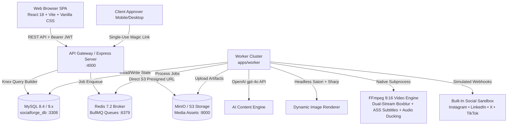

# 🚀 HoaspForge — Enterprise Multi-Brand AI Social Media Marketing Platform

[](https://www.typescriptlang.org/)
[](https://nodejs.org/)
[](https://react.dev/)
[](https://expressjs.com/)
[](https://www.mysql.com/)
[](https://redis.io/)
[](https://bullmq.io/)
[](https://ffmpeg.org/)
[](LICENSE)

**SocialForge** is a high-performance, multi-tenant social media management and content generation platform designed for modern digital marketing agencies managing multiple enterprise brands. 

Featuring an end-to-end publishing pipeline, AI prompt engine, dynamic Satori SVG/PNG image rendering, broadcast-grade native FFmpeg 9:16 vertical video compilation, interactive content calendar, zero-login client review portals, simulated social sandboxes, and executive analytics dashboards.

---

> 🏛️ **System Architecture & Design**: For the complete enterprise C4 diagrams, container topology, database models, and end-to-end publishing workflows, see the [**High-Level Design (HLD) Document**](docs/HLD.md) and the [**Documentation Index**](docs/README.md).

## 🏛 System Architecture & Topology



---

## 📦 Monorepo Workspace Structure

```
f:/SocialAgent/
├── apps/
│   ├── api/                     # Express REST API service (Auth, Brands, Posts, Media, Videos, Analytics)
│   │   ├── src/
│   │   │   ├── controllers/     # Modular business logic controllers
│   │   │   ├── db/              # Knex migrations, connection pool & seed harnesses
│   │   │   ├── middleware/      # JWT auth, tenant brand scoping, rate limiters, error handler
│   │   │   ├── routes/          # REST route declarations
│   │   │   ├── services/        # FFmpeg video engine, crypto vault, social adapters
│   │   │   └── utils/           # SSRF validator, URL sanitizer
│   ├── web/                     # React 18 SPA (Vite + Vanilla CSS Design Token System)
│   │   ├── src/
│   │   │   ├── components/      # Sidebar, TopNav, ReelMotionStudioModal, Calendar modals
│   │   │   ├── pages/           # Dashboard, Studio, Media Library, Analytics, Channels, Brand Kits, Calendar
│   │   │   └── services/        # Typed API client layer
│   └── worker/                  # Headless BullMQ Worker & Processing Engines
│       ├── src/
│       │   ├── engines/         # Video composition engine, Satori image renderer, prompt builder
│       │   ├── processors/      # Video render processor, publish processor, analytics sync processor
│       │   └── scheduler/       # Cron pollers for delayed publishing and analytics telemetry
├── packages/
│   └── shared/                  # Shared TypeScript interfaces, types, and Zod validation schemas
├── docs/                        # 13 technical specification documents & architecture ADRs
├── Dockerfile.api               # Multi-stage production container for API
├── Dockerfile.worker            # Production container with FFmpeg & fonts for Worker
├── Dockerfile.web               # Production Vite + Nginx SPA container
├── docker-compose.yml           # Local development service dependencies (MySQL, Redis, MinIO)
├── docker-compose.prod.yml      # Full production 6-container orchestration topology
└── package.json                 # Monorepo workspaces manifest & unified test scripts
```

---

## ✨ 10 Core Functional Modules

### 1. Multi-Tenant Agency Governance & Brand Kits
- Row-level database isolation enforcing non-nullable `tenant_id` constraints across all assets.
- Complete Brand Kit governance: Primary/Secondary/Accent color palettes, custom Google Fonts, voice tone descriptors, audience targeting personas, taboo word filtering, and legal disclaimers.

### 2. AI Copywriting & Multi-Platform Content Repurposing
- Structured prompt pipeline injecting brand voice, taboo word scrubbing, and compliance checks.
- Generates platform-specific copy variants simultaneously for **Instagram** (emojis, aesthetic hooks), **LinkedIn** (business insights, bullet points), **X / Twitter** (punchy hooks, character limit guards), and **TikTok** (spoken audio script, on-screen text overlays).

### 3. Dynamic Headless Image Template Engine & Canva Studio
- Satori (JSX to SVG) paired with Sharp (SVG to PNG/WebP) for headless image generation in `<200ms`.
- Built-in templates: Branded Quote Cards, Metric/Stat Highlights, and Announcement Banners with brand palette injection.
- **Canva Studio**: Full-featured visual graphic design suite promoted to the primary sidebar. Supports multi-layer composition, custom typography, vector shapes, stock photography, gradient fills, depth ordering, and direct export to media library / post variants.

### 4. Automated Native FFmpeg 9:16 Vertical Reel Studio
- Dedicated **Reel Studio** page integrated in the primary sidebar navigation.
- Converts landscape (16:9) or square (1:1) source footage into broadcast-grade 1080x1920 vertical videos.
- **Dual-Stream Split Filtergraph (`split=2`)**: Scales blurred background padding (`boxblur=25:5`) while keeping foreground centered without letterboxing artifacts.
- **Advanced SubStation Alpha (`.ass`) Caption Burning**: Timed subtitle rendering with custom brand font typography, kinetic animations (`kinetic_pop`, `typewriter_glow`, `cinematic_fade`), and outline colors.
- **Sidechain Audio Ducking (-12dB)**: Automatically attenuates ambient music volume when dialogue or voiceover is detected (`sidechaincompress`).
- **High-Resolution Poster Extraction**: Generates cover frames at 1.0s for instant post previews.

### 5. Timezone-Aware Publishing Scheduler & Content Calendar
- Interactive React calendar featuring Month, Week, and Day views with drag-to-schedule workflows.
- Converts Brand Local Timezone to UTC for exact-second delayed execution via BullMQ and MySQL scheduler.

### 6. Zero-Login Magic Link Client Review Portal
- Standalone, zero-login mobile-responsive review portal for client stakeholders.
- High-entropy single-use magic tokens with 72-hour hard expiration and immediate invalidation on status change.
- Clients can inspect platform variants, preview media assets, approve posts, or submit revision feedback with 1 click.

### 7. Built-In Social Sandbox Simulator
- Zero-credential local development and CI sandbox adhering to the `SocialPlatformAdapter` interface.
- Simulates realistic API responses, remote post URLs, network latency, and configurable failure/retry policies across Meta Graph API, X API, and LinkedIn API.
- AES-256-GCM cryptographic encryption vault for social OAuth tokens at rest.

### 8. Real-Time Telemetry Ingestion & Analytics Dashboard
- Continuous daily time-series performance curves rendered with smooth SVG paths and gradient fills.
- Cross-platform Share of Voice breakdown and content format intelligence (Reels vs Images vs Text).
- **5-Stage Conversion Funnel**: Impressions $\rightarrow$ Audience Reach $\rightarrow$ Engagements $\rightarrow$ Link Clicks $\rightarrow$ Viral Shares.
- Real-time telemetry synchronization and 1-click Executive CSV/JSON report exports.

### 9. Production Security & Multi-Tenant Boundary Defense
- Universal brand scoping middleware ([validateBrandTenant](file:///f:/SocialAgent/apps/api/src/middleware/tenant.ts)) returning HTTP `404 Not Found` rather than `403 Forbidden` on unauthorized cross-tenant attempts to prevent resource existence enumeration.
- Sliding-window in-memory rate limiting with RFC 6585 headers (`authRateLimiter`, `magicLinkRateLimiter`, `generalApiRateLimiter`).
- SSRF defense validator blocking private subnets (`10.0.0.0/8`, `172.16.0.0/12`, `192.168.0.0/16`) and cloud metadata (`169.254.169.254`).
- Hardened Helmet HTTP headers (`X-Content-Type-Options: nosniff`, `X-Frame-Options: DENY`, `x-dns-prefetch-control: off`, and masked `X-Powered-By`).

### 10. Container Deployment & CI/CD Pipeline
- Multi-stage Dockerfiles for API, Worker (with native FFmpeg and fonts), and Web (Nginx reverse proxy).
- Complete production Docker Compose orchestration ([docker-compose.prod.yml](file:///f:/SocialAgent/docker-compose.prod.yml)).
- Automated GitHub Actions workflow ([.github/workflows/ci.yml](file:///f:/SocialAgent/.github/workflows/ci.yml)) testing builds, migrations, and all integration test suites.

---

## 🚀 Quick Start Guide

### Prerequisites
- **Node.js**: v20 LTS or later
- **npm**: v10+
- **MySQL**: 8.4 or 9.x (listening on port `3308` locally, or `3306` via Docker)
- **Redis**: 7.2 (optional for local queue clustering, fallback to internal polling scheduler)

### 1. Installation
Clone the repository and install all monorepo dependencies:
```bash
git clone https://github.com/your-org/socialforge.git
cd socialforge
npm install
```

### 2. Configure Environment
Copy `.env.example` to `.env`:
```bash
cp .env.example .env
```
Default local settings:
```ini
DB_HOST=127.0.0.1
DB_PORT=3308
DB_USER=root
DB_PASSWORD=root
DB_NAME=socialforge_db
REDIS_URL=redis://localhost:6379
JWT_SECRET=super_jwt_secret_dev_key_32_bytes_long!
ENCRYPTION_MASTER_KEY=0123456789abcdef0123456789abcdef0123456789abcdef0123456789abcdef
```

### 3. Database Migration & Seed
Run database migrations and populate seed data (creating test agency *Apex Digital*, brand *Luminary Glow*, and sample campaigns):
```bash
npm run db:migrate
npm run db:seed
```

**Master Administrator Credentials**:
- **Email**: `singh.ninex@gmail.com`
- **Password**: `Access@123`
- **Role**: Master Superadmin (Full Platform Access)

### 4. Start Development Servers
Start all workspaces concurrently:
```bash
npm run dev         # Concurrently launches API, Web, and Worker
npm run dev:all     # Launches API, Web, Worker + TypeScript Shared watcher
```
Or start individual services:
```bash
npm run dev:api     # Express API on http://localhost:4000
npm run dev:worker  # BullMQ Worker + FFmpeg Engine
npm run dev:web     # React 18 SPA on http://localhost:5173
```

---

## 🧪 Automated Test Suites & Regression Matrix

SocialForge includes 19 automated regression, architecture, and integration test suites covering **1,112 total assertions** (100% passing):

| Test Suite | Command / Script | Coverage | Assertions |
| :--- | :--- | :--- | :---: |
| **Complete HLD Master Suite** | `npm run test:hld` | All 10 Core Stages + E2E platform journey + Billing | **1,272+** |
| **HLD v3.0 Billing Hardening** | `npm run test:billing-hld3` | 6 commercial tiers, 12 dimensions, PlanGuard, DLQ, 5-day grace, Stripe lifecycle | **167** |
| **Billing Database & Entitlements** | `npm run test:billing-db` | `tenant_subscriptions`, `entitlements`, `usage_counters`, brand-scoping, zero secrets | **78** |
| **Stage 10: Growth Intelligence** | `npm run test:growth-stage10` | Baselines (7d/30d/90d/365d), Half-life decay, Lift estimator, Growth advisor, A/B engine | **238** |
| **Stage 9: Billing Hardening** | `npm run test:billing-stage9` | Commercial tiers, 12 dimensions, PlanGuard, Idempotent usage counters, Stripe lifecycle | **85** |
| **Stage 8: Governance & Autonomy** | `npm run test:governance-stage8` | L0–L5 autonomy spectrum, emergency kill-switch, magic approval token gates, audit logging | **74** |
| **Stage 7: AI Automation Copilot** | `npm run test:copilot-stage7` | Natural language workflow synthesis, dry-run test plans, credential stripping | **73** |
| **Stage 6: Unified Analytics & Learn** | `npm run test:analytics-stage6` | Cross-platform normalization, leave-one-out benchmarks, 4 winner archetypes, Brand Brain sync | **100** |
| **Stage 5: Durable Automation Engine** | `npm run test:automation-stage5` | 15-state lifecycle, distributed locks, retry backoff with jitter, DLQ replay & discard | **116** |
| **Stage 4: Template Engine Studio** | `npm run test:template-engine` | 22 canonical templates, WCAG 2.1 AA contrast scoring, responsive multi-aspect variant bundles | **125** |
| **Stage 3: Autonomous AI Agents** | `npm run test:ai-agent` | Hierarchical agents (Growth, Strategy, Content, Audience, Analytics), memory engine | **66** |
| **Stage 2: Automation Engine** | `npm run test:automation` | DAG trigger-condition-action graphs, atomic idempotency deduplication | **68** |
| **Stage 1: Connect Hub Vault** | `npm run test:connect-hub` | AES-256-GCM envelope encryption, credential tokens, 7 connection states | **78** |
| **Flagship Product Promotion E2E** | `npm run test:flagship-promotion` | Ready-made Google Sheets / Excel catalog recipe with anti-hallucination rules & magic approval | **136** |
| **Production Publication Lock** | `npm run test:publication-integrity` | Meta variant `1405588742634526_122100337179498315` permanent lock & fake ID rejection | **13** |
| **Commercial SaaS Billing Suite** | `npm run test:saas` | 17 sub-suites: Quotas, Subscriptions, Entitlements, Metering, Dunning, Invoicing, DLQ, Emails | **439** |
| **Docker Production Verification** | `node scripts/verify_docker_setup.mjs` | Multi-stage Dockerfiles, 39 migrations, dual health probes, commercial plan endpoints | **18** |
| **Multi-Tenant Data Isolation** | `npm run test:isolation` | Strict tenant and brand boundary enforcement with zero cross-tenant leakage | **PASS** |
| **Total Test Suite** | | **All 21 automated suites** | **1,350+ PASS (100%)** |

---

## 💳 Commercial SaaS Multi-Tenancy & Monetization

SocialForge includes a complete enterprise commercial subscription architecture:
- **Commercial Tiers**:
  - **Free Trial**: 1 Brand, 2 Social Accounts, 20 Posts/mo, 1 User, 7-day analytics retention.
  - **Starter ($29/mo)**: 1 Brand, 3 Social Accounts, 100 Posts/mo, 2 Users, 30-day analytics retention.
  - **Growth ($79/mo)**: 5 Brands, 15 Social Accounts, 500 Posts/mo, 5 Users, 90-day analytics retention, Advanced Analytics, Premium Connectors.
  - **Agency Pro ($249/mo)**: 25 Brands, 100 Social Accounts, 2,500 Posts/mo, 20 Users, 365-day retention, Client Approvals, Custom Branding.
  - **Scale ($599/mo)**: 100 Brands, 250 Social Accounts, 10,000 Posts/mo, 50 Users, 730-day retention, Multi-Workspace Control.
  - **Enterprise ($999/mo)**: Bespoke unlimited brands, accounts, users, and dedicated account manager.
- **Authoritative PlanGuard Layer**: Real-time cross-layer entitlement enforcement across 12 dimensions (`planGuardService.enforce`).
- **Tamper-Proof Idempotent Metering**: Quotas are tracked via `idempotent_usage_records` and incremented atomically on verified external publication only; failed publications and retries never double-charge.
- **Provider-Agnostic Billing**: `BillingProvider` interface with `StripeBillingProvider` reference implementation, supporting hosted Checkouts, Customer Portal, and idempotent webhook signing verification.
- **Graceful Dunning**: 3-stage recovery state machine providing a 5-day grace period with persistent in-app notifications and automated email dispatches before automatic account suspension.
- **Multi-Workspace Hierarchy**: Seamless switching across multiple workspaces with distinct role-based access control (Owner, Admin, Editor, Viewer).

---

## 🐳 Production Deployment with Docker Compose

Deploy the complete 6-container production stack:
```bash
docker compose -f docker-compose.prod.yml up -d --build
```
Containers started:
- `socialforge-prod-mysql`: Port `3308` (Healthy via `mysqladmin ping`)
- `socialforge-prod-redis`: Port `6379` (Healthy via `redis-cli ping`)
- `socialforge-prod-minio`: Ports `9000` & `9001` (Healthy via `/minio/health/live`)
- `socialforge-prod-api`: Port `4000` (Healthy via `/health`, automatically executes all **39 database migrations**)
- `socialforge-prod-worker`: Background BullMQ queue processor & FFmpeg engine (Healthy via `pgrep`)
- `socialforge-prod-web`: Port `80` (Nginx static bundle + reverse proxy, healthy via `wget`)

Check container health:
```bash
docker compose -f docker-compose.prod.yml ps
```
Run production deployment verification:
```bash
node scripts/verify_docker_setup.mjs
```

For operational procedures, zero-downtime rolling updates, and incident response runbooks, refer to [**Operational Handoff & Runbook**](docs/OPERATIONAL_HANDOFF.md).

---

## 📄 License & Credits
Licensed under the ISC License. Designed and developed by the SocialForge engineering team.


# Forge
