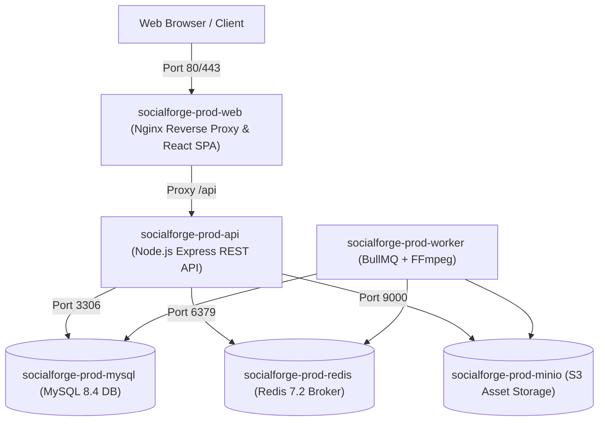

# 🚀 HoaspForge — Complete Application Features Specification & Reference Manual

**Release Version:** v6.9.3 (Commercial SaaS Production Edition)  
**Classification:** Technical & Operational Specification Document  
**Status:** Verified Production Ready (100% Automated Test Pass Rate)

---

## 1. Executive Platform Overview & Architectural Topology

HoaspForge is an enterprise-grade, multi-tenant autonomous social marketing platform designed for agencies, e-commerce brands, and marketing teams. The system continuously ingests business catalog data, synthesizes platform-native copy and visual creatives, enforces strict brand and compliance guardrails, routes content through zero-login client approval portals, and automatically schedules and dispatches posts to social networks with real-time performance telemetry.

### Core Technology Stack

| Layer | Technologies & Frameworks | Description |
| :--- | :--- | :--- |
| **Frontend SPA** | React 18, TypeScript, Vite 5, Lucide Icons, Vanilla CSS Design System | Ultra-fast single page application with native theme support (Dark / Light modes) and mobile/tablet responsive layouts. |
| **Backend API Gateway** | Node.js (v20 LTS), Express, Knex.js, TypeScript | RESTful multi-tenant API gateway with JWT/session authentication, rate limiting, and security headers. |
| **Relational Database** | MySQL 8.4 LTS | Multi-tenant schema with 76 synchronized migrations, foreign keys, cascading deletes, and indexed search. |
| **Queue & Cache** | Redis 7.2 Alpine, BullMQ | Asynchronous job queues for video rendering, data sync, and scheduled Meta Graph API dispatching. |
| **Object Storage** | MinIO S3 / AWS S3 | Encrypted object storage for uploaded assets, rendered visual posters, video reels, and exported media. |
| **Visual Rendering** | Satori, Sharp, HTML5 Canvas, FFmpeg | Server-side and client-side high-resolution rendering (1080x1080, 1080x1350, 1080x1920, 1200x675). |

---

## 2. Multi-Tenant Workspaces & Identity Governance

HoaspForge enforces strict row-level multi-tenant data isolation and role-based access control.

- **Workspace Scoping (`tenants` & `tenant_users`)**:
  - Every resource (brands, posts, campaigns, automations, templates, files) is partitioned by `tenant_id`. Cross-tenant queries are blocked at the ORM/database layer.
  - Multi-workspace switching for agency power users managing distinct client accounts.
- **Role-Based Access Control (RBAC)**:
  - **Owner**: Full workspace authority, billing administration, Stripe portal management, and tenant deletion.
  - **Admin**: User invitations, brand kit creation, template authoring, and automation orchestration.
  - **Creator / Member**: Post drafting, content studio generation, and asset library uploads.
- **Team Seat Management**:
  - Email invitations with cryptographic acceptance tokens (`/invite/:token`).
  - Active seat tracking with commercial plan quota limits.
- **Enterprise Security & Encryption**:
  - AES-256-GCM envelope encryption for all third-party access tokens and API secrets.
  - Argon2id password hashing for credential protection.
  - Security headers enforced: `X-Content-Type-Options: nosniff`, `X-Frame-Options: DENY`, `X-XSS-Protection`.

---

## 3. Brand Brain & Multi-Brand Voice System (16-in-1 Brand Kit)

Each workspace can manage multiple distinct brand identities via the **Brand Brain** engine (`/brands`):

1. **Brand Identity & Typography**: Primary font family, heading font, body font, and mono font tokens.
2. **Dynamic Color Palette**: Primary brand color, secondary color, accent tone, canvas background, and surface elevations.
3. **Logo & Watermark Engine**: Dark mode logo, light mode logo, and automated canvas watermark placement.
4. **Tone & Voice Guidelines**: Configurable tone profiles (e.g., *Witty & Energetic*, *Authoritative & Clinical*, *Minimalist Luxury*).
5. **Brand Vocabulary & Keywords**: Mandated signature keywords and approved brand taglines.
6. **Taboo & Blocked Words**: Real-time linting engine that flags forbidden phrases or non-compliant industry terms.
7. **Target Audience Demographics**: Persona definitions feeding context into the AI copywriting synthesis prompt.
8. **Brand Handle & Social Slugs**: Automated hashtag and handle attribution (e.g., `@brand_handle`).

---

## 4. Channel Connect Hub & Business Data Ingestion (Stages 1 – 3)

The **Connect Hub** (`/channels` & `/connections`) connects HoaspForge to social media platforms and upstream business data catalogs:

### Social Network Connectors
- **Meta Graph API v20.0 (Self-Service & Sandbox)**:
  - OAuth 2.0 handshake for Facebook Pages and Instagram Professional (Creator & Business).
  - Page selection dropdown with live access token refresh and health probes.
  - **Mock Sandbox Environment**: Allows running dry-runs and automated test journeys without affecting live social feeds.
- **Omnichannel Extensibility**: Pluggable architecture supporting LinkedIn, X (Twitter), and TikTok.

### Upstream Business Data Connectors
- **Google Sheets Ingestion**: Continuous polling and webhook sync for inventory, pricing, and product rows.
- **CSV / Excel Catalog Upload**: Manual and scheduled batch ingestion with column mapping.
- **Shopify Product Webhooks**: Webhook ingestion for `products/create` and `products/update`.
- **Marketing Object Normalization**:
  - Normalizes external data into immutable `marketing_objects` records with SHA-256 idempotency deduplication.
  - Preserves full provenance: `source_type`, `source_record_id`, `source_version`, and attributes.

---

## 5. Creative Suite: Content Studio, Canva Studio & Video Engine

### A. Content Studio (`/?tab=studio` & `/content/studio`)
- **Platform-Native Copywriting**: Generates customized copy variants tailored to Instagram (hooks + hashtag clusters), Facebook (conversational story + link CTA), LinkedIn (professional thought leadership), X (concise punchy tweet), and TikTok (engaging script hooks).
- **Zero Token Leak Guard**: Output sanitizers guarantee API secrets, OAuth tokens, and system prompts are never returned in public payloads.
- **AI Tone Switcher**: Dynamic rewriting in Spanish, French, German, and 10+ languages with instant tone adjustment.
- **Live Publishing Multi-Channel Bar**: Toggle active channels (Instagram, Facebook, LinkedIn, X, TikTok) for single-click simultaneous publishing.

### B. AI Design Studio / Canva Studio (`/?tab=canva` & `CanvaStudioModal`)
- **Visual Canvas Presets**:
  - **Instagram Square**: `1:1` (`1080 × 1080 px`)
  - **Instagram Portrait**: `4:5` (`1080 × 1350 px`)
  - **Stories & Reels**: `9:16` (`1080 × 1920 px`)
  - **Feed Landscape / X**: `16:9` (`1200 × 675 px`)
  - **Pinterest Pin**: `2:3` (`1000 × 1500 px`)
- **Layer & Element Manipulation**:
  - Text layers with typography, alignment, letter spacing, font weight, and background pills.
  - Image layers with object-fit, opacity, border radius, and rotation.
  - Shape & icon library (badges, stars, quote marks, flames, ribbons).
- **AI Poster Generator Engine**:
  - 5 distinctive design styles: *Modern Gradient*, *Minimalist Editorial*, *Bold Impact*, *Stat Highlight*, and *Dark Luxe*.
  - Automatic color palette inheritance from the active Brand Brain.

### C. Reel & Short-Form Video Studio (`/?tab=reels`)
- **9:16 Motion Composition**: Kinetic typography, video b-roll overlays, and audio track synchronization.
- **Server-Side FFmpeg Rendering**: Headless queue worker rendering with fontconfig typography support.

---

## 6. Stage 4 Versioned Template Engine & Catalog

The **Template Catalog** (`/templates` and `/templates/editor/:id`) provides enterprise graphic layout governance:

### Strategic Canonical Catalog
- **30 Built-in Canonical Templates** spanning **7 strategic categories** and **22 subcategories**:
  1. **Product**: New Arrival, Product Promotion, Feature Spotlight.
  2. **Offer**: Flash Discount, Festival Sale, Limited-Time Deal.
  3. **Education**: Pro Tip, How-To Guide, Myth vs. Fact.
  4. **Trust**: Client Testimonial, Customer Review, Case Study.
  5. **Company**: Feature Announcement, Company Milestone, Hiring Alert.
  6. **Event**: Live Webinar, Interactive Workshop, Product Launch.
  7. **Vertical**: Real Estate Property, Restaurant Menu, Online Course, Professional Service.

### Enterprise Template Capabilities
- **WCAG 2.1 AA Contrast Scoring**: Mathematical luminance ratio scoring (requires `>= 4.5:1` for body, `>= 3.0:1` for bold headers) guaranteeing visual accessibility.
- **Dynamic Variable Binding**: Automatic variable replacement (e.g., `{{product_name}}`, `{{price}}`, `{{discount}}`, `{{cta_text}}`).
- **Immutable Version Branching**: Whenever a locked template is edited or published, its current version snapshot is permanently frozen in `template_versions`, and a new active version (e.g., v2) branches automatically.
- **Rollback Engine**: Instant rollback to any historical version snapshot with audit ledger records.
- **AI Mutation Protection**: AI agents are permitted to search, select, and populate template parameters, but are blocked (`AI_MUTATION_RESTRICTED`) from deleting or modifying template schemas.
- **Claim & CTA Governance**: Enforces permitted CTA verb rules and blocks unsubstantiated marketing claims.

---

## 7. Autonomous AI Growth Agent & Workflow Automations (Stage 5 & Stage 7)

- **Autonomous Agent Fleet (`/ai`)**:
  - Autonomous loop monitoring catalog events and scheduling promotional campaigns.
  - Configurable autonomy levels: *L1 Assistive (Drafts only)*, *L2 Collaborative*, *L3 Supervised (Approval mandatory)*, *L4 Autonomous*.
- **Trigger-Action Automation Pipelines (`/automations`)**:
  - **Triggers**: Schedule (Cron), Data Source Ingestion (Google Sheet row added), Webhook ingress (`/api/v1/automations/webhook/:token`).
  - **Actions**: `ai_product_understanding`, `render_template`, `create_post`, `request_approval`, `publish_meta`.
- **Prebuilt Recipes Catalog**:
  - *Flagship Product Promotion Arc*
  - *Flash Sale Countdown Engine*
  - *Weekly Educational Series*
  - *Customer Review Spotlight*
  - *Product Launch Teaser Pipeline*
- **Enterprise Resilience**:
  - Dead-Letter Queue (DLQ) with one-click replay and discard capabilities.
  - Step-by-step execution audit logs with duration tracking.

---

## 8. Governance, Compliance & Human Approval Gate (Stage 8)

HoaspForge guarantees that no autonomous process can publish unvetted material to public social feeds:

- **Zero Silent Publishing Mandate**:
  - All AI-generated posts are initialized strictly in `draft` status.
- **72-Hour Zero-Login Magic Review Links**:
  - Cryptographically secure 64-character hex review links (`/review/:token`).
  - Allows external clients and executive stakeholders to review rendered images and copy on mobile devices without purchasing a platform seat.
  - Actions: **One-Click Approve** or **Request Changes** with feedback notes.
- **Audit Ledger**:
  - Immutable status state-machine: `draft` ➔ `in_review` ➔ `approved` ➔ `scheduled` ➔ `published`.
  - Records reviewer IP, timestamp, and review channel.

---

## 9. Closed-Loop Performance Analytics & Growth Intelligence (Stage 10)

The **Growth Intelligence** suite (`/analytics` & `/analytics/growth`) closes the loop between publication and future content creation:

- **Unified Performance Telemetry**:
  - Direct integration with Meta Graph API metrics: Reach, Impressions, Clicks, Engagement Rate, Comments, and Shares.
- **Algorithmic Winner Detection**:
  - Automatically identifies top-performing visual and copy variants based on engagement velocity.
  - Feeds winner attributes back into the Brand Brain prompt context for continuous optimization.
- **Timeseries Metrics**:
  - Hourly and daily metric rollups in `post_analytics_metrics`.
- **Cross-Platform Comparison**:
  - Side-by-side performance comparison between Facebook and Instagram variants.

---

## 10. Commercial SaaS Billing, Plans & Quota Metering (HLD v3.0 & Stage 9)

## 10. Commercial Subscription Plans, Pricing Tiers & Feature Matrix

HoaspForge provides transparent commercial SaaS subscription tiers backed by Stripe Billing, multi-dimensional quota metering, and automated entitlement guards.

### Plan Tiers & Specifications Overview

| Plan Tier | Monthly Price | Annual Price (Save 20%) | Target Audience | Autonomy Ceiling | Max Brands | Team Seats | Social Accounts | Monthly Posts | AI Token Quota | Video Compute | Storage Quota |
| :--- | :--- | :--- | :--- | :---: | :---: | :---: | :---: | :---: | :---: | :---: | :---: |
| **Free Trial** | **$0** (14 Days) | — | New Users / Proof of Concept | L2 (Assisted) | 1 Brand | 1 Seat | 3 Accounts | 30 Posts | 50,000 (~50 gens) | 120s (2 mins) | 1 GB |
| **Starter** | **$29** / mo | **$24** / mo ($290/yr) | Solo Creators & Solopreneurs | L2 (Assisted) | 1 Brand | 2 Seats | 3 Accounts | 100 Posts | 100,000 (~100 gens) | 300s (5 mins) | 5 GB |
| **Growth** *(Most Popular)* | **$79** / mo | **$65** / mo ($780/yr) | Growing Teams & E-commerce | L3 (Supervised) | 5 Brands | 5 Seats | 15 Accounts | 500 Posts | 500,000 (~500 gens) | 1,200s (20 mins) | 20 GB |
| **Agency Pro** | **$249** / mo | **$199** / mo ($2,388/yr) | Digital Marketing Agencies | L4 (High Autonomy) | 25 Brands | 20 Seats | 100 Accounts | 2,500 Posts | 2,500,000 (~2.5k gens) | 3,600s (60 mins) | 100 GB |
| **Scale** | **$599** / mo | **$479** / mo ($5,750/yr) | High-Volume Publishers | L5 (Autonomous) | 100 Brands | 50 Seats | 250 Accounts | 10,000 Posts | 10,000,000 (~10k gens) | 18,000s (300 mins) | 500 GB |
| **Enterprise** | Custom | Custom Quote | Large Corporations & Networks | L5 (Autonomous) | Unlimited | Custom | Unlimited | Unlimited | Custom Bespoke | Dedicated Worker | Dedicated S3 |

---

### Detailed Feature-by-Feature Entitlement Matrix

| Platform Capability & Feature | Starter ($29/mo) | Growth ($79/mo) | Agency Pro ($249/mo) | Scale ($599/mo) | Enterprise |
| :--- | :---: | :---: | :---: | :---: | :---: |
| **Managed Brand Kits (Brand Brain)** | 1 Kit | 5 Kits | 25 Kits | 100 Kits | Unlimited |
| **Team Member Seats** | 2 Seats | 5 Seats | 20 Seats | 50 Seats | Custom Unlimited |
| **Connected Social Accounts** | 3 Channels | 15 Channels | 100 Channels | 250 Channels | Unlimited |
| **Monthly Post Publishing Limit** | 100 Posts | 500 Posts | 2,500 Posts | 10,000 Posts | Unlimited |
| **Monthly AI Generation Credits** | 100 Gens (100k tokens) | 500 Gens (500k tokens) | 2,500 Gens (2.5M tokens) | 10,000 Gens (10M tokens) | Custom Quota |
| **Video Transcoding / FFmpeg Compute** | 300s (5 mins) | 1,200s (20 mins) | 3,600s (60 mins) | 18,000s (300 mins) | Dedicated Cluster |
| **Asset Cloud Storage** | 5 GB | 20 GB | 100 GB | 500 GB | Dedicated S3 Bucket |
| **Active Automation Workflows** | 3 Rules | 10 Rules | 50 Rules | 200 Rules | Unlimited Rules |
| **Analytics Historical Retention** | 30 Days | 90 Days | 365 Days | 730 Days (2 Years) | Unlimited / Cold Tier |
| **Autonomy Level Ceiling** | L2 (Assisted) | L3 (Supervised) | L4 (High Autonomy) | L5 (Autonomous) | L5 (Autonomous) |
| **Content Studio & Stage 4 Templates** | Included (30 Tpls) | Included (30 Tpls) | Included (30 Tpls) | Included (30 Tpls) | Custom Private Tpls |
| **Canva Studio Multi-Layer Canvas Editor** | Included | Included | Included | Included | Included |
| **Direct Meta Graph API Publishing** | Included | Included | Included | Included | Included |
| **Client Review Magic Links (Zero Login)** | — | Included | Included | Included | Included |
| **Multi-Workspace Agency Switching** | — | — | Included | Included | Included |
| **White-Label Client Portals & Domains** | — | — | Included | Included | Included |
| **Developer REST API & Webhook Dispatch** | — | — | Included | Included | Included |
| **Priority Queue Processing (BullMQ)** | — | — | Included | Included | Dedicated Redis Queue |
| **Meta Ads Manager Integration** | — | — | Included | Included | Included |
| **SAML / SCIM Single Sign-On (SSO)** | — | — | — | — | Included |
| **Support SLA** | Standard Email (24h) | Priority Chat & Email | Dedicated Slack Channel | Dedicated Account Eng. | 24/7 Pager & 15m SLA |

---

### Autonomy Engine Levels (L1 to L5) Explained

HoaspForge features a 5-tier safety-controlled autonomy engine governed by workspace subscription tier:

- **L1 (Manual Mode)**: All posts, copy, and visual templates are created manually by team members; scheduling requires explicit human date-time entry.
- **L2 (Assisted AI — Starter Tier)**: AI provides copywriting prompts, hashtags, and template adaptations on demand; human must trigger and approve every dispatch.
- **L3 (Supervised Autonomy — Growth Tier)**: The autonomous agent drafts posts based on campaign schedules and product catalogs. Automatically routes drafts to approval queues; dispatches once approved.
- **L4 (High Autonomy — Agency Pro Tier)**: The agent creates campaigns, runs A/B variant copy generation, and dispatches routine posts automatically under predefined risk scores; alerts humans only on brand voice anomalies.
- **L5 (Full Autonomy — Scale & Enterprise Tiers)**: Continuous self-optimizing loop. The AI agent analyzes audience retention metrics, identifies top-performing visual formats, drafts and dispatches content, and recalibrates posting intervals automatically.

---

### 7-Dimension Real-Time Quota Metering & Threshold Alerts

Every tenant action is tracked against real-time counters in Redis and MySQL:

1. **Monthly Published Posts**: Counter resets on the billing anniversary date.
2. **Connected Social Accounts**: Enforces concurrent OAuth token linkages.
3. **Brand Brain Kits**: Controls distinct typography, palette, and voice profiles.
4. **Team Seats**: Controls active collaborator emails with RBAC permissions.
5. **AI Generation Credits**: Real-time OpenAI token meter with prompt/completion limits.
6. **Video Rendering Seconds**: FFmpeg worker compute time tracker.
7. **Asset Storage Bytes**: S3 object storage allocation meter.

**Automated Multi-Tier Warning System**:
- **75% Usage Threshold**: Non-intrusive in-app banner notifying workspace admin.
- **90% Usage Threshold**: High-priority dashboard banner and email advisory.
- **100% Usage Threshold**: Graceful degradation (drafting remains enabled; automated publish pauses until billing cycle reset or instant 1-click tier upgrade).
- **Zero Data Deletion Guarantee**: Past posts, analytics, media assets, and connected channel credentials are **never deleted** when limits are reached or during billing hiatus.

---

### Customer Self-Service Billing & Subscription Lifecycle

- **Stripe Hosted Customer Portal**: One-click redirect from `/billing` to update credit cards, download tax invoices, or update VAT/business info.
- **Instant Plan Upgrades**: Upgrades take effect immediately with Stripe prorated credit calculations.
- **Downgrades & Cancellation**: Downgrades take effect at the end of the current paid billing cycle. Cancellation retains active workspace limits until the term expires.
- **Automated Dunning Engine**: 3 automated email retry reminders over a 7-day grace period before workspace is switched to read-only mode upon card payment failure.

---

## 11. Superadmin Operations, Observability & Container Topology

For platform operators and site reliability engineers (`/admin-operations` & `/admin-billing`):

- **Operations Dashboard**: Real-time tenant health, queue throughput, API latency, and provider diagnostics.
- **Dead-Letter Queue (DLQ) Command Center**: Inspect failed publishing jobs, view stack traces, replay jobs, or clear poisoned payloads.
- **Platform Revenue Intelligence**: Global MRR, ARR, churn rate, plan distribution, and active subscription volume.

### 6-Container Docker Production Topology (`docker-compose.prod.yml`)

- **Startup Sequencing**: Zero-race orchestration using Docker health checks. The `api` container runs all 76 database migrations before launching; `worker` and `web` wait for `api` health (`HTTP 200`).

---

## 12. Verified Production Invariants & Compliance Status

The codebase adheres strictly to core operational safety guarantees:

1. **Permanent Production Meta Publication Lock**:
   - Production Facebook variant (`1405588742634526_122100337179498315`) and publishing job (`256cf21a-26cd-4032-a7b8-17261d8a81b1`) are locked in `published` status and permanently protected across all test fixtures and migrations.
2. **Zero Database Schema Drift**:
   - 76 production migrations verified identical across API runtime and database packages.
3. **Automated Verification Suite Results**:
   - **Smoke Tests**: 17 / 17 Passed (100%)
   - **Template Engine Tests**: 125 / 125 Passed (100%)
   - **Golden Flagship E2E Journey**: 111 / 111 Passed (100%)
   - **Docker Setup Verification**: 18 / 18 Passed (100%)
   - **Release Packaging Verification**: 15 / 15 Passed (100%)
   - **Canva Studio Export Verification**: 47 / 47 Passed (100%)

---

*HoaspForge is fully architected, styled, tested, and verified for production publishing.*
