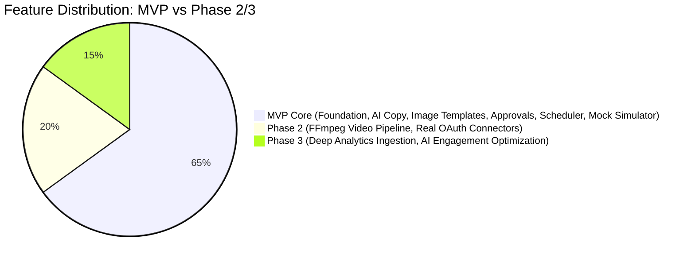

# SocialForge — Product Requirements Specification (PRS)

## 1. Functional Requirements Matrix

### 1.1 Multi-Tenancy, Organizations & User Management
- **FR-ORG-01 (Tenant Isolation)**: The platform must enforce strict data boundaries between organizations (agencies). A user belonging to Tenant A cannot discover, read, update, or delete data belonging to Tenant B.
- **FR-ORG-02 (Multi-Brand Support)**: Each tenant can create multiple Brands. Each Brand has an independent configuration (timezone, industry, social connections, brand kit, and content calendar).
- **FR-ORG-03 (Role-Based Access Control)**:
  - System must enforce roles: `agency_admin`, `brand_manager`, `creator`, `client_approver`, and `viewer`.
  - Roles must be scoped either organization-wide or constrained to specific assigned brands.
- **FR-ORG-04 (Authentication & Sessions)**:
  - Email/password authentication with secure Argon2/Bcrypt hashing.
  - JWT access tokens (short-lived: 15 minutes) and refresh tokens (long-lived: 7 days) with revocation capability.
  - Magic link one-time token generation for external client reviewers without account creation.

### 1.2 Brand Kit & Governance Engine
- **FR-BRD-01 (Identity Definition)**: Each brand profile must store:
  - Brand name, slug, tagline, industry, website, timezone.
  - Primary, secondary, accent, and neutral color hex codes.
  - Primary heading font and secondary body font (Google Fonts / custom webfont URLs).
  - High-resolution SVG / PNG logo assets (horizontal, icon-only, light/dark variants).
- **FR-BRD-02 (Tone of Voice & AI Persona)**:
  - Formality slider / descriptor (e.g., Casual, Professional, Irreverent, Academic).
  - Target audience demographics, pain points, and terminology.
  - Default hashtags to append automatically.
  - Restricted / Taboo words list (legal compliance, banned competitor names).
  - Standard mandatory legal disclaimers.

### 1.3 Media Asset Management (S3 Storage)
- **FR-MED-01 (Direct Uploads)**: Frontend requests presigned S3/MinIO upload URLs from the API and uploads media directly to object storage, bypassing API server memory bottlenecks.
- **FR-MED-02 (Asset Taxonomy)**: Media assets are partitioned by tenant, brand, and media type (`image`, `video`, `audio`, `logo`).
- **FR-MED-03 (Metadata & Preview Extraction)**: Worker generates web-optimized thumbnails, extracts dimensions (width, height), duration (for video/audio), and codec metadata.

### 1.4 AI Content Studio & Multimodal Generation
- **FR-AI-01 (Single-Prompt Multimodal Batching)**: Creator provides a topic, campaign theme, or draft bullet points. The AI engine generates:
  - Multi-platform post copy (X/Twitter, LinkedIn, Instagram, Facebook, TikTok).
  - Contextual hashtags respecting platform etiquette.
  - Short-form video script with scene breakdowns and voiceover narration.
  - Visual graphic copy suggestions (headline, quote text, statistic).
- **FR-AI-02 (Platform Character & Format Constraints)**:
  - X/Twitter: 280-character limit enforcement, optional thread splitting.
  - LinkedIn: Professional formatting, hook line, double spacing, 3000-character ceiling.
  - Instagram: Aesthetic spacing, caption length limit (2200 chars), up to 30 hashtags.
  - TikTok / Shorts: 100-character description + audio script.
- **FR-AI-03 (Brand Voice Enforcement)**: Injected system instructions strictly enforce the brand's tone, taboo word prohibitions, and required disclaimers.

### 1.5 Dynamic Image Template Rendering Service
- **FR-IMG-01 (Built-In Templates)**: System must supply responsive templates:
  - *Quote Card*: Author avatar, quote body, author name, handle, brand logo.
  - *Stat / Metric Highlight*: Large bold numeral, descriptive subtext, trend badge.
  - *Announcement Banner*: Bold title, subtitle, date/tag badge, call-to-action pill.
  - *Product Feature Card*: Headline, 3 bullet highlights, brand footer.
- **FR-IMG-02 (Dynamic Palette & Typography Injection)**: Templates automatically ingest colors and fonts directly from the active Brand Kit without manual CSS editing.
- **FR-IMG-03 (Aspect Ratio Output)**: Renders exportable 1:1 (Square), 4:5 (Portrait), 1.91:1 (Landscape), and 9:16 (Vertical Story) PNG/WebP images directly to S3.

### 1.6 Short-Form Video Processing (FFmpeg Pipeline)
- **FR-VID-01 (Aspect Ratio Normalization)**: Converts arbitrary input video footage into 9:16 vertical 1080x1920 format (via smart center crop or blurred background padding).
- **FR-VID-02 (Audio Mixing & Ducking)**: Merges background music track with voiceover/narration audio, dynamically ducking background music volume by -12dB during speech segments.
- **FR-VID-03 (Animated Captions)**: Burns formatted, word-level or phrase-level subtitles onto the video using brand fonts and high-contrast color styling.
- **FR-VID-04 (Brand Watermark & Outro Bumper)**: Automatically stamps brand logo in the upper corner and appends a 2-second call-to-action outro bumper.

### 1.7 Collaborative Review & Approval Workflow
- **FR-APP-01 (Status State Machine)**:
  - States: `draft` ➔ `in_review` ➔ `changes_requested` ➔ `approved` ➔ `scheduled` ➔ `publishing` ➔ `published` / `failed`.
- **FR-APP-02 (Internal vs External Approvals)**:
  - Internal: Brand Manager signs off within the main agency dashboard.
  - External: Client Approver accesses a dedicated, standalone, mobile-friendly Magic Link portal.
- **FR-APP-03 (Contextual Feedback)**: Reviewers can comment on specific variants, highlight requested edits, or reject the post with structured feedback.
- **FR-APP-04 (Lock on Approval)**: Once marked `approved` or `scheduled`, post variants are locked from accidental editing unless explicitly un-scheduled or sent back to `draft`.

### 1.8 Content Calendar & Timezone-Aware Scheduling
- **FR-SCH-01 (Interactive Calendar)**: Visual calendar with Month, Week, Day, and List views displaying scheduled posts with platform icons and thumbnail previews.
- **FR-SCH-02 (Timezone Normalization)**: Posts are scheduled in the brand's local timezone (e.g., `America/New_York`), stored in UTC (`TIMESTAMPTZ`), and displayed adjusted to the viewer's local browser timezone or the brand's timezone.
- **FR-SCH-03 (Drag-and-Drop Rescheduling)**: Dragging a post card on the calendar updates its scheduled timestamp and adjusts the underlying BullMQ delayed job.

### 1.9 Social Platform Publishing & Sandbox Simulator
- **FR-PUB-01 (Unified Adapter Engine)**: Consistent interface for Meta, X, LinkedIn, TikTok, YouTube Shorts, and Mock Simulator.
- **FR-PUB-02 (Sandbox Mock Simulator)**:
  - Full simulated posting pipeline allowing instant success, delayed publishing, simulated network failure, and simulated engagement accumulation without requiring external API keys.
- **FR-PUB-03 (Resilient Retry Policies)**:
  - Automatic exponential backoff for transient HTTP 429 / 5xx errors (up to 3 retries over 15 minutes).
  - Permanent failure alerts with error payloads saved to `publish_logs`.

### 1.10 Analytics & Insights
- **FR-ANA-01 (Metric Aggregation)**: Records Impressions, Reach, Likes, Comments, Shares, Clicks, and Video Views.
- **FR-ANA-02 (Brand Performance Dashboard)**: Displays aggregate engagement graphs, follower trends, and top-performing post variants.

---

## 2. MVP vs. Later-Phase Scope Breakdown

| Feature Area | MVP Scope (Phase 1) | Post-MVP / Later-Phase (Phase 2 & 3) |
| :--- | :--- | :--- |
| **Tenancy & Auth** | Email/Password, JWT, Tenant/Brand CRUD, RBAC roles. | SSO / SAML2, 2FA/MFA, Team invitation email dispatch via SendGrid. |
| **Brand Kit** | Colors, Typography, Logo upload, Tone guidelines, Taboo words. | AI Brand Kit auto-extractor from website URL. |
| **AI Studio** | OpenAI GPT-4o copy generation, multi-platform adaptation, hashtag clouds. | Vision-based image critique, automated competitor trend scraping. |
| **Image Rendering** | Satori/Sharp SVG template renderer (Quote card, Announcement, Stat). | In-browser WYSIWYG canvas editor with freehand layer manipulation. |
| **Video Engine** | Architecture defined, test CLI script & worker stub. | Full FFmpeg automated 9:16 rendering with whisper transcription & auto-captions. |
| **Approvals** | State machine, internal approval, magic link client portal. | Slack / Microsoft Teams webhook approval notifications. |
| **Scheduling** | BullMQ delayed queue, interactive calendar, timezone conversion. | AI "Best Time to Post" predictive scheduling algorithms. |
| **Publishing** | SocialForge Mock Simulator + Meta & LinkedIn adapter foundations. | Live TikTok Content API & YouTube Shorts direct OAuth integration. |
| **Analytics** | Simulated engagement metrics, post audit logs, basic dashboard. | Automated PDF executive client reports, live webhook polling sync. |

---

## 3. Non-Functional Requirements (NFRs)

- **NFR-PERF-01 (API Response Times)**: 95% of standard CRUD requests must resolve in $< 150\text{ ms}$.
- **NFR-PERF-02 (Async Job Throughput)**:
  - Image rendering jobs: $< 3\text{ seconds}$ per variant.
  - AI generation jobs: $< 5\text{ seconds}$ per multi-platform request.
  - Video rendering jobs: $< 60\text{ seconds}$ for a 30-second 1080x1920 clip.
- **NFR-PERF-03 (Scheduling Precision)**: Delayed post publication must trigger within $\pm 5\text{ seconds}$ of the target UTC timestamp.
- **NFR-REL-01 (Publishing Idempotency)**: Under no circumstances may a social post be dispatched twice due to network retries or worker restarts (enforced by Redis locks / unique post variant execution tokens).
- **NFR-SEC-01 (Credential Protection)**: Social OAuth tokens must be encrypted with AES-256-GCM before persisting to PostgreSQL.
- **NFR-AVAIL-01 (Container Resilience)**: Services must feature Docker health checks with automatic restart policies (`restart: unless-stopped`).
