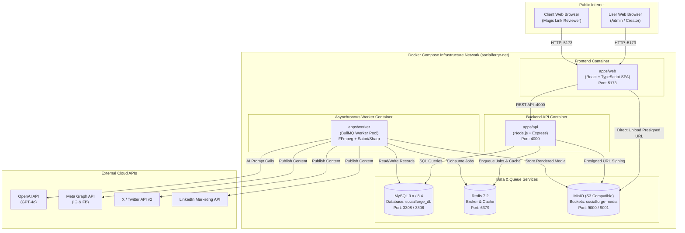
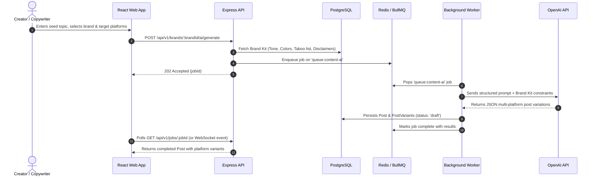
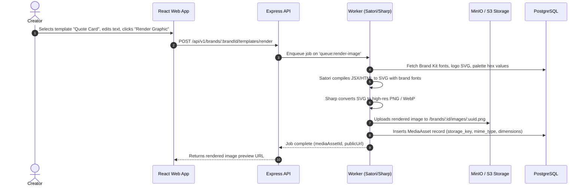
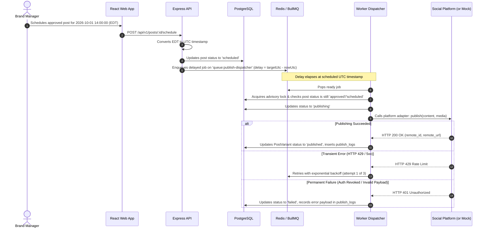
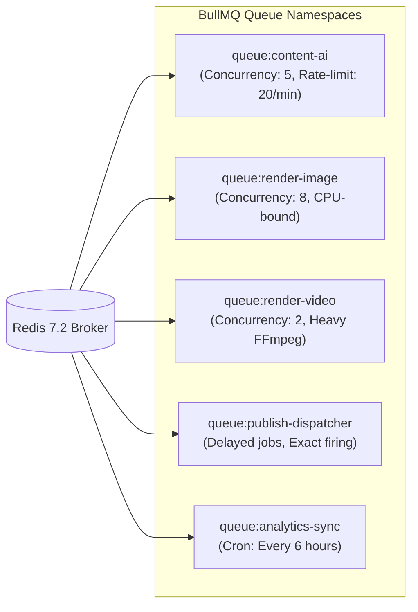

# SocialForge — System Architecture & Topology

## 1. Architectural Pattern: Modular Monorepo

SocialForge utilizes a modular monorepo pattern partitioned into specialized applications and shared packages:

```
f:/SocialAgent/
├── packages/
│   └── shared/         # Universal TypeScript types, Zod schemas, validation contracts
├── apps/
│   ├── api/            # Express.js REST API service (stateless, horizontally scalable)
│   ├── worker/         # BullMQ queue worker service (CPU/IO-intensive processing)
│   └── web/            # React + Vite client-side single page application
└── docker-compose.yml  # Unified multi-container environment
```

### Why Modular Monorepo?
1. **Zero Type Drift**: The frontend, backend API, and worker processors share the exact same TypeScript domain interfaces and Zod validation schemas.
2. **Unified Versioning**: Database migration contracts and shared constants (platform limits, role names, queue keys) are synchronized across git commits.
3. **Decoupled Scaling**: The API container handles low-latency HTTP requests, while the worker container is dedicated to long-running CPU workloads (video rendering, image synthesis, OpenAI streaming).

---

## 2. Infrastructure & Container Topology



---

## 3. Data Flow Lifecycles

### 3.1 Content Generation & Adaptation Flow



---

### 3.2 Dynamic Template Image Rendering Flow



---

### 3.3 Scheduling & Resilient Dispatch Flow



---

## 4. Multi-Tenant Data Isolation Strategy

1. **Row-Level Tenancy with Tenant Context Middleware**:
   - Every database query in `apps/api` executes through a tenant-scoping middleware.
   - The verified JWT token contains `tenantId` and authorized `brandIds`.
   - All critical domain tables (`brands`, `posts`, `media_assets`) have non-nullable `tenant_id` foreign keys indexed alongside primary keys (`tenant_id, id`).
2. **Database Queries Enforcement**:
   ```sql
   -- Standard tenant-scoped query pattern
   SELECT * FROM posts 
   WHERE id = $1 AND tenant_id = $2;
   ```
3. **Storage Isolation**:
   - Assets in S3/MinIO are strictly partitioned by path:
     `s3://socialforge-media/{tenant_id}/{brand_id}/{asset_type}/{year}/{month}/{file_uuid}.{ext}`
   - Presigned upload and download URLs are signed server-side only after verifying tenant ownership.

---

## 5. Storage Architecture (S3 / MinIO)

### Bucket Structure
```
socialforge-media/
├── {tenant_id}/
│   ├── {brand_id}/
│   │   ├── logos/              # Persistent Brand Kit vector/raster logos
│   │   ├── raw/                # User uploaded source images/videos
│   │   ├── rendered-images/    # Automated Satori/Sharp output images
│   │   ├── rendered-videos/    # Automated FFmpeg output 9:16 MP4s
│   │   └── thumbnails/         # Scaled down preview images (400x400)
```

### Direct Upload Lifecycle:
1. Web client initiates upload by sending file metadata (`file_name`, `mime_type`, `file_size_bytes`) to `POST /api/v1/brands/:id/media/presigned-url`.
2. API validates file type and quota, generates a UUID-based S3 key, and issues a 15-minute presigned PUT URL.
3. Web client directly PUTs the binary stream to MinIO/S3.
4. Web client notifies API `POST /api/v1/brands/:id/media/confirm-upload` to register the database record and trigger worker thumbnail generation.

---

## 6. Queue & Worker Architecture (BullMQ)



- **Backoff Strategy**: Failed publishing jobs use exponential backoff (`attempts: 3`, `backoff: { type: 'exponential', delay: 10000 }`).
- **Dead Letter Handling**: Permanently failed jobs are moved to BullMQ's failed set and logged with stack traces in the PostgreSQL `publish_logs` table.
