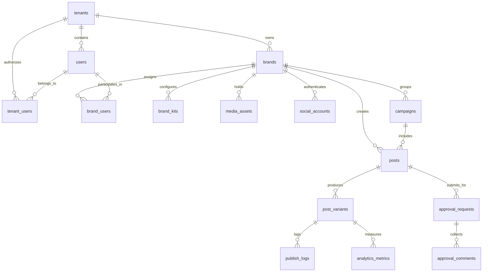

# SocialForge — Database Design & Migration Specification (MySQL)

## 1. Database Overview & Engine Configuration

- **Engine**: MySQL 9.x / 8.4 (InnoDB Storage Engine)
- **Database Name**: `socialforge_db`
- **Default Charset & Collation**: `utf8mb4`, `utf8mb4_unicode_ci`
- **Timezone**: `UTC` (All timestamps stored in UTC)
- **Primary Keys**: UUID (Stored as `CHAR(36)` generated at application layer via `crypto.randomUUID()`)
- **Port**: `3308` (Default local port) / `3306` (Container network)
- **Migration Framework**: Knex.js with `mysql2` driver

---

## 2. Entity-Relationship Diagram (ERD)



---

## 3. Database Schema DDL (MySQL)

```sql
CREATE DATABASE IF NOT EXISTS socialforge_db 
  CHARACTER SET utf8mb4 
  COLLATE utf8mb4_unicode_ci;

USE socialforge_db;

-- 1. TENANTS
CREATE TABLE tenants (
    id CHAR(36) PRIMARY KEY,
    name VARCHAR(255) NOT NULL,
    slug VARCHAR(255) NOT NULL UNIQUE,
    subscription_tier VARCHAR(50) NOT NULL DEFAULT 'standard',
    settings JSON NOT NULL,
    created_at TIMESTAMP NOT NULL DEFAULT CURRENT_TIMESTAMP,
    updated_at TIMESTAMP NOT NULL DEFAULT CURRENT_TIMESTAMP ON UPDATE CURRENT_TIMESTAMP
) ENGINE=InnoDB;

-- 2. USERS
CREATE TABLE users (
    id CHAR(36) PRIMARY KEY,
    email VARCHAR(255) NOT NULL UNIQUE,
    password_hash VARCHAR(255) NOT NULL,
    full_name VARCHAR(255) NOT NULL,
    avatar_url TEXT NULL,
    is_active BOOLEAN NOT NULL DEFAULT TRUE,
    created_at TIMESTAMP NOT NULL DEFAULT CURRENT_TIMESTAMP,
    updated_at TIMESTAMP NOT NULL DEFAULT CURRENT_TIMESTAMP ON UPDATE CURRENT_TIMESTAMP
) ENGINE=InnoDB;

-- 3. TENANT_USERS (Membership)
CREATE TABLE tenant_users (
    id CHAR(36) PRIMARY KEY,
    tenant_id CHAR(36) NOT NULL,
    user_id CHAR(36) NOT NULL,
    role VARCHAR(50) NOT NULL DEFAULT 'creator',
    created_at TIMESTAMP NOT NULL DEFAULT CURRENT_TIMESTAMP,
    updated_at TIMESTAMP NOT NULL DEFAULT CURRENT_TIMESTAMP ON UPDATE CURRENT_TIMESTAMP,
    CONSTRAINT uq_tenant_user UNIQUE (tenant_id, user_id),
    CONSTRAINT fk_tenant_users_tenant FOREIGN KEY (tenant_id) REFERENCES tenants(id) ON DELETE CASCADE,
    CONSTRAINT fk_tenant_users_user FOREIGN KEY (user_id) REFERENCES users(id) ON DELETE CASCADE
) ENGINE=InnoDB;

-- 4. BRANDS
CREATE TABLE brands (
    id CHAR(36) PRIMARY KEY,
    tenant_id CHAR(36) NOT NULL,
    name VARCHAR(255) NOT NULL,
    slug VARCHAR(255) NOT NULL,
    industry VARCHAR(100) NULL,
    website_url TEXT NULL,
    timezone VARCHAR(100) NOT NULL DEFAULT 'UTC',
    created_at TIMESTAMP NOT NULL DEFAULT CURRENT_TIMESTAMP,
    updated_at TIMESTAMP NOT NULL DEFAULT CURRENT_TIMESTAMP ON UPDATE CURRENT_TIMESTAMP,
    CONSTRAINT uq_brand_slug_per_tenant UNIQUE (tenant_id, slug),
    CONSTRAINT fk_brands_tenant FOREIGN KEY (tenant_id) REFERENCES tenants(id) ON DELETE CASCADE
) ENGINE=InnoDB;

-- 5. BRAND_USERS
CREATE TABLE brand_users (
    id CHAR(36) PRIMARY KEY,
    brand_id CHAR(36) NOT NULL,
    user_id CHAR(36) NOT NULL,
    brand_role VARCHAR(50) NOT NULL DEFAULT 'creator',
    created_at TIMESTAMP NOT NULL DEFAULT CURRENT_TIMESTAMP,
    CONSTRAINT uq_brand_user UNIQUE (brand_id, user_id),
    CONSTRAINT fk_brand_users_brand FOREIGN KEY (brand_id) REFERENCES brands(id) ON DELETE CASCADE,
    CONSTRAINT fk_brand_users_user FOREIGN KEY (user_id) REFERENCES users(id) ON DELETE CASCADE
) ENGINE=InnoDB;

-- 6. BRAND_KITS
CREATE TABLE brand_kits (
    id CHAR(36) PRIMARY KEY,
    brand_id CHAR(36) NOT NULL UNIQUE,
    tone_of_voice JSON NOT NULL,
    target_audiences JSON NOT NULL,
    primary_colors JSON NOT NULL,
    fonts JSON NOT NULL,
    logo_urls JSON NOT NULL,
    hashtags_default JSON NOT NULL,
    disclaimers TEXT NULL,
    taboo_words JSON NOT NULL,
    guidelines TEXT NULL,
    updated_at TIMESTAMP NOT NULL DEFAULT CURRENT_TIMESTAMP ON UPDATE CURRENT_TIMESTAMP,
    CONSTRAINT fk_brand_kits_brand FOREIGN KEY (brand_id) REFERENCES brands(id) ON DELETE CASCADE
) ENGINE=InnoDB;

-- 7. MEDIA_ASSETS
CREATE TABLE media_assets (
    id CHAR(36) PRIMARY KEY,
    tenant_id CHAR(36) NOT NULL,
    brand_id CHAR(36) NOT NULL,
    storage_key TEXT NOT NULL,
    public_url TEXT NOT NULL,
    thumbnail_url TEXT NULL,
    file_name VARCHAR(255) NOT NULL,
    mime_type VARCHAR(100) NOT NULL,
    file_size_bytes BIGINT NOT NULL,
    media_type VARCHAR(50) NOT NULL,
    metadata JSON NOT NULL,
    created_at TIMESTAMP NOT NULL DEFAULT CURRENT_TIMESTAMP,
    CONSTRAINT fk_media_assets_tenant FOREIGN KEY (tenant_id) REFERENCES tenants(id) ON DELETE CASCADE,
    CONSTRAINT fk_media_assets_brand FOREIGN KEY (brand_id) REFERENCES brands(id) ON DELETE CASCADE
) ENGINE=InnoDB;

-- 8. CAMPAIGNS
CREATE TABLE campaigns (
    id CHAR(36) PRIMARY KEY,
    brand_id CHAR(36) NOT NULL,
    name VARCHAR(255) NOT NULL,
    description TEXT NULL,
    start_date DATE NULL,
    end_date DATE NULL,
    status VARCHAR(50) NOT NULL DEFAULT 'active',
    created_at TIMESTAMP NOT NULL DEFAULT CURRENT_TIMESTAMP,
    CONSTRAINT fk_campaigns_brand FOREIGN KEY (brand_id) REFERENCES brands(id) ON DELETE CASCADE
) ENGINE=InnoDB;

-- 9. POSTS
CREATE TABLE posts (
    id CHAR(36) PRIMARY KEY,
    tenant_id CHAR(36) NOT NULL,
    brand_id CHAR(36) NOT NULL,
    author_id CHAR(36) NOT NULL,
    campaign_id CHAR(36) NULL,
    title VARCHAR(255) NOT NULL,
    base_content TEXT NOT NULL,
    status VARCHAR(50) NOT NULL DEFAULT 'draft',
    scheduled_for TIMESTAMP NULL,
    published_at TIMESTAMP NULL,
    created_at TIMESTAMP NOT NULL DEFAULT CURRENT_TIMESTAMP,
    updated_at TIMESTAMP NOT NULL DEFAULT CURRENT_TIMESTAMP ON UPDATE CURRENT_TIMESTAMP,
    CONSTRAINT fk_posts_tenant FOREIGN KEY (tenant_id) REFERENCES tenants(id) ON DELETE CASCADE,
    CONSTRAINT fk_posts_brand FOREIGN KEY (brand_id) REFERENCES brands(id) ON DELETE CASCADE,
    CONSTRAINT fk_posts_author FOREIGN KEY (author_id) REFERENCES users(id) ON DELETE RESTRICT,
    CONSTRAINT fk_posts_campaign FOREIGN KEY (campaign_id) REFERENCES campaigns(id) ON DELETE SET NULL
) ENGINE=InnoDB;

-- 10. POST_VARIANTS
CREATE TABLE post_variants (
    id CHAR(36) PRIMARY KEY,
    post_id CHAR(36) NOT NULL,
    platform VARCHAR(50) NOT NULL,
    content TEXT NOT NULL,
    media_asset_ids JSON NOT NULL,
    platform_specific_config JSON NOT NULL,
    status VARCHAR(50) NOT NULL DEFAULT 'pending',
    remote_post_id VARCHAR(255) NULL,
    remote_post_url TEXT NULL,
    created_at TIMESTAMP NOT NULL DEFAULT CURRENT_TIMESTAMP,
    updated_at TIMESTAMP NOT NULL DEFAULT CURRENT_TIMESTAMP ON UPDATE CURRENT_TIMESTAMP,
    CONSTRAINT uq_post_platform_variant UNIQUE (post_id, platform),
    CONSTRAINT fk_post_variants_post FOREIGN KEY (post_id) REFERENCES posts(id) ON DELETE CASCADE
) ENGINE=InnoDB;

-- 11. SOCIAL_ACCOUNTS
CREATE TABLE social_accounts (
    id CHAR(36) PRIMARY KEY,
    brand_id CHAR(36) NOT NULL,
    platform VARCHAR(50) NOT NULL,
    account_name VARCHAR(255) NOT NULL,
    account_id VARCHAR(255) NOT NULL,
    access_token_encrypted TEXT NOT NULL,
    refresh_token_encrypted TEXT NULL,
    token_expires_at TIMESTAMP NULL,
    is_active BOOLEAN NOT NULL DEFAULT TRUE,
    metadata JSON NOT NULL,
    created_at TIMESTAMP NOT NULL DEFAULT CURRENT_TIMESTAMP,
    updated_at TIMESTAMP NOT NULL DEFAULT CURRENT_TIMESTAMP ON UPDATE CURRENT_TIMESTAMP,
    CONSTRAINT uq_brand_platform_account UNIQUE (brand_id, platform, account_id),
    CONSTRAINT fk_social_accounts_brand FOREIGN KEY (brand_id) REFERENCES brands(id) ON DELETE CASCADE
) ENGINE=InnoDB;

-- 12. APPROVAL_REQUESTS
CREATE TABLE approval_requests (
    id CHAR(36) PRIMARY KEY,
    post_id CHAR(36) NOT NULL,
    requested_by CHAR(36) NOT NULL,
    reviewer_id CHAR(36) NULL,
    status VARCHAR(50) NOT NULL DEFAULT 'pending',
    magic_token VARCHAR(255) NULL UNIQUE,
    magic_token_expires_at TIMESTAMP NULL,
    created_at TIMESTAMP NOT NULL DEFAULT CURRENT_TIMESTAMP,
    resolved_at TIMESTAMP NULL,
    CONSTRAINT fk_approval_requests_post FOREIGN KEY (post_id) REFERENCES posts(id) ON DELETE CASCADE,
    CONSTRAINT fk_approval_requests_requested_by FOREIGN KEY (requested_by) REFERENCES users(id) ON DELETE RESTRICT,
    CONSTRAINT fk_approval_requests_reviewer FOREIGN KEY (reviewer_id) REFERENCES users(id) ON DELETE SET NULL
) ENGINE=InnoDB;

-- 13. APPROVAL_COMMENTS
CREATE TABLE approval_comments (
    id CHAR(36) PRIMARY KEY,
    approval_request_id CHAR(36) NOT NULL,
    user_id CHAR(36) NULL,
    author_name VARCHAR(255) NOT NULL,
    is_external_client BOOLEAN NOT NULL DEFAULT FALSE,
    comment TEXT NOT NULL,
    created_at TIMESTAMP NOT NULL DEFAULT CURRENT_TIMESTAMP,
    CONSTRAINT fk_approval_comments_request FOREIGN KEY (approval_request_id) REFERENCES approval_requests(id) ON DELETE CASCADE,
    CONSTRAINT fk_approval_comments_user FOREIGN KEY (user_id) REFERENCES users(id) ON DELETE SET NULL
) ENGINE=InnoDB;

-- 14. PUBLISH_LOGS
CREATE TABLE publish_logs (
    id CHAR(36) PRIMARY KEY,
    post_variant_id CHAR(36) NOT NULL,
    attempt_number INT NOT NULL DEFAULT 1,
    status VARCHAR(50) NOT NULL,
    http_status INT NULL,
    response_payload JSON NOT NULL,
    error_message TEXT NULL,
    created_at TIMESTAMP NOT NULL DEFAULT CURRENT_TIMESTAMP,
    CONSTRAINT fk_publish_logs_variant FOREIGN KEY (post_variant_id) REFERENCES post_variants(id) ON DELETE CASCADE
) ENGINE=InnoDB;

-- 15. ANALYTICS_METRICS
CREATE TABLE analytics_metrics (
    id CHAR(36) PRIMARY KEY,
    post_variant_id CHAR(36) NOT NULL,
    impressions INT NOT NULL DEFAULT 0,
    reach INT NOT NULL DEFAULT 0,
    likes INT NOT NULL DEFAULT 0,
    comments INT NOT NULL DEFAULT 0,
    shares INT NOT NULL DEFAULT 0,
    clicks INT NOT NULL DEFAULT 0,
    video_views INT NOT NULL DEFAULT 0,
    engagement_rate DECIMAL(5, 4) NOT NULL DEFAULT 0.0000,
    recorded_at TIMESTAMP NOT NULL DEFAULT CURRENT_TIMESTAMP,
    CONSTRAINT fk_analytics_metrics_variant FOREIGN KEY (post_variant_id) REFERENCES post_variants(id) ON DELETE CASCADE
) ENGINE=InnoDB;

-- INDEXES
CREATE INDEX idx_brands_tenant_id ON brands(tenant_id);
CREATE INDEX idx_tenant_users_user_id ON tenant_users(user_id);
CREATE INDEX idx_brand_users_user_id ON brand_users(user_id);
CREATE INDEX idx_posts_brand_status ON posts(brand_id, status);
CREATE INDEX idx_posts_scheduled_for ON posts(scheduled_for);
CREATE INDEX idx_posts_tenant_created ON posts(tenant_id, created_at);
CREATE INDEX idx_media_brand_type ON media_assets(brand_id, media_type);
CREATE INDEX idx_analytics_post_variant ON analytics_metrics(post_variant_id, recorded_at);
```
