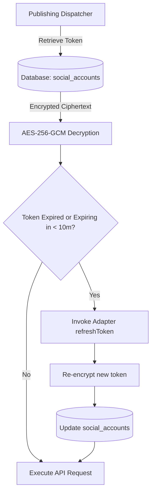

# SocialForge — Social Platform Integrations & Publishing Engine

## 1. Unified SocialPlatformAdapter Interface

To ensure clean decoupling between business workflows and third-party social network APIs, all network implementations adhere to a standard TypeScript interface contract:

```typescript
export interface PublishPayload {
  postVariantId: string;
  brandId: string;
  content: string;
  mediaUrls: string[];
  platformConfig?: Record<string, any>;
}

export interface PublishResult {
  success: boolean;
  remotePostId: string;
  remotePostUrl: string;
  publishedAt: Date;
  rawResponse: Record<string, any>;
}

export interface MetricSnapshot {
  impressions: number;
  reach: number;
  likes: number;
  comments: number;
  shares: number;
  clicks: number;
  videoViews: number;
}

export interface SocialPlatformAdapter {
  readonly platformId: string;
  validateContent(content: string, mediaUrls: string[]): { valid: boolean; errors: string[] };
  publish(payload: PublishPayload, credentials: EncryptedCredentials): Promise<PublishResult>;
  fetchMetrics(remotePostId: string, credentials: EncryptedCredentials): Promise<MetricSnapshot>;
  refreshToken(refreshToken: string): Promise<{ accessToken: string; expiresIn: number }>;
}
```

---

## 2. Platform Provider Specifications

### 2.1 Meta Graph API (Instagram Business & Facebook Pages)
- **Authentication**: OAuth 2.0 with Long-Lived Page/User Access Tokens (60-day lifespan).
- **Required Scopes**: `instagram_basic`, `instagram_content_publish`, `pages_show_list`, `pages_read_engagement`, `pages_manage_posts`.
- **Media Upload Pipeline**:
  - Step 1: Initialize container `POST /{ig-user-id}/media?image_url=...` or `?media_type=REELS&video_url=...`.
  - Step 2: Poll container status until `FINISHED`.
  - Step 3: Publish container `POST /{ig-user-id}/media_publish?creation_id=...`.

### 2.2 X (Twitter) API v2
- **Authentication**: OAuth 2.0 User Context (PKCE flow) with offline access refresh tokens.
- **Required Scopes**: `tweet.read`, `tweet.write`, `users.read`, `media.write`, `offline.access`.
- **Publishing Pipeline**:
  - Step 1: Chunked media upload to `upload.twitter.com/1.1/media/upload.json` (INIT, APPEND, FINALIZE).
  - Step 2: Tweet creation `POST /2/tweets` with `media.media_ids`.

### 2.3 LinkedIn Marketing API
- **Authentication**: OAuth 2.0 with 60-day refresh tokens.
- **Required Scopes**: `w_member_social`, `r_liteprofile`, `w_organization_social`.
- **Publishing Pipeline**:
  - Ingest via UGC Post API `POST /v2/ugcPosts` or Versioned Posts API `POST /rest/posts`.

### 2.4 TikTok Content Posting API
- **Authentication**: OAuth 2.0.
- **Required Scopes**: `video.publish`, `video.upload`.
- **Publishing Pipeline**: Direct video chunked upload to TikTok CDN followed by publish confirmation.

### 2.5 YouTube Data API v3 (Shorts)
- **Authentication**: Google OAuth 2.0.
- **Required Scopes**: `https://www.googleapis.com/auth/youtube.upload`.
- **Publishing Pipeline**: Resumable multipart upload to `POST https://www.googleapis.com/upload/youtube/v3/videos?uploadType=resumable&part=snippet,status`. Videos $\le 60\text{ seconds}$ with `#Shorts` tag in title/description are automatically categorized as Shorts.

---

## 3. SocialForge Mock Sandbox Simulator

Developing and testing multi-platform social media platforms without developer verification on 5 distinct third-party platforms causes severe development bottlenecks.

SocialForge provides an out-of-the-box **Mock Sandbox Provider**:
- Simulates realistic OAuth connection flows.
- Simulates network latency (configurable, e.g. 500ms).
- Simulates platform validation errors (e.g. text length violation, unsupported video aspect ratio).
- Emulates realistic remote post URLs (e.g. `https://mock.socialforge.local/post/102938`).
- Accumulates simulated realistic post engagement (impressions, likes, comments) over time for testing analytics ingestion.

---

## 4. Token Vault & Refresh Engine



1. **At-Rest Encryption**: OAuth access tokens and refresh tokens are encrypted using AES-256-GCM before writing to PostgreSQL. The encryption key is held in environment variables (`ENCRYPTION_MASTER_KEY`).
2. **Proactive Refresh**: When a scheduled job is ready to fire, the system verifies token validity. If within 10 minutes of expiry, it executes the refresh token exchange and updates the database before attempting publication.
