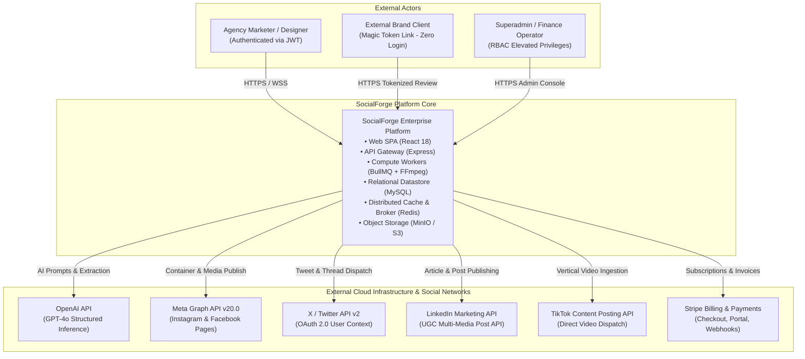
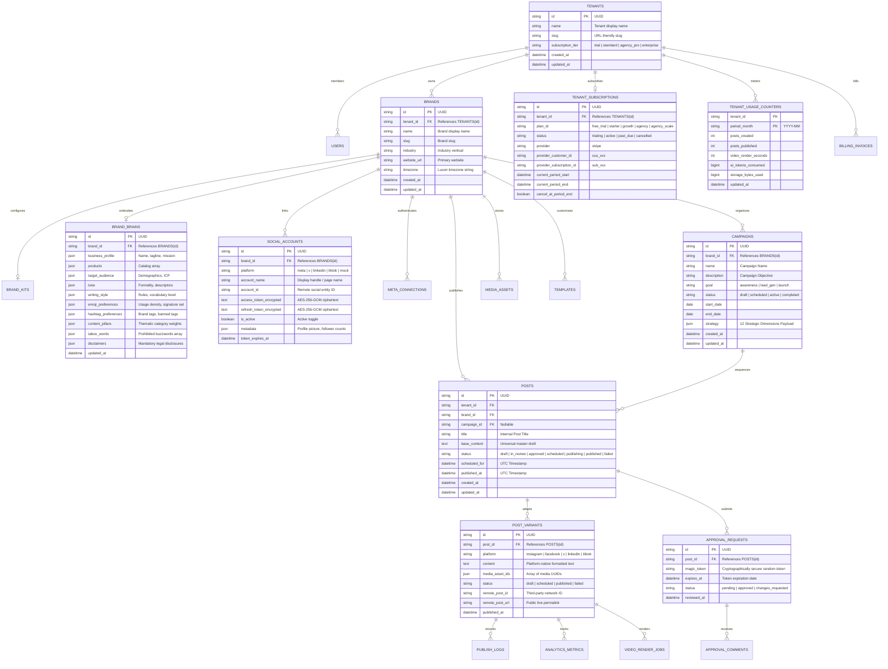
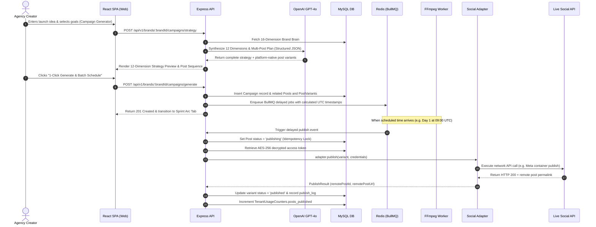
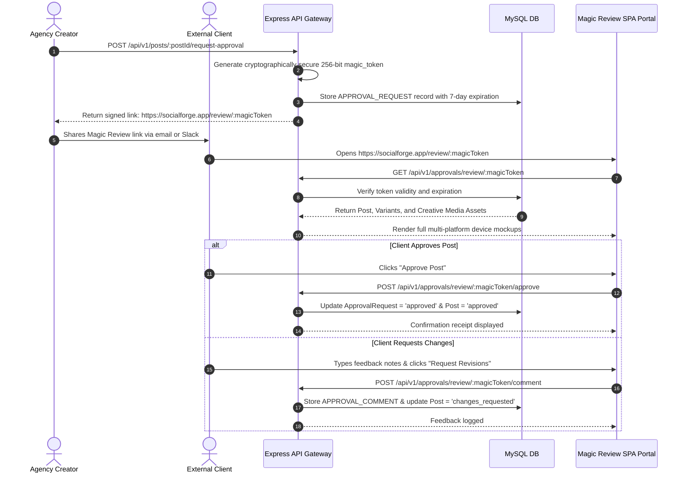
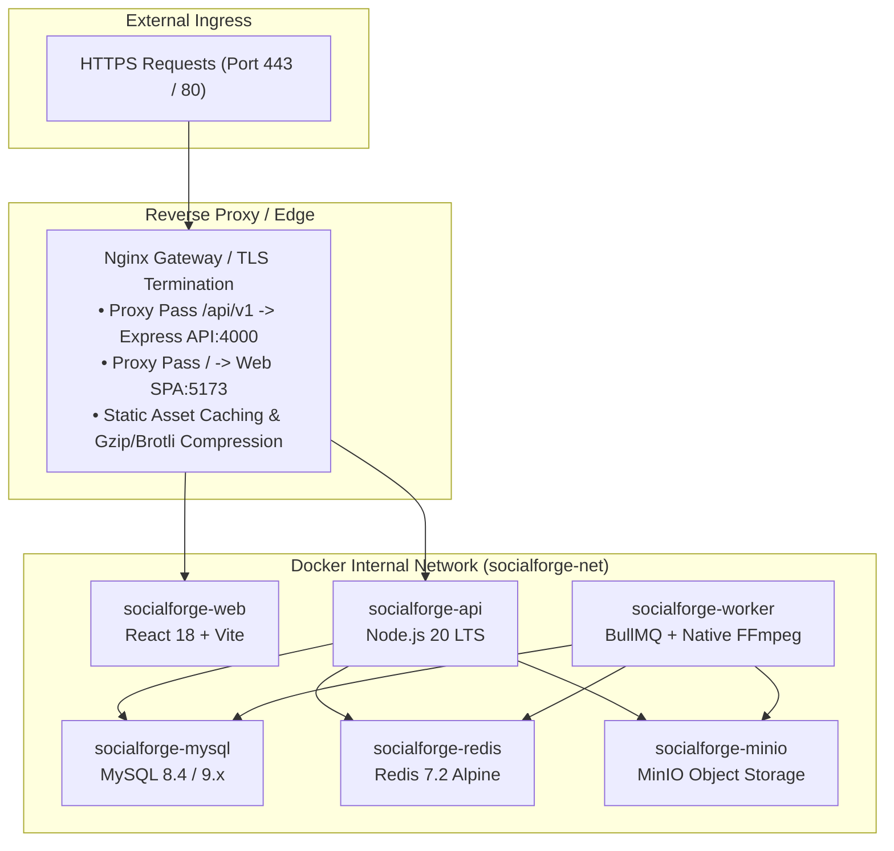

# SocialForge — Comprehensive High-Level Design (HLD) Document
### Multi-Tenant Autonomous AI Social Media & Marketing Orchestration Platform

**Document Version:** 2.0.0  
**System Name:** SocialForge  
**Classification:** Enterprise Distributed Modular Monorepo  
**Architecture Style:** Event-Driven, Multi-Tenant Modular Monorepo with Dedicated Asynchronous Compute Workers  
**Target Audience:** CTOs, Lead Architects, Product Managers, Security Engineers, and Enterprise Investors  
**Last Updated:** October 2026  

---

## 1. Executive Summary & Vision

### 1.1 Product Mission
**SocialForge** is an enterprise-grade, multi-tenant AI social media automation and orchestration SaaS platform engineered for marketing agencies, multi-brand holding companies, venture studios, and high-velocity digital creators. 

Social media marketing currently suffers from fragmented tooling, high operational friction, inconsistent brand voice adherence, and tedious client approval cycles. SocialForge solves this by providing a unified, closed-loop operating system that takes a single raw business idea or launch objective and executes the full marketing lifecycle:

```
┌────────────────────────────────────────────────────────────────────────────────────────┐
│                                SOCIALFORGE VALUE LOOP                                  │
└────────────────────────────────────────────────────────────────────────────────────────┘

  1. BRAND INGESTION           2. AI CAMPAIGN SYNTHESIS        3. MULTIMODAL STUDIO
 ┌──────────────────────┐     ┌────────────────────────┐     ┌────────────────────────┐
 │ 16-Dimension Brain   │────▶│ 12 Strategic Dimensions│────▶│ Copy, Canva Posters,   │
 │ & URL Web Scraper    │     │ & Coordinated Multi-   │     │ & 9:16 Video Reels     │
 │                      │     │ Post Campaign Arc      │     │ (FFmpeg Engine)        │
 └──────────────────────┘     └────────────────────────┘     └────────────────────────┘
                                                                          │
                                                                          ▼
  6. CLOSED-LOOP INTELLIGENCE  5. RESILIENT DISPATCH           4. ZERO-LOGIN APPROVAL
 ┌──────────────────────┐     ┌────────────────────────┐     ┌────────────────────────┐
 │ Cross-Network Tele-  │◀────│ Real Graph APIs (Meta, │◀────│ Magic Token Client     │
 │ metry & AI Advisor   │     │ X, LinkedIn, TikTok) & │     │ Portal (Cryptographic  │
 │ Growth Insights      │     │ Zero-Setup Mock Sandbox│     │ Links, Feedback Notes) │
 └──────────────────────┘     └────────────────────────┘     └────────────────────────┘
```

### 1.2 Core Value Propositions
1. **Multi-Tenant Agency & Brand Isolation**: Strict logical data segregation across tenants, brands, media assets, credentials, and billing meters.
2. **16-Dimension Brand Brain**: Autonomous extraction of brand voice, target personas, tone, style rules, taboo words, and mandatory disclaimers from public URLs or manual entry.
3. **AI Campaign Arc Generator**: 1-click transformation of business concepts into multi-day narrative arcs (Launch Sprint, Nurture Arc, Evergreen Sequence) across Instagram, Facebook, X, LinkedIn, and TikTok.
4. **Multimodal Creative Production**: Native copy composition, Canva-like visual poster generation, and native FFmpeg 9:16 vertical short-form video synthesis with synchronized subtitles and audio ducking.
5. **Magic Client Approval Workflow**: Zero-friction client review portals accessible via cryptographically signed tokens—no client login required.
6. **Resilient Hybrid Publishing Engine**: Production-grade OAuth 2.0 adapters for Meta (Instagram & Facebook), X (Twitter), LinkedIn, and TikTok, alongside an instant Mock Sandbox Simulator for safe staging and demoing.
7. **Closed-Loop SaaS Monetization**: Full Stripe subscription billing, granular usage quotas, 3-tier dunning recovery, and an automated superadmin revenue telemetry dashboard.

---

## 2. Business Model & Monetization Strategy

SocialForge operates on a **B2B Tiered SaaS Subscription Model** with usage-based overage safeguards, targeted at solo creators, digital marketing agencies, and enterprise marketing holding companies.

```
┌───────────────────────────────────────────────────────────────────────────────────────────────────────┐
│                                   COMMERCIAL PACKAGING & TIERS                                       │
├─────────────────────┬──────────────┬──────────────┬──────────────────┬─────────────────┬──────────────┤
│ Metric / Feature    │ Free Trial   │ Starter      │ Growth           │ Agency Pro      │ Agency Scale │
├─────────────────────┼──────────────┼──────────────┼──────────────────┼─────────────────┼──────────────┤
│ Monthly Price (USD) │ $0           │ $29 / mo     │ $79 / mo         │ $199 / mo       │ $499 / mo    │
│ Annual Price (USD)  │ $0           │ $290 / yr    │ $790 / yr        │ $1,990 / yr     │ $4,990 / yr  │
│ Managed Brands      │ 1 Brand      │ 2 Brands     │ 5 Brands         │ 15 Brands       │ Unlimited    │
│ Connected Channels  │ 2 Channels   │ 5 Channels   │ 15 Channels      │ 45 Channels     │ Unlimited    │
│ Posts / Month       │ 20 Posts     │ 100 Posts    │ 400 Posts        │ 1,500 Posts     │ Unlimited    │
│ Team Seats          │ 1 User       │ 2 Users      │ 5 Users          │ 15 Users        │ 50 Users     │
│ AI Tokens / Month   │ 50,000       │ 250,000      │ 1,000,000        │ 4,000,000       │ 15,000,000   │
│ Video Render Secs   │ 60 secs      │ 300 secs     │ 1,200 secs       │ 4,800 secs      │ 18,000 secs  │
│ Cloud Storage       │ 500 MB       │ 5 GB         │ 25 GB            │ 100 GB          │ 500 GB       │
│ Magic Review Links  │ Basic (3d)   │ Included     │ Included         │ Included        │ White-Label  │
│ Sandbox Simulator   │ Included     │ Included     │ Included         │ Included        │ Included     │
│ Support SLA         │ Community    │ Standard     │ Priority Email   │ Dedicated Slack │ Dedicated AM │
└─────────────────────┴──────────────┴──────────────┴──────────────────┴─────────────────┴──────────────┘
```

### 2.1 Customer Personas & Market Segments
1. **The Solo Creator / Freelancer (`Starter: $29/mo`)**:
   - Manages personal brand or 1–2 client accounts.
   - Primary pain point: Time spent repurposing text across Instagram, X, and LinkedIn.
   - Benefit: AI Content Studio and Canva graphic generator save 15+ hours/week.
2. **The Boutique Digital Agency (`Growth: $79/mo` - `Agency Pro: $199/mo`)**:
   - Manages 5 to 15 brands with a small creative team (copywriters, designers).
   - Primary pain point: Disjointed approval workflows via Google Sheets/Slack and brand voice drift across junior writers.
   - Benefit: 16-Dimension Brand Brain guarantees tone compliance; Magic Review Links eliminate client back-and-forth; Campaign Arc Generator plans monthly client content in minutes.
3. **The Enterprise Holding Company / Franchise (`Agency Scale: $499/mo` + Custom)**:
   - Manages 30+ regional or subsidiary brands.
   - Primary pain point: Multi-brand compliance risk, access security, and operational reporting.
   - Benefit: Role-Based Access Control (RBAC), superadmin audit logs, customized video render pipelines, and dedicated capacity.

### 2.2 Revenue Model & Unit Economics
The business model achieves strong gross margins (>80%) by balancing fixed infrastructure with measured compute consumption:

* **Customer Acquisition Cost (CAC)**: ~$180 blended (inbound content, marketing agency directories, partner referral).
* **Average Revenue Per Account (ARPA)**: $125/month across blended tiers.
* **Customer Lifetime Value (LTV)**: ~$3,000 (assuming 24-month agency retention).
* **LTV : CAC Ratio**: **16.6x**, indicating outstanding growth efficiency.

#### Cost of Goods Sold (COGS) Breakdown per Active Brand:
1. **AI Inference (OpenAI GPT-4o)**: ~$0.004 per multi-channel post generation; ~$0.08 per 12-dimension campaign synthesis. Average brand consumes ~$3.20/month in LLM tokens.
2. **Video Compute (Worker FFmpeg)**: Containerized native CPU compute rendering 1080×1920 MP4s. Marginal compute cost per 30-second render is ~$0.02.
3. **Object Storage & Bandwidth (MinIO / Cloudflare R2 / AWS S3)**: ~$0.015/GB/month. Media compression and WebP/MP4 conversion optimize storage costs.
4. **Payment Gateway (Stripe)**: 2.9% + $0.30 per successful invoice transaction.

### 2.3 Automated Revenue Operations & Dunning Recovery
Revenue leakage is minimized through an integrated billing lifecycle:
* **Stripe Webhook Synchronization**: Real-time idempotency handling for `invoice.payment_succeeded`, `invoice.payment_failed`, `customer.subscription.updated`, and `customer.subscription.deleted`.
* **3-Phase Automated Dunning Engine**:
  * *Day 1 (Failure)*: Payment failure registered; invoice state marked `open`; billing alert toast triggered in dashboard; retry scheduled.
  * *Day 3 (Grace Period)*: Automated payment reminder dispatch; subtle banner warning in agency dashboard.
  * *Day 7 (Account Pausing)*: Tenant transitioned to `past_due`; publishing engine locked to read-only; historical posts and data retained.
* **Dead Letter Queue (DLQ) & Audit Logging**: Unhandled or corrupted billing webhooks are routed to a persistent DLQ for manual inspection and zero-data-loss replay.

---

## 3. High-Level Architecture & System Topologies

SocialForge is architected as an **Enterprise Distributed Modular Monorepo** ensuring code reuse, unified TypeScript types across front-and-backend, and deterministic decoupling between the HTTP request-response cycle and compute-heavy video/AI tasks.

### 3.1 C4 Level 1: System Context Diagram



---

### 3.2 C4 Level 2: Container Topology & Service Matrix

```mermaid
graph TB
    subgraph "Client Layer"
        WebClient["apps/web (React 18 + Vite)\nPort: 5173 / 80\n• Glassmorphic Design System\n• Real-Time Multi-Platform Previews\n• Canva-like Layer Canvas\n• 3-Tab Campaign Generator"]
    end

    subgraph "API & Orchestration Layer"
        ExpressAPI["apps/api (Node.js 20 LTS + Express)\nPort: 4000\n• RESTful Endpoints (/api/v1)\n• TenantContext & Auth\n• AES-256 CryptoVault\n• SSRF Shield & Rate Limiting\n• Entitlement & Quota Guard"]
    end

    subgraph "Asynchronous Compute Layer"
        WorkerService["apps/worker (BullMQ Worker)\n• Native FFmpeg 9:16 Video Rendering\n• Dynamic Audio Ducking\n• Subtitle Burn-In Engine\n• Batch Telemetry Sync"]
    end

    subgraph "Persistence & Storage Layer"
        MySQL[("MySQL 8.4 / 9.x Community\nPort: 3308 / 3306\n• Schema: socialforge_db\n• Multi-Tenant Relational Schema\n• ACID Transactions & Cascading FKs")]
        RedisCache[("Redis 7.2 Alpine\nPort: 6379\n• BullMQ Job Queues\n• In-Memory Token Blacklist\n• Sliding-Window Rate Limiting")]
        MinIO[("MinIO S3-Compatible Storage\nPort: 9000 / 9001\n• Bucket: socialforge-media\n• Presigned Upload Signatures\n• Static Asset Distribution")]
    end

    subgraph "Shared Foundation"
        SharedPkg["packages/shared\n• Universal TypeScript Types\n• Zod Request/Response Schemas\n• Billing & Plan Constants\n• Luxon Timezone Helpers"]
    end

    WebClient -->|REST API Calls (Bearer JWT)| ExpressAPI
    WebClient -.->|Direct Presigned Uploads| MinIO

    ExpressAPI -->|SQL Queries (Knex.js)| MySQL
    ExpressAPI -->|Enqueue Jobs & Token Keys| RedisCache
    ExpressAPI -->|Generate Presigned URLs| MinIO

    WorkerService -->|Pop Rendering Jobs| RedisCache
    WorkerService -->|Update Status & Metrics| MySQL
    WorkerService -->|Read Raw & Write Output MP4s| MinIO

    ExpressAPI -.-> SharedPkg
    WorkerService -.-> SharedPkg
    WebClient -.-> SharedPkg
```

---

## 4. Current Features & Deep Functional Specification

SocialForge incorporates an end-to-end suite of production-grade features built directly into the codebase:

### 4.1 Feature 1: Multi-Tenant Workspace & Brand Management
* **Logical Isolation**: Every query executes within a verified tenant scope (`tenant_id`). Cross-tenant data leakage is prevented via Knex middleware and database constraints.
* **Multi-Brand Portfolio**: Single agency workspaces can manage unlimited brand profiles. Each brand has its own timezone, social connections, brand assets, campaigns, and approval flows.
* **Workspace Member Roles (RBAC)**:
  * `owner` / `admin`: Full administrative control, billing access, member management.
  * `brand_manager`: Can create and edit campaigns, schedule posts, connect brand channels.
  * `creator`: Can draft copy, generate graphics, and submit posts for approval.
  * `client_approver`: Read-only access to brand posts; can approve or request revisions.
  * `viewer`: Read-only auditing permissions.

---

### 4.2 Feature 2: 16-Dimension Brand Brain & Intelligent Website Scraper
The Brand Brain serves as the single source of truth for brand voice and positioning:
1. **Autonomous URL Extraction (`websiteScraperService.ts`)**: Ingests public client URLs, extracts meta tags, DOM headers (`h1-h3`), paragraph copy, and CSS color codes, feeding raw text into GPT-4o for structural extraction.
2. **16 Structured Strategic Dimensions**:
   * *Business Profile*: Name, tagline, mission, industry vertical.
   * *Products & Offerings*: Item catalog, key differentiators, pricing model.
   * *Primary & Secondary Audiences*: Demographics, psychographics, pain points.
   * *Tone Formality & Descriptors*: (e.g. "Clinical Radiance", "Playful Provocative").
   * *Writing Style Guidelines*: Sentence rhythm, vocabulary level, active voice rules.
   * *Point of View*: First-person plural ("we"), second-person ("you"), third-person.
   * *Emoji Preferences*: Strict usage density (none, minimal, moderate, heavy) and signature emoji sets.
   * *Hashtag Rules*: Branded hashtags, prohibited community tags, maximum count per platform.
   * *Content Pillars*: Core recurring thematic tracks (e.g. 40% Education, 30% Proof, 30% Promo).
   * *Key Brand Messages*: Non-negotiable brand statements.
   * *Taboo Words & Phrases*: Blacklisted industry jargon and prohibited buzzwords.
   * *Mandatory Disclaimers*: Required legal disclosures (e.g. FDA disclosures, financial licensing).
   * *Visual Identity Colors*: Primary, secondary, accent, surface, and text hex values.
   * *Typography Pairings*: Heading and body font rules.
   * *Call-to-Action Library*: Preferred conversions (e.g. "Book a Demo", "Link in bio").
   * *Competitive Differentiation*: Positioning vectors against key rivals.
3. **Real-Time Voice Compliance Meter**: Analyzes any draft against these 16 dimensions, returning a 0–100% compliance score alongside actionable suggestions.

---

### 4.3 Feature 3: AI Campaign Generator & 12 Strategic Dimensions Arc Engine
Located on the redesigned **Campaigns Page** (`CampaignsPage.tsx`), this engine eliminates random, one-off posting in favor of cohesive narrative arcs:

```
┌────────────────────────────────────────────────────────────────────────────────────────┐
│                          3-TAB CAMPAIGNS PAGE ARCHITECTURE                             │
├──────────────────────────┬─────────────────────────────┬───────────────────────────────┤
│ Tab 1: CAMPAIGN          │ Tab 2: Active Brand         │ Tab 3: Selected Sprint Arc    │
│ GENERATOR                │ Campaigns                   │ Drilldown (e.g. Autumn Arc)   │
├──────────────────────────┼─────────────────────────────┼───────────────────────────────┤
│ • Inline multi-step      │ • Grid & carousel of all    │ • Full multi-post narrative   │
│   synthesis interface    │   active campaigns in MySQL │   sequence inspection         │
│ • Business prompt input  │ • Visual progress bars      │ • Per-platform variant tabs   │
│ • 8 Goal selectors       │   (e.g. 6/7 posts scheduled)│   (Instagram, X, LI, TikTok)  │
│ • 5 Duration selectors   │ • Status badges & dates     │ • Single-Post AI Assistant    │
│ • Multi-platform toggles │ • 1-click drilldown into    │ • 1-Click Batch Scheduler     │
│ • 12 Dimensions Preview  │   narrative sprint arc      │ • 1-Click Batch Publisher     │
└──────────────────────────┴─────────────────────────────┴───────────────────────────────┘
```

#### The 12 Strategic Dimensions Synthesized:
1. **Campaign Name & Narrative Concept** (e.g., "Autumn Radiance Barrier Repair Sprint")
2. **Primary Campaign Objective** (Awareness, Lead Gen, Product Launch, Retention, etc.)
3. **Target Audience Focus Segment**
4. **Core Value Proposition & Angle**
5. **Campaign Key Message**
6. **Hashtag Strategy** (Branded + Trending + Niche)
7. **Visual Aesthetic & Creative Direction**
8. **Call-to-Action Architecture**
9. **Content Distribution Cadence** (Daily, Alternate Days, Twice Daily)
10. **Narrative Story Arc Progression** (Teaser → Problem Agitation → Solution Reveal → Proof/Testimonial → Urgency/Offer)
11. **Primary KPI & Benchmark Metric**
12. **Multi-Post Coordinated Content Sequence**: Pre-generates platform-native variants for every post in the arc, with distinct character lengths, hashtags, and formatting.

#### Campaign Automation Features:
* **Batch Scheduling Engine**: Translates campaign arcs into calendar slots with customizable cadence and start times.
* **Batch Publishing Engine**: Publishes or schedules all campaign posts across all selected networks in a single click.
* **Single-Post AI Assistant**: Allows creators to rewrite, translate, or transform individual posts in a campaign without affecting the rest of the arc.

---

### 4.4 Feature 4: Content Studio & Multi-Platform AI Composer
Located in `ContentStudioPage.tsx`, the composer enables granular creation and multi-channel adaptation:
* **10 Specialized Content Formats**:
  1. *Instagram Captions* (Hook, Story, Carousel CTA, Hashtag spacing).
  2. *X (Twitter) Standalone Posts* (280 characters, strong hook, minimal fluff).
  3. *X Viral Threads* (Numbered progression, bookmark callouts, concluding summary).
  4. *LinkedIn Thought Leadership* (Professional white-space formatting, industry insights).
  5. *TikTok / Shorts Script Outlines* (On-screen text, vocal script, visual cue guidance).
  6. *Carousel Slide Decks* (Slide-by-slide copy progression).
  7. *Promotional Offer Copy* (Urgency, discount codes, guarantee highlight).
  8. *Educational How-To Explanations* (Step-by-step breakdown).
  9. *Customer Success Stories* (Problem-Agitation-Result framework).
  10. *Interactive Question / Poll Prompts* (Engagement catalysts).
* **11 Smart AI Style Transformations**:
  * Rewrite, Shorten, Expand, Professional, Friendly, Humorous, Educational, Persuasive, Luxury, Conversational, and Multilingual Translation (6 languages).
* **Live Device Simulator Previews**: Real-time interactive previews simulating native mobile UI for Instagram, Facebook, X, LinkedIn, and TikTok.

---

### 4.5 Feature 5: AI Design Studio (Canva-like Visual Layer Editor)
The visual editor (`CanvaStudioModal.tsx`) provides in-app graphic creation:
* **Multi-Layer Canvas Model**: Supports background layers, image assets, shape vectors, dynamic badge ribbons, and typographic text boxes.
* **Dynamic Aspect Ratios**: Instant canvas resizing across 4 industry standards: `1:1` (Square), `4:5` (Instagram Portrait), `1.91:1` (Landscape / OpenGraph), and `9:16` (Story / Reel / Pin).
* **AI Poster Synthesizer (`aiPosterService.ts`)**: Automatically converts post headlines and brand color schemes into layered graphics.
* **SVG Rasterization Engine**: Renders vector layers into high-resolution PNG/WebP assets for social network delivery.

---

### 4.6 Feature 6: Reel Motion Studio (Native FFmpeg 9:16 Video Engine)
Short-form vertical video is synthesized via an asynchronous rendering pipeline (`videoEngine.ts` and `apps/worker`):
* **4-Beat Narrative Storyboard Arc**:
  * *Beat 1 (0–3s)*: Hook & Pattern Interrupt (High-contrast visual, bold question).
  * *Beat 2 (3–10s)*: Problem Agitation & Core Value.
  * *Beat 3 (10–22s)*: Proof, Demo, or Transformation Evidence.
  * *Beat 4 (22–30s)*: Direct Call-to-Action (CTA).
* **Automated FFmpeg Processing**:
  * 1080×1920 portrait MP4 rendering at 30fps with H.264/AAC encoding.
  * Dynamic Gaussian boxblur backdrops for non-vertical source assets.
  * Hardcoded ASS subtitle burn-in synchronized to vocal cadence.
  * Sidechain dynamic audio ducking: Music volume drops automatically during voiceovers.

---

### 4.7 Feature 7: Calendar & Multi-Timezone Scheduling Engine
Visual planning is handled in `CalendarPage.tsx`:
* **Multi-Timezone Determinism**: Schedules are configured in brand-local time (e.g. `America/Los_Angeles`) and converted to UTC timestamps via Luxon for deterministic BullMQ execution.
* **Interactive Views**: Month-at-a-glance, weekly time-block grid, and chronological agenda list.
* **Drag-and-Drop Rescheduling**: Moving a post card automatically updates the UTC schedule and recalculates the BullMQ job delay.
* **Conflict & Density Detection**: Highlights over-scheduled days and enforces platform pacing rules.

---

### 4.8 Feature 8: Magic Review & External Approval Portal
Client sign-off is streamlined via tokenized approval links (`MagicReviewPortal.tsx`):
* **Zero-Login Stakeholder Experience**: Agency clients click a single link to access a dedicated, responsive review interface without creating an account or remembering passwords.
* **Cryptographic Token Model**:
  ```
  Token = Base64URL(HMAC_SHA256(post_id + brand_id + timestamp + salt, APP_SECRET))
  ```
  Tokens have configurable expiry windows (e.g. 7 days) and support one-time invalidation.
* **Interactive Feedback**: Clients can approve in one click or add inline comments and change requests, notifying the agency creator in real time.

---

### 4.9 Feature 9: Multi-Network Social Publishing & Sandbox Simulator
Publishing operations implement the unified `BaseSocialAdapter` architecture:
* **Meta Graph API Adapter (`MetaAdapter.ts`)**:
  * Supports Facebook Pages and Instagram Professional / Creator accounts.
  * Implements the official Meta 2-step container workflow:
    1. `POST /{ig-user-id}/media` (creates image or video media container).
    2. Polling for container readiness (`status_code: FINISHED`).
    3. `POST /{ig-user-id}/media_publish` (publishes container to the live profile).
  * Handles permissions and long-lived token exchange (`60-day validity`).
* **X / Twitter API v2 Adapter (`XTwitterAdapter.ts`)**: Dispatches single tweets and multi-tweet threaded sequences using OAuth 2.0 User Context tokens.
* **LinkedIn Marketing API Adapter (`LinkedInAdapter.ts`)**: Publishes text, image, and multi-image posts via the LinkedIn UGC Post API.
* **TikTok Content Posting API Adapter (`TikTokAdapter.ts`)**: Ingests vertical 9:16 video assets directly into creator publishing inboxes.
* **Mock Sandbox Simulator (`MockSandboxAdapter.ts`)**:
  * Allows end-to-end testing with zero third-party credentials.
  * Simulates realistic network latency (150–400ms), validation failures, mock remote post IDs, real-looking permalinks, and synthetic telemetry.

---

### 4.10 Feature 10: Unified Analytics Telemetry & AI Growth Advisor
Located in `AnalyticsPage.tsx`:
* **Cross-Network Metrics Aggregation**: Unifies impressions, reach, engagement rate, likes, comments, and shares into a normalized schema.
* **Post-Level Performance Breakdown**: Identifies top-performing post formats and platforms.
* **AI Marketing Advisor**: Evaluates historical engagement telemetry and generates personalized growth recommendations (e.g., "Your LinkedIn thought leadership posts on Tuesdays at 9:00 AM generate 2.8x higher engagement than average. Consider shifting your X threads to follow this schedule.").

---

### 4.11 Feature 11: Enterprise Billing, Usage Quotas & Admin Operations
Located in `BillingPage.tsx` and `AdminBillingPage.tsx`:
* **Real-Time Usage Metering**: Displays live progress bars for monthly post quotas, AI tokens, video rendering seconds, and connected channels.
* **Stripe Customer Portal**: Self-serve tier upgrades, payment method updates, and invoice downloads.
* **Superadmin Finance Dashboard**:
  * Real-time metrics: Monthly Recurring Revenue (MRR), Annual Recurring Revenue (ARR), Active Subscriptions, Churn Rate.
  * Dead Letter Queue (DLQ) inspector for failed billing webhooks.
  * Audit logs for every invoice, subscription change, and payment attempt.

---

## 5. Complete Relational Data Architecture (MySQL)

SocialForge is backed by a relational schema in MySQL 8.4/9.x (`socialforge_db`) enforcing relational integrity, foreign key cascading, and strict tenant isolation:



---

## 6. End-to-End Sequence Workflows

### 6.1 Multi-Platform Campaign Synthesis & 1-Click Dispatch



---

### 6.2 Magic Review Approval Flow (Zero-Login Client Sign-Off)



---

## 7. Security, Isolation & Compliance Architecture

SocialForge implements enterprise security best practices across all application layers:

### 7.1 Multi-Tenant Data Isolation
* **Scoping Enforcement**: Every database query is scoped to `tenant_id` and verified against the authenticated user's session claims.
* **Cascading Foreign Keys**: Deleting a brand or tenant cleanly purges all child associations, preventing orphaned records.
* **Granular Role-Based Access Control (RBAC)**: Route handlers verify role entitlements before executing write actions.

### 7.2 Cryptographic Secret Storage (`CryptoVault.ts`)
* Social network access tokens and refresh tokens are encrypted at rest using **AES-256-GCM**.
* Each encrypted value is stored with a unique 12-byte initialization vector (`iv`) and a 16-byte authentication tag (`auth_tag`), protecting against ciphertext tampering.
* Encryption keys are loaded from environment variables (`ENCRYPTION_KEY`) and never logged or exposed via API responses.

### 7.3 Server-Side Request Forgery (SSRF) Defense Shield
The platform downloads assets and scrapes websites provided by users. To prevent SSRF attacks against internal network resources:
* Hostnames are resolved to IP addresses before initiating requests.
* Connections are blocked to:
  * Loopback addresses (`127.0.0.0/8`, `::1`).
  * Private RFC1918 subnets (`10.0.0.0/8`, `172.16.0.0/12`, `192.168.0.0/16`).
  * Link-local and cloud metadata addresses (`169.254.169.254`).
  * Non-standard protocols (only `http:` and `https:` are permitted).

### 7.4 Authentication & Session Security
* **JWT Access Tokens**: Short-lived (15-minute) tokens signed with HMAC-SHA256.
* **Refresh Tokens**: Long-lived (7-day) tokens stored in secure, `HttpOnly`, `SameSite=Lax` cookies, supporting silent rotation and revocation.
* **CSRF Protection**: Double-submit cookie patterns and origin verification on state-changing requests.
* **Rate Limiting**: Sliding-window rate limiters protect sensitive endpoints (`/auth/login`, `/posts/:id/publish-now`) from brute-force attacks and abuse.

---

## 8. Infrastructure, Deployment & DevOps Specification

### 8.1 Container & Network Architecture



### 8.2 Production Container Matrix

| Container Service | Runtime Base | Host Port | Internal Port | Resource Allocation | Role / Function |
| :--- | :--- | :--- | :--- | :--- | :--- |
| **`socialforge-web`** | Node 20 / Nginx Alpine | `5173` / `80` | `80` | 0.5 CPU / 512 MB RAM | Serves the compiled React Single Page Application |
| **`socialforge-api`** | Node.js 20 LTS (Distroless) | `4000` | `4000` | 2.0 CPU / 2.0 GB RAM | REST API, authentication, database transactions |
| **`socialforge-worker`** | Debian Bullseye + FFmpeg 6.x | N/A | N/A | 4.0 CPU / 4.0 GB RAM | Asynchronous BullMQ worker for video rendering and batch jobs |
| **`socialforge-mysql`** | MySQL 8.4 / 9.x Community | `3308` | `3306` | 2.0 CPU / 4.0 GB RAM | Primary relational datastore (`socialforge_db`) |
| **`socialforge-redis`** | Redis 7.2 Alpine | `6379` | `6379` | 1.0 CPU / 1.0 GB RAM | In-memory message broker, queue storage, and cache |
| **`socialforge-minio`** | MinIO RELEASE S3-API | `9000`, `9001` | `9000`, `9001` | 1.0 CPU / 2.0 GB RAM | S3-compatible asset storage (videos, images, exports) |

---

## 9. Technology Stack Summary

| Layer | Technologies Selected | Rationale / Architectural Benefit |
| :--- | :--- | :--- |
| **Frontend UI** | React 18, TypeScript, Vite, Vanilla CSS Design System | Ultra-responsive glassmorphism, zero Tailwind bloat, predictable component performance |
| **Backend API** | Node.js 20, Express, TypeScript, Knex.js | Strong type safety, fast I/O concurrency, flexible SQL query building |
| **Asynchronous Compute**| BullMQ, Redis 7, Native FFmpeg | Scalable queue processing, resilient retries, fast video encoding |
| **Relational Database** | MySQL 8.4 / 9.x | ACID compliance, strict foreign key cascading, JSON column support |
| **Object Storage** | MinIO / AWS S3 / Cloudflare R2 | S3-compatible, scalable blob storage with presigned upload URLs |
| **AI Ingestion & LLMs** | OpenAI GPT-4o with Structured JSON Outputs | Reliable schema conformity, strong instruction following across brand tone and formats |
| **Social APIs** | Meta Graph API v20, X API v2, LinkedIn UGC, TikTok v2 | Native network integration combined with an instant Mock Sandbox Simulator |
| **Billing & Payments** | Stripe API, Stripe Elements, Customer Portal | Industry-standard recurring billing, automatic tax compliance, customer self-service |
| **Timezone Engine** | Luxon | Reliable timezone math and daylight saving time handling for global scheduling |

---

## 10. Conclusion & Strategic Roadmap

SocialForge delivers a unified social media operations platform for marketing agencies and multi-brand enterprises. By combining **16-Dimension Brand Brains**, **12-Dimension Campaign Synthesis**, **Multimodal Creative Production**, and **Zero-Login Client Approvals**, the platform eliminates creative bottlenecks while maintaining strict brand consistency.

### Planned Enhancements:
1. **TikTok & Instagram Direct Auto-Publishing Verification**: Complete official Meta & TikTok app reviews for broad multi-tenant OAuth publishing.
2. **AI Video Voiceover Generation**: Integrate ElevenLabs neural voice synthesis directly into the Reel Motion Studio pipeline.
3. **White-Label Agency Client Portals**: Allow top-tier agencies to host review portals and dashboards on custom domains (`review.agencyname.com`) with custom branding.
4. **Predictive Performance Scoring**: Train historical regression models on published post telemetry to forecast engagement rates prior to publishing.

---
*Document maintained by the SocialForge Engineering Team. For questions or technical updates, refer to the repository architecture specifications in `/docs`.*
