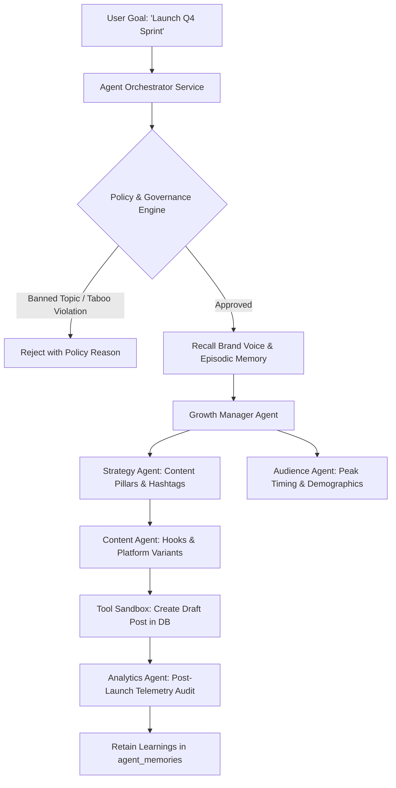

# AI Agent Architecture (Stage 3)

## 1. Overview & Objectives

The SocialForge Autonomous AI Agent System (HLD Stage 3) operates as an intelligent growth manager and marketing strategist for brands. Moving beyond single-caption generation, it provides closed-loop agency-level reasoning:
- Analyzing historical engagement velocity and conversion signals.
- Formulating multi-phase campaign milestones and content pillars.
- Synthesizing multi-channel copy that strictly adheres to brand voice guidelines and taboo word scrubbing.
- Operating under safe guardrails and policy governance with human-in-the-loop review escalations.
- Executing real tools in a sandbox (querying analytics, accessing brand guidelines, and creating draft posts).

---

## 2. Core Data Models

### 2.1 `agent_runs` Table
Records every autonomous and interactive agent goal execution.

| Column | Type | Description |
| :--- | :--- | :--- |
| `id` | `VARCHAR(36)` (PK) | Unique run identifier |
| `tenant_id` | `VARCHAR(36)` (FK) | Strict multi-tenant isolation anchor |
| `brand_id` | `VARCHAR(36)` (FK, Nullable) | Associated brand profile |
| `agent_type` | `VARCHAR(64)` | `growth_manager`, `strategy_agent`, `content_agent`, `audience_agent`, `analytics_agent` |
| `prompt` | `TEXT` | User goal or trigger prompt |
| `status` | `VARCHAR(50)` | `planning` \| `executing` \| `completed` \| `failed` |
| `plan` | `JSON` | Step-by-step reasoning plan formulated by the agent |
| `tool_calls` | `JSON` | Array of executed tools, duration, and telemetry results |
| `results` | `JSON` | Synthesized growth plan, strategy, or drafted post content |
| `tokens_used` | `INT` | LLM token consumption tracking |
| `duration_ms` | `INT` | Wall-clock execution duration in milliseconds |
| `started_at` / `completed_at` | `TIMESTAMP` | Execution timing markers |

### 2.2 `agent_memories` Table
Persistent, multi-tiered memory store enabling long-term brand contextual recall.

| Column | Type | Description |
| :--- | :--- | :--- |
| `id` | `VARCHAR(36)` (PK) | Memory entry identifier |
| `tenant_id` | `VARCHAR(36)` (FK) | Scoped to tenant |
| `brand_id` | `VARCHAR(36)` (FK, Nullable) | Brand-specific memory partition |
| `memory_type` | `VARCHAR(64)` | `short_term`, `episodic`, `brand_guidelines`, `engagement_pattern`, `preference` |
| `key` | `VARCHAR(255)` | Retrieval key (e.g. `guidelines_<brandId>`, `growth_plan_<brandId>`) |
| `value` | `JSON` | Structured memory payload |
| `confidence` | `FLOAT` | Confidence weighting score (0.0 to 1.0) |
| `expires_at` | `TIMESTAMP` (Nullable) | Automatic TTL expiration |

### 2.3 `agent_settings` Table
Tenant- and brand-level autonomous agent configuration.

| Column | Type | Description |
| :--- | :--- | :--- |
| `id` | `VARCHAR(36)` (PK) | Configuration identifier |
| `tenant_id` | `VARCHAR(36)` (FK) | Tenant scope |
| `brand_id` | `VARCHAR(36)` (FK, Nullable) | Optional brand scope |
| `model` | `VARCHAR(100)` | Underlying model (e.g. `gpt-4o`, `claude-3-5-sonnet`) |
| `temperature` | `FLOAT` | Generation temperature (default 0.7) |
| `autonomous_mode` | `VARCHAR(32)` | `semi` (requires human approval) \| `full` (autonomous publishing) |
| `require_approval_before_publish` | `BOOLEAN` | Hard guardrail ensuring drafts require magic link / team review |
| `max_weekly_auto_posts` | `INT` | Rate limit on autonomous post generation |
| `strictness_level` | `INT` | Policy compliance strictness (0 to 100) |
| `banned_topics` | `JSON` | Disallowed industry topics (e.g. `['cryptocurrency', 'politics']`) |

---

## 3. Agent Hierarchy & Roles

1. **Growth Manager Agent (`growthManager.service.ts`)**:
   - Deconstructs high-level objectives into 4-phase growth milestones (Attention Capture $\to$ Authority Building $\to$ Proof & Validation $\to$ Conversion).
   - Recommends weekly post frequency and optimal dispatch windows.
2. **Strategy Agent (`strategyAgent.service.ts`)**:
   - Formulates content pillars with percentage allocations.
   - Generates tiered hashtag bundles (Branded, Industry, Niche).
   - Provides call-to-action frameworks.
3. **Content Agent (`contentAgent.service.ts`)**:
   - Synthesizes 3 distinct hook angles.
   - Generates multi-platform copy tailored for LinkedIn, X/Twitter, Instagram, and Facebook.
   - Automatically scrubs brand kit taboo words.
4. **Audience Agent (`audienceAgent.service.ts`)**:
   - Analyzes target audience profiles and format resonance scores.
   - Computes peak engagement windows localized to the brand's timezone.
5. **Analytics Agent (`analyticsAgent.service.ts`)**:
   - Ingests real post telemetry from `posts` and `post_analytics`.
   - Identifies top-performing creative angles and recommends operational optimizations.

---

## 4. Tool Registry & Sandbox Architecture

All external actions and telemetry queries execute through [`toolRegistryService`](file:///f:/SocialAgent/apps/api/src/services/agent/toolRegistry.service.ts):

| Tool Name | Category | Real Capability |
| :--- | :--- | :--- |
| `analytics.queryMetrics` | `analytics` | Queries real post statistics, draft vs. published counts, and reach. |
| `brandBrain.getVoiceRules` | `brand` | Retrieves 16-dimension brand guidelines, tone descriptors, and taboo words. |
| `content.generateVariants` | `content` | Produces platform-tailored copy variants. |
| `content.createDraftPost` | `content` | Inserts real post records in `posts` and `post_variants` tables. |
| `publishing.checkStatus` | `publishing` | Inspects scheduled and published post queue. |
| `audience.analyzeTarget` | `audience` | Analyzes demographic targets and engagement hours. |
| `connectHub.queryDatasources` | `datasource` | Queries connected Stage 1 Connect Hub data sources. |

---

## 5. REST API Endpoints

- `POST /api/v1/agent/run`: Executes autonomous agent goal with step-by-step reasoning plan and tool calls.
- `GET /api/v1/agent/runs`: Lists historical agent runs with status, token usage, and tenant scoping.
- `GET /api/v1/agent/runs/:id`: Fetches single run with detailed plan, tool outputs, and telemetry.
- `GET /api/v1/agent/settings`: Retrieves tenant/brand agent configuration.
- `PUT /api/v1/agent/settings`: Updates model, autonomous mode (`semi`/`full`), and banned topics.
- `GET /api/v1/agent/memories`: Queries stored memory items by category and brand.
- `GET /api/v1/agent/tools`: Lists registered sandbox tools.
