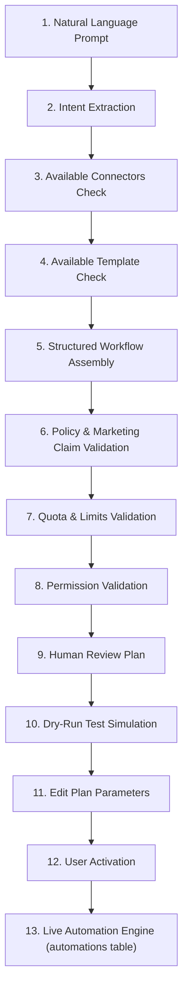

# SocialForge HLD Stage 7: AI Automation Copilot Architecture

## 1. Overview & Objective
The **AI Automation Copilot** enables users to describe end-to-end multi-channel marketing workflows in natural language. The system converts unstructured natural language instructions into a strictly validated, deterministic automation plan.

### Key Example:
> *"Whenever a new product is added to my Google Sheet, use Product Promotion and publish to Instagram/Facebook every weekday at 7 PM."*

### Synthesized Structured Plan:
- **Trigger**: New or updated product (`datasource_change`, Google Sheets / Excel)
- **Condition**: `status = 'READY'`
- **Template**: `Product Promotion` (`tpl-product-flagship`)
- **Channels**: `Instagram + Facebook`
- **Schedule**: `Weekdays 7 PM` (`0 19 * * 1-5`)
- **Approval**: `Required` (Enforced magic link sign-off)
- **Status**: `validated` / `tested` / `activated`

---

## 2. End-to-End Workflow Pipeline



---

## 3. Strict Safety Guardrails (Zero-Tolerance Invariants)

| Guardrail | Enforcement Mechanism |
| :--- | :--- |
| **No Raw Credential Access** | Connector verification checks health and scopes without querying or returning encrypted tokens (`access_token`, `client_secret` stripped from all tool call audit logs). |
| **No Approval Bypass** | `approvalPolicy.required` is non-negotiably set to `true`. Attempts to edit or remove approval are rejected by the service layer. |
| **No Direct External Publishing** | The Copilot synthesizes workflow configurations and stores plans in `copilot_automation_plans`. It cannot execute live social mutations during generation or dry-run testing. |
| **No Unsupported Claims** | Policy scanner parses brand rules and rejects prohibited superlatives (`#1 best in the universe`, guaranteed cure claims, unverified pricing/discounts). |
| **Tenant & Brand Boundary Isolation** | All plans, templates, and connections are strictly partitioned by `tenant_id` and `brand_id`. Cross-tenant retrieval, editing, or activation returns null or 403 Forbidden. |
| **Production Post Variant Protection** | Production post variant `1405588742634526_122100337179498315` remains permanently published, intact, and immune to copilot mutations. |

---

## 4. Database Schema: `copilot_automation_plans`

```sql
CREATE TABLE copilot_automation_plans (
  id UUID PRIMARY KEY,
  tenant_id UUID NOT NULL REFERENCES tenants(id) ON DELETE CASCADE,
  brand_id UUID NOT NULL REFERENCES brands(id) ON DELETE CASCADE,
  user_id UUID NOT NULL REFERENCES users(id) ON DELETE CASCADE,
  prompt TEXT NOT NULL,
  extracted_intent JSON NOT NULL,
  structured_plan JSON NOT NULL,
  validation_report JSON NOT NULL,
  status VARCHAR(50) NOT NULL DEFAULT 'validated', -- 'validated', 'tested', 'activated', 'cancelled'
  automation_id UUID NULL REFERENCES automations(id) ON DELETE SET NULL,
  tool_calls JSON NOT NULL,
  test_results JSON NULL,
  created_at TIMESTAMP NOT NULL DEFAULT CURRENT_TIMESTAMP,
  updated_at TIMESTAMP NOT NULL DEFAULT CURRENT_TIMESTAMP,
  INDEX idx_copilot_tenant_brand (tenant_id, brand_id),
  INDEX idx_copilot_status (status)
);
```

---

## 5. API Endpoints

### 1. `POST /agent/copilot/automation`
Synthesizes a structured plan from natural language.
- **Request Body**: `{ "prompt": string, "brandId"?: string }`
- **Response**: `{ "success": true, "plan": CopilotAutomationPlan }`

### 2. `GET /agent/copilot/automations`
Lists all generated plans for the authenticated tenant/brand.

### 3. `GET /agent/copilot/automation/:id`
Retrieves a plan by ID.

### 4. `POST /agent/copilot/automation/:id/test`
Dry-run simulation of the workflow pipeline without external network side-effects.
- **Response**: `{ "success": true, "testResults": { "testStatus": "passed", "stepSimulations": [...] } }`

### 5. `PUT /agent/copilot/automation/:id`
Edits workflow parameters (name, description, schedule, cron) before activation while strictly locking `approvalPolicy.required = true`.

### 6. `POST /agent/copilot/automation/:id/activate`
Converts the human-reviewed plan into an active row in the `automations` table and updates plan status to `'activated'`.

### 7. `POST /agent/copilot/automation/:id/cancel`
Cancels the plan and prevents any future activation.
