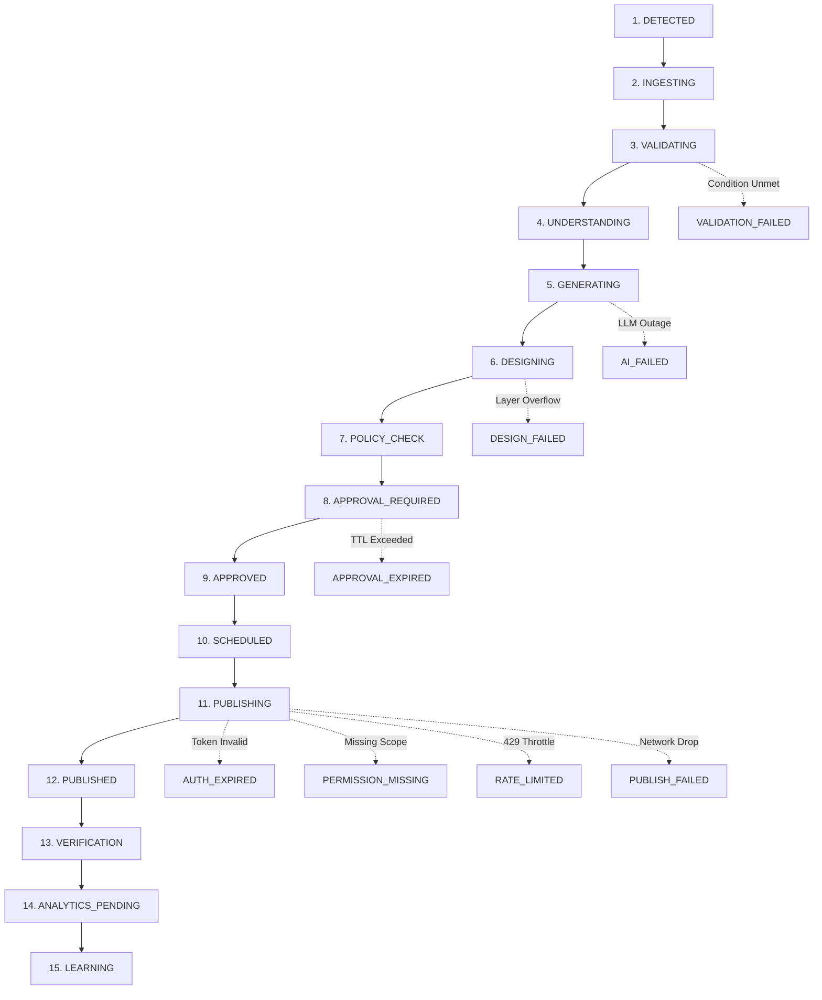

# SocialForge Stage 5: Durable Event-Driven Automation Engine Architecture

## 1. Overview & Objectives

The SocialForge Durable Automation Engine (HLD Stage 5) elevates workflow execution into an enterprise-grade, durable, event-driven distributed system. It handles high-throughput business data triggers (Drive, Sheets, CSV, E-Commerce, CRM, Webhooks, Schedules), coordinates multi-model AI synthesis, enforces visual template reflows and brand policies, manages human approval workflows, and reliably publishes to social networks with guaranteed delivery, fault tolerance, and closed-loop feedback learning.

### Core Architectural Pillars
- **15-State Automation Lifecycle**: Granular deterministic state transitions from `DETECTED` through `LEARNING`.
- **8 Explicit Failure States**: Typed failure classification enabling surgical retry decisions vs. dead-letter routing.
- **10 Enterprise Trigger Types**: Drive files, Sheets rows, CSV imports, Commerce products, CRM offers, Cron schedules, Milestones, Analytics winners, Manual runs, and Webhooks.
- **7-Part Deterministic Exactly-Once Deduplication**: Eliminates duplicate processing across concurrent webhooks or worker bursts.
- **TTL-Based Distributed Locking**: Concurrency protection preventing race conditions on runs and automations.
- **Step State Persistence (`automation_step_runs`)**: Real-time persistence of step inputs, outputs, error diagnostics, and duration.
- **Exponential Backoff Retry Engine**: Automatic jittered retry schedules for transient errors (`RATE_LIMITED`, `AI_FAILED`, etc.).
- **Dead-Letter Queue (DLQ) Management**: Persistent quarantine (`automation_dlq`) with one-click replaying and administrative discarding.
- **Operational Controls**: Immediate, idempotent `pause`, `resume`, and `cancel` for active workflows and runs.
- **Multi-Tenant and Brand Isolation**: Strict tenant scoping across all tables, execution contexts, queries, and worker queues.

---

## 2. 15-State Durable Automation Lifecycle

The workflow engine executes an immutable, sequential 15-state progression:

| # | Lifecycle State | Stage Description | Output / Artifact |
| :- | :--- | :--- | :--- |
| 1 | `DETECTED` | Inbound trigger payload received and registered. | Trigger event snapshot & initial run creation. |
| 2 | `INGESTING` | Raw payload normalized into canonical business record. | Normalized payload structure. |
| 3 | `VALIDATING` | Workflow condition evaluation (equals, contains, matches). | Condition outcome log; routes to `VALIDATION_FAILED` on failure. |
| 4 | `UNDERSTANDING` | Contextual analysis of product/file/event semantics. | Key angles, audiences, and content intentions. |
| 5 | `GENERATING` | Multi-platform AI copy & caption synthesis. | Multi-variant copy (`instagram`, `facebook`, `linkedin`). |
| 6 | `DESIGNING` | Visual template binding & multi-aspect ratio rendering. | Rendered canvas layers & dimension bundles (1:1, 4:5, 9:16). |
| 7 | `POLICY_CHECK` | Prohibited claim scanning & CTA verb validation. | Compliance verification sign-off. |
| 8 | `APPROVAL_REQUIRED` | Review link generation & approval request logging. | 64-character cryptographic hex token & portal URL. |
| 9 | `APPROVED` | Reviewer approval granted (portal or programmatic). | Approval timestamp & actor audit record. |
| 10 | `SCHEDULED` | Time reservation in publishing queue. | Scheduled dispatch timestamp. |
| 11 | `PUBLISHING` | Social provider API call dispatch. | API payload transmission. |
| 12 | `PUBLISHED` | Network acknowledgment received with remote IDs. | Permanent `remote_post_id` & permalink URL. |
| 13 | `VERIFICATION` | Active live verification of remote social post. | Health check confirmation on target feed. |
| 14 | `ANALYTICS_PENDING` | Telemetry tracker queued for impressions & engagement. | Telemetry tracking job ID. |
| 15 | `LEARNING` | Performance feedback injected into brand memory. | Brand memory update & prompt calibration. |

---

## 3. Failure Classification & Retry / DLQ Matrix

Failures are strongly typed into 8 categories:

| Failure State | Description | Retry Strategy | Target on Exhaustion |
| :--- | :--- | :--- | :--- |
| `VALIDATION_FAILED` | Inbound data did not pass automation conditions or required fields. | Non-retryable (terminal failure). | Run marked failed. |
| `AI_FAILED` | Upstream LLM provider timeout, rate limit, or generation syntax error. | Retryable: Exponential backoff with jitter. | DLQ (`automation_dlq`). |
| `DESIGN_FAILED` | Canvas layer out of bounds, template missing, or image rendering crash. | Non-retryable / Human inspection needed. | DLQ (`automation_dlq`). |
| `AUTH_EXPIRED` | Meta / social OAuth token expired or revoked. | Non-retryable without reauth notification. | DLQ (`automation_dlq`). |
| `PERMISSION_MISSING` | Target Facebook Page / Instagram account missing required publishing scopes. | Non-retryable without user intervention. | DLQ (`automation_dlq`). |
| `RATE_LIMITED` | Social platform 429 rate limit exceeded. | Retryable: Exponential backoff with jitter. | DLQ (`automation_dlq`). |
| `PUBLISH_FAILED` | Network timeout or platform transient 5xx error during publication. | Retryable: Exponential backoff with jitter. | DLQ (`automation_dlq`). |
| `APPROVAL_EXPIRED` | Magic link approval window exceeded without client review response. | Non-retryable; workflow escalation. | DLQ (`automation_dlq`). |

---

## 4. Supported Triggers (All 10 Enterprise Types)

1. **`drive_file_changed`**: Watches Google Drive folders for new media assets or edits.
2. **`sheets_row_updated`**: Ingests new or updated rows from Google Sheets inventory or marketing calendars.
3. **`csv_import_completed`**: Triggers batch generation when an Excel/CSV bulk import job finishes.
4. **`commerce_product_created`**: Ingests product catalog additions or updates (Shopify, WooCommerce).
5. **`crm_event_offer`**: Triggered on CRM pipeline milestones, discount events, or promotional offers.
6. **`scheduled_time`**: Cron-based scheduled interval triggers (`apps/worker/src/schedulers`).
7. **`campaign_milestone`**: Triggered when a marketing campaign achieves target budget or date milestones.
8. **`analytics_winner_detected`**: Triggered when A/B test analytics identify a winning creative variant.
9. **`manual_run_now`**: Instant ad-hoc workflow run initiated by operators.
10. **`connector_webhook`**: Real-time inbound webhook event from external SaaS or Connect Hub connectors.

---

## 5. Exactly-Once Idempotency & Distributed Locking

### 5.1 7-Part Exactly-Once Key
To prevent duplicate execution across webhook retries and concurrent cron workers, SocialForge computes an authoritative 7-part composite key:

$$\text{Key} = \text{sha256}(\text{tenant\_id} + \text{automation\_id} + \text{source\_connection\_id} + \text{source\_record\_id} + \text{source\_version} + \text{action\_type} + \text{template\_version})$$

- If an active or completed run exists with this exact key, the inbound trigger is automatically suppressed with status `skipped` and reason `Idempotency key already executed`.

### 5.2 Distributed Locks (`distributed_locks`)
- Distributed locks protect resources with a unique resource key and TTL (default 60 seconds).
- Re-entrant check via cryptographic lock tokens (`crypto.randomUUID()`).
- Safe heartbeat renewal (`refreshLock`) and clean release (`releaseLock`).

---

## 6. Step State Persistence (`automation_step_runs`)

Every phase in the 15-state lifecycle persists its granular execution record in `automation_step_runs`:
- `run_id`, `automation_id`, `tenant_id`, `brand_id`
- `step_index`, `step_name`, `lifecycle_phase`
- `status` (`pending`, `running`, `completed`, `failed`, `skipped`)
- `input_payload` (JSON snapshot of step inputs)
- `output_payload` (JSON snapshot of step outputs)
- `error_message` (Diagnostic error string)
- `duration_ms` (Wall-clock execution time)

---

## 7. Exponential Backoff & Dead-Letter Queue (DLQ)

### 7.1 Exponential Backoff Algorithm
$$\text{delayMs} = \min(\text{baseDelayMs} \times 2^{\text{retryCount}} + \text{jitter}, \text{maxDelayMs})$$
Where $\text{jitter} = \text{randomInt}(0, 250\text{ms})$.
- Default $\text{baseDelayMs} = 1000\text{ms}$.
- Default $\text{maxRetries} = 3$.

### 7.2 DLQ Table (`automation_dlq`)
When retries are exhausted (or non-retryable failure occurs):
1. A DLQ record is inserted into `automation_dlq` containing failure state, payload, and error diagnostics.
2. The run status transitions to `failed` and lifecycle reflects the failure state.
3. Operators can inspect the DLQ via `/api/automations/dlq`.
4. Replaying a DLQ item (`/api/automations/dlq/:id/replay`) resets the run to `pending`, clears retry counters, and enqueues it for worker reprocessing.
5. Operators can discard irrecoverable DLQ items (`DELETE /api/automations/dlq/:id`).

---

## 8. Operational Controls (Pause, Resume, Cancel)

- **Pause (`POST /api/automations/:id/pause`)**: Sets automation status to `paused` and sets `paused_at`. Any incoming triggers or worker runs are immediately rejected.
- **Resume (`POST /api/automations/:id/resume`)**: Clears `paused_at` and restores status to `active`.
- **Cancel Run (`POST /api/automations/runs/:runId/cancel`)**: Immediately halts an in-flight execution, releases its distributed lock, and records `cancellation_reason`.
- **Cancel Automation (`POST /api/automations/:id/cancel`)**: Terminates an automation permanently, setting status to `cancelled` and recording `cancelled_at`.

---

---

## 9. Ready-Made Flagship Recipe: "Product Promotion"

The flagship enterprise recipe (`product-promotion`) automates the full catalog-to-social publishing pipeline for products added or edited in Google Sheets or Excel:

```mermaid
flowchart LR
    Sheets[Google Sheets / Excel] --> Detect[Detect & Validate]
    Detect --> Normalize[Normalize Product]
    Normalize --> AI[AI Copy Synthesis]
    AI --> Template[Product Promotion Template]
    Template --> Policy[Claim Policy Check]
    Policy --> Approval[Human Approval Gate]
    Approval --> Schedule[Configurable Schedule]
    Schedule --> Publish[Meta Publication]
    Publish --> Analytics[Collect Analytics]
    Analytics --> Learning[AI Growth Recommendation]
```

### Configuration & Policy Matrix
- **Trigger**: New or updated product row (`datasource_change` / Google Sheets / Excel).
- **Condition**: `Status = READY` (evaluated with case-insensitive equality).
- **Channels**: Facebook (1:1 square) + Instagram (4:5 portrait & 9:16 vertical reels).
- **Strict Anti-Hallucination Guardrails**:
  - **Never invent product price**: Ingestion strictly fails if `price` is omitted or empty.
  - **Never invent discount**: Unsupplied discounts remain strictly `null` (never fabricated).
  - **Never invent availability**: Missing stock status fails validation (never fabricated).
  - **Never invent guarantees**: Guarantees are only included if explicitly declared in the source row.
- **Approval Gate**: Human sign-off required by default via expirable 64-character cryptographic hex magic links.
- **Configurable Schedule**: User-specified dispatch time via `scheduled_for`.
- **Publication Integrity**:
  - Never publish without required fields (`product_name`, `price`, `availability`, `base_content`).
  - Never report publishing success without real provider confirmation (`isRealExternalPostId`).
  - All publishing operations store job records in `publishing_jobs`.
- **Telemetry & Closed-Loop Learning**:
  - Published metrics ingested into `post_analytics_snapshots` and `post_analytics_metrics`.
  - Actionable marketing growth recommendations generated and stored in `agent_memories`.

---

## 10. Verification & Quality Gates

The Automation Engine is validated by:
- **`scripts/test_automation_engine_stage5.mjs`**: 116 automated assertions covering the durable 15-state lifecycle, DLQ, retries, and distributed locks.
- **`scripts/test_flagship_product_promotion_e2e.mjs`**: 136 automated assertions verifying the complete Flagship "Product Promotion" journey.
- **`npm run test:hld`**: 15 full platform verification suites passing 100% with zero regressions (794 assertions).
- **Production Post Protection**: Permanent lock on variant `1405588742634526_122100337179498315` verified intact across all runs.

