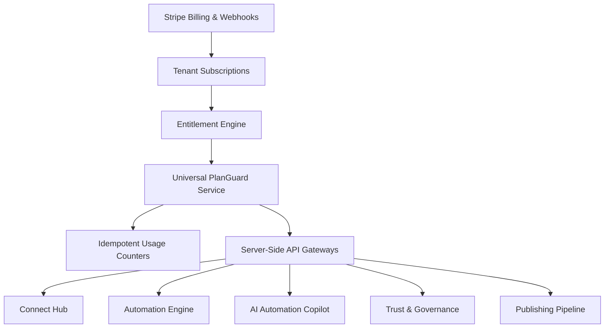
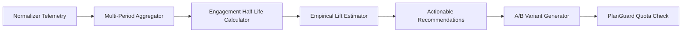

# SocialForge HLD Stage 9: Billing Hardening and Entitlements Architecture

## 1. Executive Summary

SocialForge Stage 9 establishes an enterprise-grade, non-bypassable billing hardening, entitlement enforcement, and usage metering framework. The system implements a strict, authoritative execution pipeline:

Every operation across Connect Hub, Automation Engine, AI Copilot, Governance, and Publishing is validated server-side against resolved subscription capabilities and quotas. AI cannot bypass subscription or token boundaries, automations cannot execute without active entitlements, and external publishing is guarded server-side.

---

## 2. Commercial Tier Matrix (6 Commercial Tiers × 12 Dimensions)

SocialForge hardens 6 distinct commercial tiers seeded in `subscription_plans`, mapped against 12 enforceable dimensions:

| Dimension / Resource | Free Trial / Trial ($0) | Starter ($29/mo) | Growth ($79/mo) | Agency Pro ($249/mo) | Scale ($599/mo) | Enterprise ($999+/mo) |
|---|---|---|---|---|---|---|
| **1. Brands (`brands`)** | 1 brand | 1 brand | 5 brands | 25 brands | 100 brands | Unlimited (500+) |
| **2. Seats / Users (`seats`)** | 1 seat | 2 seats | 5 seats | 20 seats | 50 seats | Unlimited (100+) |
| **3. Social Accounts (`social_accounts`)** | 2 accounts | 3 accounts | 15 accounts | 100 accounts | 250 accounts | Unlimited (500+) |
| **4. Active Automations (`active_automations`)** | 10 automations | 3 automations | 10 automations | 50 automations | 150 automations | Unlimited (9,999) |
| **5. AI Token Budget (`ai_credits`)** | 25,000 / mo | 100,000 / mo | 500,000 / mo | 2,500,000 / mo | 10,000,000 / mo | 50,000,000+ / mo |
| **6. Video Rendering (`video_minutes`)** | 60 sec / mo | 300 sec / mo | 1,200 sec / mo | 3,600 sec / mo | 18,000 sec / mo | Unlimited |
| **7. Media Storage (`storage`)** | 1 GB | 5 GB | 20 GB | 100 GB | 500 GB | 2 TB+ |
| **8. Monthly Posts (`posts`)** | 20 posts | 100 posts | 500 posts | 2,500 posts | 10,000 posts | Unlimited (50,000+) |
| **9. Analytics Retention (`analytics_retention`)** | 7 days | 30 days | 90 days | 365 days | 730 days | Indefinite |
| **10. Premium Connectors (`premium_connectors`)** | ❌ None | ❌ Standard Only | ✅ Sheets/Excel | ✅ ERP/Sheets/CRM | ✅ Full Data Suite | ✅ Custom Connectors |
| **11. Autonomy Ceiling (`autonomy_level`)** | L2 (Approval Req) | L2 (Approval Req) | L3 (Auto Low-Risk) | L4 (Full Auto Budget) | L5 (Continuous Self-Drive) | L5 (Unrestricted) |
| **12. Multi-Tenant Workspaces (`agency_workspaces`)** | ❌ Single | ❌ Single | ❌ Single | ✅ Multi-Workspace | ✅ Multi-Workspace | ✅ Dedicated Isolation |

---

## 3. Core Architectural Components

### 3.1 Universal PlanGuard Service (`PlanGuardService`)
Located in [`apps/api/src/services/billing/planGuard.service.ts`](file:///f:/SocialAgent/apps/api/src/services/billing/planGuard.service.ts), `PlanGuardService` acts as the single source of truth for checking and enforcing all 12 entitlement dimensions:
- `check(tenantId, resource, requestedAmount, context)`: Evaluates subscription status (active, trialing, past_due, expired, cancelled), active usage counters, and features. Returns `PlanGuardCheckResult` with status, remaining quota, limits, and grace period information.
- `enforce(tenantId, resource, requestedAmount, context)`: Asserts entitlement and throws a structured `PlanGuardError` (HTTP 403, `PLAN_LIMIT_EXCEEDED`) if quota is reached, status is invalid, or feature is absent.
- `incrementUsageIdempotent(params)`: Executes atomic, duplicate-safe usage metering.
- `getSnapshot(tenantId)`: Returns comprehensive 12-dimension health status for tenant workspace dashboards.

### 3.2 Idempotent Usage Metering (`idempotent_usage_records`)
To guarantee zero double-charging or duplicate quota decrements during retries, network blips, or duplicate webhook payloads:
- A dedicated database table `idempotent_usage_records` captures unique `(tenant_id, idempotency_key)`.
- Before incrementing `tenant_usage_counters`, `planGuardService.incrementUsageIdempotent` verifies key existence and atomically inserts the record.
- If a duplicate key is detected (e.g. from an automation retry, re-published post, or duplicate webhook), the operation succeeds idempotently without double-incrementing the tenant's usage counter.

### 3.3 Universal PlanGuard Middleware (`requirePlanGuard`)
Exported in [`apps/api/src/middleware/planLimits.ts`](file:///f:/SocialAgent/apps/api/src/middleware/planLimits.ts):
- Intercepts Express requests across routes (`/brands`, `/connections`, `/automations`, `/publishing`).
- Rejects requests exceeding plan limits with HTTP 403, structured error payload (`PLAN_LIMIT_EXCEEDED`), current usage, allowed limits, and `upgradeRequired: true`.
- Aliases `requireEntitlement` and `enforcePlanLimit` for 100% backward compatibility.

---

## 4. Multi-Layer In-Service Enforcements

| Subsystem | Service / Controller | Enforcement Points |
|---|---|---|
| **Connect Hub** | `ConnectionsController.createConnection` & `connection.service.ts` | Enforces `social_accounts` ceiling; blocks premium connectors (`google-sheets`, `excel`, `enterprise_erp`, `salesforce`) on Trial/Starter. |
| **Automation Engine** | `AutomationService.createAutomation` & `updateAutomation` | Blocks creating or activating automations when `active_automations` count meets plan limit. |
| **AI Copilot** | `CopilotAutomationService.generateAutomationPlan` | Validates `ai_credits` (500 tokens reserved) before initiating intent synthesis; blocks if budget exhausted. |
| **Governance & Trust** | `GovernancePolicyService.setAutonomyLevel` & `updateSettings` | Enforces plan max autonomy level ceiling (`L2` on Trial/Starter, `L3` on Growth, `L4` on Agency, `L5` on Scale/Enterprise). |
| **Publishing Pipeline** | `PublishingService.publishSocialPost` | Enforces `posts` quota and subscription active/grace period status server-side before Meta API dispatch. |

---

## 5. Stripe Lifecycle & Resilience Engineering

### 5.1 Durable Webhooks & Dead-Letter Queue (DLQ)
- `StripeBillingProvider` handles webhooks idempotently with database audit logging in `billing_events`.
- Handled events:
  - `checkout.session.completed` ➔ Activates or provisions workspace subscription.
  - `customer.subscription.updated` ➔ Synchronizes upgrades, downgrades, and `cancel_at_period_end`.
  - `customer.subscription.deleted` ➔ Transitions subscription to `cancelled` and blocks operations.
  - `invoice.paid` ➔ Records invoice in `billing_invoices`, clears past-due status, dispatches branded PDF receipt.
  - `invoice.payment_failed` ➔ Transitions to `past_due`, starts 5-day grace period, sends critical dunning alerts.
- `WebhookDlqService` retries failing webhooks up to 5 times with exponential backoff (30s, 60s, 120s, 240s, 480s). Deliveries exceeding 5 attempts are automatically transitioned to `dead_letter` for operator inspection and replay.

### 5.2 5-Day Dunning Grace Period
- When payment fails, the workspace transitions to `past_due` with a 5-day (120-hour) grace period.
- During grace:
  - `PlanGuard.check()` permits ongoing operations with `isGracePeriod: true` and `gracePeriodEndsAt`.
  - Multi-stage emails and in-app banners alert workspace owners to update payment credentials.
- After 120 hours without recovery:
  - Account escalates to `unpaid` suspension.
  - All publishing and mutations are blocked, while brand data and history remain safely preserved.
- When `invoice.paid` arrives:
  - Subscription is immediately restored to `active`.
  - Full workspace publishing privileges resume without operator intervention.

---

## 6. Verification and Invariants

### 6.1 Test Suite Results
- **HLD v3.0 Billing Hardening & Boundaries Suite (`scripts/test_billing_hld_v3_hardening.mjs`)**: 167 passed, 0 failed.
- **Stage 9 Test Suite (`scripts/test_billing_entitlements_stage9.mjs`)**: 85 passed, 0 failed.
- **HLD Test Suite (`npm run test:hld`)**: 19 test suites, 1,112+ tests passed, 0 failed.
- **Flagship Promotion E2E (`npm run test:flagship-promotion`)**: 14 sections, 136 checks passed, 0 failed.
- **SaaS Test Suite (`npm run test:saas`)**: 17 scripts, 100% passed, 0 failed.

### 6.2 Guaranteed System Invariants
1. **Production Post Lock**: Remote post variant `1405588742634526_122100337179498315` remains permanently published in `post_variants` and `publishing_jobs`.
2. **Zero Secret Leakage**: Stripe API keys (`sk_test_...`) and webhook secrets (`whsec_...`) are never exposed to the frontend, database exports, or AI prompts.
3. **Multi-Tenant Boundary Isolation**: Cross-tenant subscriptions, usage counters, and billing events are strictly isolated by `tenant_id`.
4. **Idempotency Guarantee**: Idempotent usage records prevent duplicate quota decrements under all retry scenarios.
5. **No Out-of-Scope Features**: LinkedIn, TikTok, Shopify, voiceover, and custom domains are preserved for future milestones without pollution.

---

## 7. Stage 10: Growth Intelligence Specification

With billing hardening and entitlements in place, SocialForge is primed for **HLD Stage 10: Growth Intelligence**:

### 7.1 Scope of Stage 10
1. **Multi-Period Baseline Aggregation**: Dynamic moving averages (7d, 30d, 90d, 365d) respecting plan analytics retention limits.
2. **Engagement Half-Life Modeling**: Exponential decay curves modeling how content velocity trends across platforms (Facebook 24h half-life, Instagram 48h half-life).
3. **Lift Estimation Engine**: Bayesian confidence intervals estimating uplift against baseline performance.
4. **Autonomous Growth Recommendations**: Structured feedback loops generating content hooks, scheduling adjustments, and campaign expansions.
5. **A/B Variant Experimentation**: Controlled copy and media variants linked to winner detection and Brand Brain memory.
