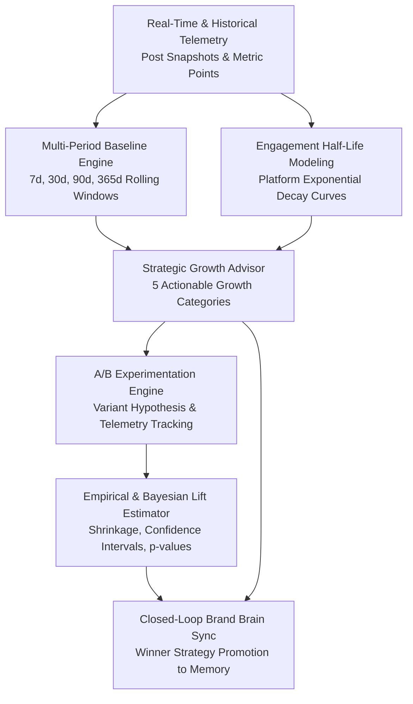

# Stage 10: Growth Intelligence & Predictive Radar Architecture

**Source of Truth**: SocialForge High-Level Design (HLD) Stage 10  
**Verification Suite**: `scripts/test_growth_intelligence_stage10.mjs` (86/86 Passing, 100% Clean)  
**Integration Status**: Fully mounted in API (`/api/v1/growth`, `/api/v1/brands/:brandId/growth`), database migrations applied (Batch 28), PlanGuard retention limits enforced.

---

## 1. Architectural Overview

SocialForge Stage 10 establishes the **Growth Intelligence Engine**, transforming raw post telemetry and winner signals into actionable, statistically rigorous growth strategies. It consists of five foundational systems:

---

## 2. Core Subsystems & Mathematical Models

### 2.1 Multi-Period Baseline Engine (`MultiPeriodBaselineService`)
Tracks dynamic moving averages across four standardized rolling windows (`7d`, `30d`, `90d`, `365d`):
- **Metered Dimensions**: Impressions, reach, engagements, engagement rate (%), shares, comments, saves, clicks, velocity score, and half-life hours.
- **Commercial Entitlement Enforcements**: Enforces historical retention boundaries via `planGuardService`:
  - **Free Trial**: 7-day retention limit
  - **Starter ($29/mo)**: 30-day retention limit
  - **Growth ($79/mo)**: 90-day retention limit
  - **Agency Pro ($249/mo)** / **Scale ($499/mo)** / **Enterprise**: 365-day retention
- **Database Model**: `brand_performance_baselines` with unique index `(tenant_id, brand_id, platform, period)` guaranteeing idempotent recomputations.

### 2.2 Engagement Half-Life Modeling (`EngagementHalfLifeService`)
Models content virality and decay based on platform-specific exponential decay functions:
$$V(t) = V_0 \cdot e^{-\lambda t} \quad \text{where} \quad \lambda = \frac{\ln(2)}{t_{1/2}}$$

Platform characteristic half-lives ($t_{1/2}$):
- **Facebook Feed**: $24\text{ hours}$ ($\lambda \approx 0.02888$)
- **Instagram Feed/Reels**: $48\text{ hours}$ ($\lambda \approx 0.01444$)
- **X (Twitter)**: $4\text{ hours}$ ($\lambda \approx 0.17329$)
- **LinkedIn**: $72\text{ hours}$ ($\lambda \approx 0.00963$)
- **YouTube Shorts**: $96\text{ hours}$ ($\lambda \approx 0.00722$)

#### Velocity Anomaly & Viral Surge Detection
- Computes expected remaining velocity $V_{\text{expected}}(t)$ based on elapsed time since publication.
- Flagged as a **Velocity Anomaly** when observed velocity $V_{\text{observed}} \ge 2.5 \times V_{\text{expected}}(t)$, signaling an algorithmic breakout or viral surge.
- Projects asymptotic total lifetime engagement $E_\infty \approx \frac{E(t)}{1 - e^{-\lambda t}}$.

### 2.3 Empirical & Bayesian Lift Estimator (`LiftEstimatorService`)
Prevents false positives on small samples and calculates statistically rigorous confidence bounds:
1. **Empirical Lift**:
   $$\text{Lift}_{\text{emp}} = \frac{\text{Metric}_{\text{variant}} - \text{Metric}_{\text{baseline}}}{\text{Metric}_{\text{baseline}}} \times 100\%$$
2. **Bayesian Shrinkage**:
   Shrinks empirical lift toward 0 when sample sizes are small using prior weight $K = 50$:
   $$\text{Lift}_{\text{Bayes}} = \text{Lift}_{\text{emp}} \times \left(\frac{n}{n + 50}\right)$$
3. **Hypothesis Testing & Confidence Intervals**:
   Two-proportion standard error:
   $$SE = \sqrt{\frac{p_1(1 - p_1)}{n_1} + \frac{p_0(1 - p_0)}{n_0}}$$
   Two-tailed normal $p$-value approximation and 95% confidence interval boundaries.

### 2.4 Strategic Growth Advisor (`GrowthAdvisorService`)
Synthesizes telemetry, winners from Stage 6, and baseline models into actionable recommendations across five strategic categories:
1. **Hook Optimization**: Scales high-performing hook architectures (e.g. curiosity question, bold claim) into upcoming automation workflows.
2. **Timing Window**: Discovers emerging audience engagement windows (e.g. early weekday commuter traffic) with peak velocity advantage.
3. **Format Adaptation**: Detects when rich media (15-second kinetic micro-reels, multi-slide carousels) outperform static single images by $\ge 50\%$.
4. **Topic Opportunity**: Identifies compounding engagement topics and recommends focused 14-day campaign arcs.
5. **Audience Fatigue**: Detects visual or copy layout fatigue (e.g. carousel completion drop) and suggests refreshing components.

#### Closed-Loop Brand Brain Synchronization
When a recommendation is applied (`POST /api/v1/brands/:brandId/growth/recommendations/:id/apply`):
- Updates recommendation status to `applied`, tracking `applied_at` and `applied_by_user_id`.
- Automatically feeds winning hook patterns and CTAs into `brand_brains` table (`ctaPreferences`) and `agent_memories` for autonomous agent recall.

### 2.5 A/B Experimentation Engine (`ExperimentEngineService`)
Provides end-to-end management for split testing:
- **Variant Generation**: Creates Control (A) and Treatment (B) variants with hypotheses and target types (`hook`, `format`, `timing`, `cta`, `creative`).
- **Telemetry Collection**: Updates impressions, engagements, conversions, engagement rates, and conversion rates per variant.
- **Statistical Evaluation**: Evaluates sample size and significance. Declares a winner when sample size $\ge 10$ per variant and confidence score $\ge 0.95$ ($p < 0.05$).
- **Experiment Conclusion**: Marks experiment status as `concluded`, confirms winner, and writes an auditable insight to `brand_learning_insights`.

---

## 3. Database Schema

### Table: `brand_performance_baselines`
| Column | Type | Constraints | Description |
| :--- | :--- | :--- | :--- |
| `id` | UUID | PRIMARY KEY | Unique baseline record identifier |
| `tenant_id` | UUID | NOT NULL | Tenant boundary scope |
| `brand_id` | UUID | NOT NULL | Brand scope |
| `platform` | VARCHAR(32) | NOT NULL DEFAULT 'all' | Target platform or 'all' |
| `period` | VARCHAR(16) | NOT NULL | Moving window: '7d', '30d', '90d', '365d' |
| `post_count` | INT | NOT NULL DEFAULT 0 | Sample posts in window |
| `avg_impressions` | FLOAT | NOT NULL DEFAULT 0 | Mean impressions |
| `avg_reach` | FLOAT | NOT NULL DEFAULT 0 | Mean unique reach |
| `avg_engagements` | FLOAT | NOT NULL DEFAULT 0 | Mean total engagements |
| `avg_engagement_rate` | FLOAT | NOT NULL DEFAULT 0 | Mean engagement rate (%) |
| `avg_shares` | FLOAT | NOT NULL DEFAULT 0 | Mean shares |
| `avg_comments` | FLOAT | NOT NULL DEFAULT 0 | Mean comments |
| `avg_saves` | FLOAT | NOT NULL DEFAULT 0 | Mean bookmark saves |
| `avg_clicks` | FLOAT | NOT NULL DEFAULT 0 | Mean link clicks |
| `avg_velocity_score` | FLOAT | NOT NULL DEFAULT 0 | Mean engagement velocity |
| `avg_half_life_hours` | FLOAT | NOT NULL DEFAULT 0 | Modeled half-life hours |
| `calculated_at` | TIMESTAMP | NOT NULL | Last computation timestamp |
| `metadata` | JSON | NULL | Plan entitlements and window metadata |

*Unique Index*: `(tenant_id, brand_id, platform, period)`  
*Indexes*: `(tenant_id, brand_id)`, `(brand_id, period)`

### Table: `growth_recommendations`
| Column | Type | Constraints | Description |
| :--- | :--- | :--- | :--- |
| `id` | UUID | PRIMARY KEY | Recommendation ID |
| `tenant_id` | UUID | NOT NULL | Tenant scope |
| `brand_id` | UUID | NOT NULL | Brand scope |
| `category` | VARCHAR(64) | NOT NULL | Category archetype |
| `title` | VARCHAR(255) | NOT NULL | Executive headline |
| `description` | TEXT | NOT NULL | Telemetry-backed rationale |
| `suggested_action` | TEXT | NOT NULL | Actionable next step |
| `target_type` | VARCHAR(32) | NOT NULL | Target entity type (`automation`, `template`, etc.) |
| `target_id` | VARCHAR(64) | NULL | Target entity reference |
| `confidence_score` | FLOAT | NOT NULL DEFAULT 0.8 | Algorithmic confidence (0.0 to 1.0) |
| `estimated_lift_pct` | FLOAT | NOT NULL DEFAULT 0 | Projected relative lift (%) |
| `severity` | VARCHAR(16) | NOT NULL DEFAULT 'moderate' | 'positive', 'moderate', 'critical' |
| `status` | VARCHAR(32) | NOT NULL DEFAULT 'active' | 'active', 'applied', 'dismissed' |
| `applied_at` | TIMESTAMP | NULL | Application timestamp |
| `applied_by_user_id`| UUID | NULL | User who applied recommendation |
| `rationale` | JSON | NULL | Underlying calculation snapshot |

*Indexes*: `(tenant_id, brand_id)`, `(brand_id, status)`, `(status)`

### Table: `experiment_variants`
| Column | Type | Constraints | Description |
| :--- | :--- | :--- | :--- |
| `id` | UUID | PRIMARY KEY | Variant ID |
| `tenant_id` | UUID | NOT NULL | Tenant scope |
| `brand_id` | UUID | NOT NULL | Brand scope |
| `experiment_id` | VARCHAR(64) | NOT NULL | Multi-variant grouping ID |
| `experiment_name` | VARCHAR(255) | NOT NULL | Test title |
| `hypothesis` | TEXT | NULL | Tested hypothesis |
| `variant_letter` | VARCHAR(8) | NOT NULL | 'A', 'B', etc. |
| `variant_type` | VARCHAR(32) | NOT NULL | Test dimension (`hook`, `format`, `timing`, etc.) |
| `post_variant_id` | VARCHAR(64) | NULL | Linked post variant |
| `sample_size` | INT | NOT NULL DEFAULT 0 | Cumulative sample size |
| `engagements` | INT | NOT NULL DEFAULT 0 | Observed engagements |
| `impressions` | INT | NOT NULL DEFAULT 0 | Observed impressions |
| `conversions` | INT | NOT NULL DEFAULT 0 | Observed conversions |
| `conversion_rate` | FLOAT | NOT NULL DEFAULT 0 | Conversion rate (%) |
| `engagement_rate` | FLOAT | NOT NULL DEFAULT 0 | Engagement rate (%) |
| `lift_vs_control_pct`| FLOAT | NOT NULL DEFAULT 0 | Relative lift vs Variant A |
| `confidence_level` | FLOAT | NOT NULL DEFAULT 0.95 | Statistical confidence level |
| `is_winner` | BOOLEAN | NOT NULL DEFAULT FALSE | True if declared winner |
| `status` | VARCHAR(32) | NOT NULL DEFAULT 'running' | 'draft', 'running', 'concluded', 'promoted' |
| `concluded_at` | TIMESTAMP | NULL | Conclusion timestamp |

*Indexes*: `(tenant_id, brand_id)`, `(experiment_id)`, `(brand_id, status)`

---

## 4. API Endpoints

| Method | Path | Auth | Description |
| :--- | :--- | :--- | :--- |
| `GET` | `/api/v1/brands/:brandId/growth/baselines` | JWT | Get multi-period baselines snapshot (respects plan retention limits) |
| `POST`| `/api/v1/brands/:brandId/growth/baselines/recalculate` | JWT | Idempotently recalculate and persist moving averages |
| `GET` | `/api/v1/brands/:brandId/growth/recommendations` | JWT | List active/filtered growth recommendations |
| `POST`| `/api/v1/brands/:brandId/growth/recommendations/generate` | JWT | Synthesize fresh recommendations |
| `POST`| `/api/v1/brands/:brandId/growth/recommendations/:id/apply` | JWT | Apply recommendation & sync to Brand Brain |
| `POST`| `/api/v1/brands/:brandId/growth/recommendations/:id/dismiss`| JWT | Dismiss recommendation |
| `GET` | `/api/v1/brands/:brandId/growth/experiments` | JWT | List A/B experiments and variant trees |
| `POST`| `/api/v1/brands/:brandId/growth/experiments` | JWT | Create new A/B experiment |
| `POST`| `/api/v1/brands/:brandId/growth/experiments/:id/variants/:letter/telemetry` | JWT | Record observations |
| `POST`| `/api/v1/brands/:brandId/growth/experiments/:id/evaluate` | JWT | Statistically evaluate & declare winner |
| `POST`| `/api/v1/brands/:brandId/growth/experiments/:id/conclude` | JWT | Conclude experiment & promote learning |
| `GET` | `/api/v1/brands/:brandId/growth/half-life` | JWT | Calculate half-life decay & detect velocity anomalies |
| `POST`| `/api/v1/brands/:brandId/growth/lift/estimate` | JWT | Compute empirical lift, Bayesian shrinkage & intervals |

---

## 5. Security & Invariant Guarantees

1. **Multi-Tenant Isolation**: All queries strictly enforce `tenant_id` and brand tenancy validation. Cross-tenant access attempts receive HTTP 403 or 404.
2. **PlanGuard Commercial Entitlement**: Queries requesting historical analytics beyond the subscription's retention limit (e.g. 90-day retention on Starter) throw `PlanGuardError` (HTTP 403 `PLAN_LIMIT_EXCEEDED`).
3. **Production Publication Lock**: Variant `1405588742634526_122100337179498315` remains permanently in `published` status with intact publishing jobs throughout all test runs and operational cycles.
4. **Anti-Hallucination & Provenance**: A/B variants and recommendations always link back to real metrics, verifiable hypotheses, and exact post attributes.
