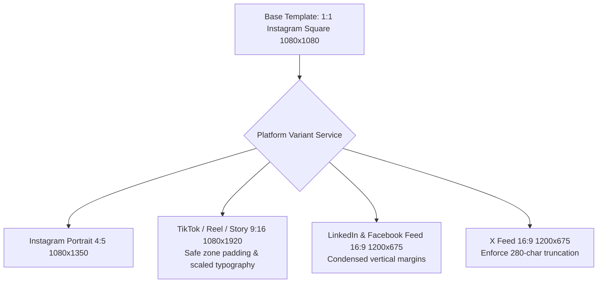

# Template Engine Architecture (Stage 4)

## 1. Overview & Objectives

The SocialForge Template Engine (HLD Stage 4) standardizes multi-platform visual content formatting, layer rendering, parameter substitution, and brand governance. It eliminates manual graphic redesigns across aspect ratios and guarantees that visual assets adhere to approved brand identities.

Key design principles:
- **Dynamic Variable Substitution**: Deep dot-path variable resolution (e.g., `{{brand.name}}`, `{{product.price | currency}}`, `{{cta.text | "Shop Now"}}`) across template copy and visual layer trees.
- **Platform Variants**: Automated coordinate scaling and layout reflows across 4 standard aspect ratios: 1:1 (Instagram Square), 4:5 (Instagram Portrait), 9:16 (TikTok & Stories/Reels), and 16:9 (LinkedIn & Facebook Feed).
- **Immutable Version History**: Every template mutation is recorded in `template_versions` with historical layer snapshots, changelog auditing, and one-click rollback capabilities.
- **Brand Kit Validation Engine**: Automated WCAG 2.1 AA contrast ratio scoring (minimum 4.5:1 for normal text, 3:1 for large text), canvas boundary containment, and brand color/font palette compliance.
- **Multi-Tenant Segregation**: Built-in canonical templates are globally available and immutable; custom brand templates are strictly scoped to `tenant_id`.

---

## 2. Canonical Template Categories & Subcategories (Stage 4)

The template catalog contains 22 canonical templates spanning 7 strategic categories:

| Category | Subcategories | Focus & Primary Application |
| :--- | :--- | :--- |
| **Product** | `new_arrival`, `product_promotion`, `feature` | E-commerce drop reveals, flagship promo cards, technical feature highlights |
| **Offer** | `discount`, `festival`, `limited_time` | Percentage deals, seasonal/holiday campaigns, countdown flash sales |
| **Education** | `tip`, `how_to`, `myth_vs_fact` | Bite-sized domain wisdom, carousel step guides, industry misconception debunking |
| **Trust** | `testimonial`, `review`, `case_study` | Customer quotes with star ratings, Trustpilot badges, enterprise ROI summaries |
| **Company** | `announcement`, `milestone`, `hiring` | Official corporate releases, community metrics celebrations, talent recruitment |
| **Event** | `webinar`, `workshop`, `launch` | Live virtual events, interactive workshops, product unveiling registrations |
| **Vertical** | `property`, `restaurant`, `course`, `service` | Real estate listings, culinary/menu specials, masterclass enrollments, B2B services |

---

## 3. Core Data Models

### 3.1 `templates` Table
Stores custom and system graphic templates.

| Column | Type | Description |
| :--- | :--- | :--- |
| `id` | `VARCHAR(36)` (PK) | Unique template identifier |
| `tenant_id` | `VARCHAR(36)` (FK, Nullable) | Scoped tenant ID (`NULL` for global built-in templates) |
| `brand_id` | `VARCHAR(36)` (FK, Nullable) | Scoped brand ID |
| `name` | `VARCHAR(255)` | Human-readable template name |
| `description` | `TEXT` (Nullable) | Template summary |
| `category` | `VARCHAR(64)` | `product` \| `offer` \| `education` \| `trust` \| `company` \| `event` \| `vertical` |
| `subcategory` | `VARCHAR(64)` | 22 canonical subcategories (e.g. `new_arrival`, `discount`, `feature`) |
| `aspect_ratio` | `VARCHAR(20)` | Default base aspect ratio (`1:1`, `9:16`, `16:9`, `4:5`) |
| `dimensions` | `JSON` | Pixel specs (`{ width, height }`) |
| `is_custom` | `BOOLEAN` | `true` for user/brand created templates |
| `is_built_in` | `BOOLEAN` | `true` for standard system templates |
| `background` | `JSON` | Background styling (gradient, solid color, image URL, opacity) |
| `layers` | `JSON` | Array of text, shape, image, badge, and CTA elements |
| `visual_components` | `JSON` | Canonical component layers tree |
| `tags` | `JSON` | Categorization tags |
| `thumbnail_url` | `TEXT` (Nullable) | Rendered preview thumbnail URI |
| `created_at` / `updated_at` | `TIMESTAMP` | Record timestamps |

### 3.2 `template_versions` Table
Immutable historical version snapshots for auditing and rollbacks.

| Column | Type | Description |
| :--- | :--- | :--- |
| `id` | `VARCHAR(36)` (PK) | Unique version record ID |
| `template_id` | `VARCHAR(36)` (FK) | Reference to parent template |
| `tenant_id` | `VARCHAR(36)` (FK) | Tenant isolation anchor |
| `version_number` | `INT` | Incrementing version sequence (1, 2, 3...) |
| `subcategory` | `VARCHAR(64)` | Snapshot subcategory |
| `dimensions` | `JSON` | Snapshot dimensions |
| `layers` | `JSON` | Snapshot of all canvas layers |
| `visual_components` | `JSON` | Snapshot of visual components |
| `background` | `JSON` | Snapshot of background configuration |
| `platform_variants` | `JSON` | Multi-platform layout snapshots |
| `is_locked` | `BOOLEAN` | Once published/used, frozen from further modification |
| `usage_count` | `INT` | Total posts/publications referencing this snapshot |
| `changelog` | `TEXT` | Summary of modifications |
| `created_by` | `VARCHAR(36)` (Nullable) | Author user ID |
| `created_at` | `TIMESTAMP` | Version snapshot timestamp |

---

## 4. AI Agent Controlled System Artifact Governance

Templates are governed as controlled system artifacts:
1. **Direct Mutation Prohibition**: AI agents are strictly blocked from invoking template creation, update, or deletion operations (`AI_MUTATION_RESTRICTED`).
2. **Safe Selection Tool**: Agents select templates using `template.selectTemplate`, which scores templates based on category, subcategory, platform, and brand relevance.
3. **Safe Population Tool**: Agents bind variables to templates using `template.populateAndRender`, executing validation against required fields, claim restrictions, and CTA rules without modifying template definitions.

## 5. Platform Variant & Aspect Ratio Reflow Engine

### Supported Platform Targets:
1. `instagram_square`: 1080x1080 (1:1), 2,200 char limit, 5% margin.
2. `instagram_portrait`: 1080x1350 (4:5), 2,200 char limit, 6% margin.
3. `tiktok_reel`: 1080x1920 (9:16), 4,000 char limit, 12% margin (bottom UI safe zone).
4. `linkedin_feed`: 1200x627 (16:9), 3,000 char limit, 5% margin.
5. `facebook_feed`: 1200x630 (1.91:1), 63,206 char limit, 5% margin.
6. `x_twitter`: 1200x675 (16:9), 280 char limit, 5% margin.

---

## 4. Dynamic Renderer Syntax & Filters

The dynamic renderer evaluates template expressions inside any text or layer attribute:
- **Dot-Path Resolution**: `{{brand.name}}`, `{{product.price}}`, `{{cta.headline}}`
- **Filters**:
  - `uppercase` / `upper`: `{{product.name | uppercase}}` $\to$ `RADIANCE SERUM`
  - `lowercase` / `lower`: `{{user.role | lowercase}}` $\to$ `creator`
  - `capitalize`: `{{tier | capitalize}}` $\to$ `Starter`
  - `currency`: `{{product.price | currency}}` $\to$ `$49.99`
- **Fallback Defaults**: `{{optional.cta | "Learn More"}}` $\to$ uses `"Learn More"` if null or undefined.

---

## 5. Brand Kit Validation Engine & WCAG Compliance

Implemented in [`templateValidatorService`](file:///f:/SocialAgent/apps/api/src/services/templates/templateValidator.service.ts):
- **Relative Luminance & Contrast Formula**: Computes exact WCAG contrast ratios ($L_1 + 0.05) / (L_2 + 0.05)$.
- **Thresholds**:
  - Normal text (< 18pt): Requires $\ge 4.5:1$ contrast ratio.
  - Large/Bold text ($\ge 18pt$ or weight $\ge 700$): Requires $\ge 3.0:1$ contrast ratio.
- **Canvas Bounds Checking**: Catches element coordinates outside the 0–100% normalized viewable canvas.

---

## 6. REST API Endpoints

- `GET /api/v1/brands/:brandId/templates`: Lists custom and built-in templates.
- `POST /api/v1/brands/:brandId/templates`: Creates custom template and snapshots Version 1.
- `GET /api/v1/brands/:brandId/templates/:templateId`: Retrieves template details.
- `POST /api/v1/brands/:brandId/templates/:templateId/duplicate`: 1-click duplication.
- `DELETE /api/v1/brands/:brandId/templates/:templateId`: Deletes custom template (built-in templates protected).
- `GET /api/v1/brands/:brandId/templates/:templateId/versions`: Lists immutable version history.
- `POST /api/v1/brands/:brandId/templates/:templateId/versions`: Creates manual version snapshot.
- `POST /api/v1/brands/:brandId/templates/:templateId/versions/:versionNumber/rollback`: Restores template to chosen version.
- `POST /api/v1/brands/:brandId/templates/:templateId/validate`: Runs brand kit and WCAG contrast check.
- `POST /api/v1/brands/:brandId/templates/:templateId/variants`: Generates multi-platform bundles.
