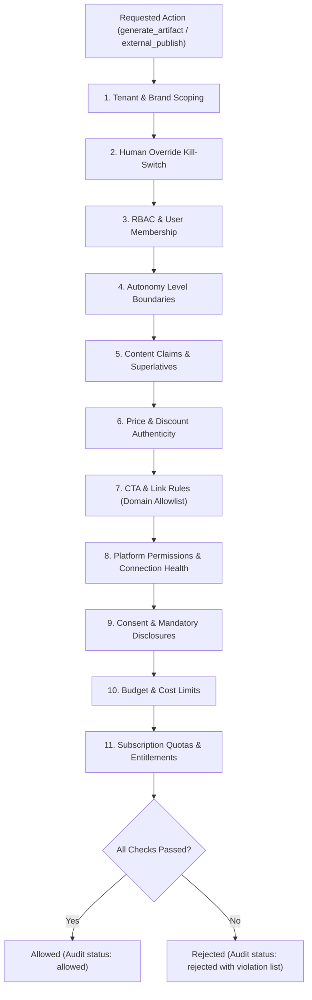
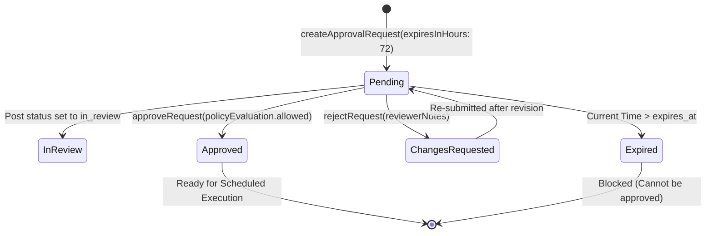

# SocialForge HLD Stage 8: Trust, Approval, Governance and Controlled Autonomy Architecture

## 1. Overview & Objective
Stage 8 establishes the enterprise-grade trust, governance, and controlled autonomy layer for SocialForge according to HLD v3.0. It bridges autonomous AI marketing workflows and human oversight with:
- **Autonomy Levels (L0–L5)**: Rigorous execution boundaries from "Suggest only" to "Bounded Policy Autonomy", defaulting non-negotiably to **L2 (External action requires approval)**.
- **11-Dimension Governance Policy Engine**: Comprehensive real-time compliance evaluation evaluating multi-tenancy, kill-switch status, RBAC, autonomy limits, claims, pricing authenticity, CTA links, channel permissions, disclosures, budgets, and quotas.
- **Approval Center**: Multi-channel preview, pre-approval content editing, auditable rejection notes, TTL expiration enforcement, policy validation before sign-off, and policy-gated bulk approvals.
- **Human Override Kill Switch**: Global and brand-level "Pause All Automations" kill switch that immediately halts external executions while preserving durable state for seamless resumption.
- **Zero Credential Exposure**: Automatic recursive redaction of sensitive credentials, tokens, and secrets in governance audit logs.
- **Multi-Tenant Boundary Isolation**: Absolute separation across tenants and brands with immutable production post invariant.

---

## 2. Autonomy Level Matrix (L0–L5)

| Level | Name | Description | Mutation Capabilities | Default |
| :--- | :--- | :--- | :--- | :--- |
| **L0** | **Suggest Only** | Copilot and agents can formulate recommendations, but cannot mutate persistent state or publish externally. | Read-only analysis | No |
| **L1** | **Internal Artifacts** | Can generate internal draft proposals, templates, and variants in draft status. External action strictly blocked. | Internal artifacts only | No |
| **L2** | **Approval Required** | External publishing, webhook triggers, and live marketing actions require explicit human sign-off via Approval Center. | Internal draft + Gated external | **Yes (System Default)** |
| **L3** | **Bounded Automation** | Pre-authorized templates and approved routine campaigns can execute autonomously if all policy rules pass; approval required otherwise. | Bounded external automation | No |
| **L4** | **Budget & Usage Controlled** | Fully autonomous within configured monthly spend thresholds and post quota caps. | Budget-bounded autonomous | No |
| **L5** | **Explicit Policy Autonomy** | Autonomous execution strictly bound to explicit brand policy, disclaimer requirements, and allowed domains. | Policy-bounded autonomous | No |

---

## 3. The 11-Dimension Governance Policy Engine

Before any internal generation or external action is executed or approved, it is evaluated against 11 independent compliance dimensions:



### Policy Rules Specification:
1. **Tenant & Brand Scoping**: Enforces that the target brand belongs strictly to the authenticated tenant.
2. **Human Override (Kill-Switch)**: If `emergency_paused: true`, all mutations and external calls are rejected immediately.
3. **RBAC & User Membership**: Verifies that the acting user is an active member of the tenant in `tenant_users`.
4. **Autonomy Level Boundaries**: Blocks actions exceeding current level (e.g., L0/L1 attempting external publication).
5. **Content Claims & Superlatives**: Flags prohibited or unprovable marketing guarantees (`#1 in the universe`, `100% cure guaranteed`, `best in the world guaranteed`, etc.).
6. **Price & Discount Authenticity**: Flags negative prices, non-numeric amounts, or discount percentages exceeding 100%.
7. **CTA & Link Rules**: Bans URL shorteners and deceptive redirects (`bit.ly`, `tinyurl.com`, `cutt.ly`, `t.co`) and restricts links to the brand's verified `allowed_domains` allowlist.
8. **Platform Permissions**: Verifies healthy, active OAuth connection status for Meta (Facebook/Instagram) or other social providers.
9. **Consent & Disclosures**: Ensures sponsored promotions include mandatory disclosure tags (`#ad`, `#sponsored`, or custom brand disclaimers).
10. **Budget & Cost Limits**: Compares projected operation cost against configured `monthly_budget_limit`.
11. **Subscription Quotas**: Evaluates real-time tenant entitlements via `EntitlementService.canPublish`.

---

## 4. Approval Center Architecture

The Approval Center manages the lifecycle of content requiring human review:



### Key Capabilities:
- **Configurable TTL Expiration**: Every approval request defines an expiration window (default: 72 hours). Requests past expiration are automatically transitioned to `expired` and cannot be approved without re-submission.
- **Multi-Platform Previews**: Renders realistic multi-channel mockups for Facebook (1:1), Instagram (4:5 / 1:1), with character count, media attachments, and platform tags.
- **In-Line Pre-Approval Editing**: Human reviewers can revise copy or schedule dates directly before approving. Changes are recorded in an immutable `edit_history` audit array.
- **Mandatory Rejection Feedback**: Rejection requires documented notes and transitions the underlying post to `changes_requested`.
- **Policy-Gated Approval**: Even with human approval, the engine validates the post against the 11-dimension policy engine before changing status to `approved`.
- **Bulk Approval**: Batch approval with individual policy validation and comprehensive audit logging.

---

## 5. Human Override Kill Switch & State Durability

The emergency kill-switch provides a global or brand-level safety pause:
- **Emergency Pause (`POST /api/v1/governance/override/pause`)**: Sets `emergency_paused = true`, records the operator identity and reason, and logs an auditable `human_override` event.
- **Zero Data Loss**: While active, scheduled jobs, pending approval requests, draft posts, and active automations remain durable.
- **Resume (`POST /api/v1/governance/override/resume`)**: Clears the emergency pause, restoring automated pipelines without data loss or duplicate executions.

---

## 6. Database Schema

### 1. `brand_governance_settings`
```sql
CREATE TABLE brand_governance_settings (
  id CHAR(36) PRIMARY KEY,
  tenant_id CHAR(36) NOT NULL REFERENCES tenants(id) ON DELETE CASCADE,
  brand_id CHAR(36) NOT NULL REFERENCES brands(id) ON DELETE CASCADE,
  autonomy_level VARCHAR(10) NOT NULL DEFAULT 'L2',
  max_autonomy_level VARCHAR(10) NOT NULL DEFAULT 'L5',
  require_approval_for_all_external BOOLEAN NOT NULL DEFAULT TRUE,
  emergency_paused BOOLEAN NOT NULL DEFAULT FALSE,
  paused_at TIMESTAMP NULL,
  paused_by CHAR(36) NULL REFERENCES users(id) ON DELETE SET NULL,
  pause_reason TEXT NULL,
  monthly_budget_limit DECIMAL(10,2) NOT NULL DEFAULT 500.00,
  current_month_spend DECIMAL(10,2) NOT NULL DEFAULT 0.00,
  allowed_domains JSON NULL,
  banned_words JSON NULL,
  mandatory_disclaimers JSON NULL,
  policy_rules JSON NULL,
  created_at TIMESTAMP DEFAULT CURRENT_TIMESTAMP,
  updated_at TIMESTAMP DEFAULT CURRENT_TIMESTAMP ON UPDATE CURRENT_TIMESTAMP,
  UNIQUE KEY uniq_brand_gov (tenant_id, brand_id)
);
```

### 2. `governance_audit_logs`
```sql
CREATE TABLE governance_audit_logs (
  id CHAR(36) PRIMARY KEY,
  tenant_id CHAR(36) NOT NULL REFERENCES tenants(id) ON DELETE CASCADE,
  brand_id CHAR(36) NULL REFERENCES brands(id) ON DELETE CASCADE,
  user_id CHAR(36) NULL REFERENCES users(id) ON DELETE SET NULL,
  event_type VARCHAR(50) NOT NULL,
  action VARCHAR(100) NOT NULL,
  entity_type VARCHAR(64) NULL,
  entity_id VARCHAR(128) NULL,
  status VARCHAR(20) NOT NULL,
  actor_role VARCHAR(50) NULL,
  policy_results JSON NULL,
  tool_call JSON NULL,
  details JSON NULL,
  reason TEXT NULL,
  ip_address VARCHAR(45) NULL,
  created_at TIMESTAMP DEFAULT CURRENT_TIMESTAMP
);
```

### 3. `approval_requests` (Stage 8 Upgrades)
- Added `tenant_id`, `brand_id`, `entity_type`, `entity_id`, `review_notes`, `expires_at`, `edit_history`, `metadata`, `reviewed_by`.

---

## 7. REST API Endpoints

| Method | Path | Description |
| :--- | :--- | :--- |
| `GET` | `/api/v1/governance/settings?brandId=...` | Retrieves brand governance settings and autonomy level |
| `PUT` | `/api/v1/governance/settings` | Updates governance settings, budget limit, and rules |
| `POST` | `/api/v1/governance/autonomy-level` | Transitions autonomy level (L0–L5) with audit trail |
| `POST` | `/api/v1/governance/override/pause` | Emergency human override kill switch pause |
| `POST` | `/api/v1/governance/override/resume` | Resumes automations after emergency pause |
| `POST` | `/api/v1/governance/policy/evaluate` | Evaluates action against the 11 policy dimensions |
| `GET` | `/api/v1/governance/approvals` | Lists pending, approved, rejected, and expired requests |
| `GET` | `/api/v1/governance/approvals/:id` | Retrieves single approval request with TTL countdown |
| `GET` | `/api/v1/governance/approvals/:id/preview` | Generates multi-channel previews (Facebook, Instagram) |
| `PUT` | `/api/v1/governance/approvals/:id` | Edits copy and schedule before approval |
| `POST` | `/api/v1/governance/approvals/:id/approve` | Policy-gated approval for execution |
| `POST` | `/api/v1/governance/approvals/:id/reject` | Rejects request with required reviewer notes |
| `POST` | `/api/v1/governance/approvals/bulk-approve` | Bulk approves multiple eligible requests |
| `GET` | `/api/v1/governance/audit-logs` | Retrieves governance audit log trail |

---

## 8. Verification & Test Suite Summary

- **Test Suite**: `scripts/test_governance_stage8.mjs` (`npm run test:governance-stage8`)
- **Total Tests**: **74 passed, 0 failed**
- **Full Platform Regression (`npm run test:hld`)**: **941 tests passing across Stages 1–8**
- **Production Post Invariant**: Remote post `1405588742634526_122100337179498315` remains published, locked, and untouched.
