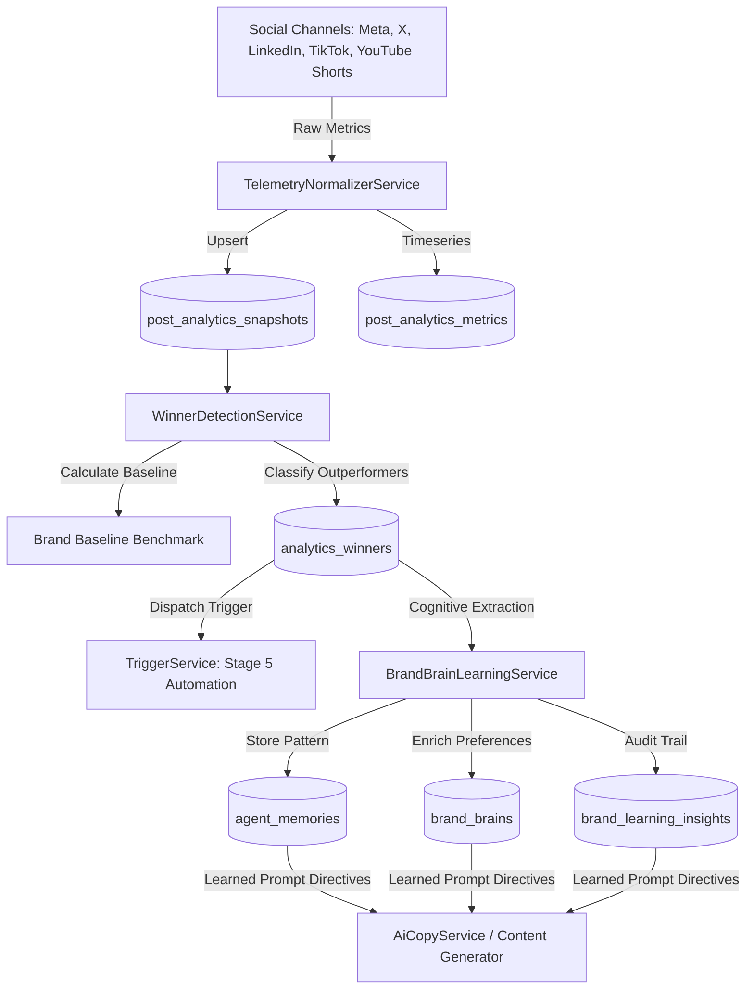

# SocialForge HLD Stage 6: Unified Analytics Telemetry, Winner Detection & Continuous Brand Brain Learning

## 1. Overview & Objectives

Stage 6 delivers an end-to-end, multi-platform telemetry analytics pipeline, real-time winner detection engine, and cognitive closed-loop learning system that directly enriches the SocialForge Brand Brain.

Key Capabilities:
1. **Unified Cross-Platform Analytics Telemetry**:
   - Ingests and normalizes raw telemetry across **Meta (Facebook & Instagram)**, **X (Twitter)**, **LinkedIn**, **TikTok**, and **YouTube Shorts**.
   - Canonical normalization model: `impressions`, `reach`, `likes`, `comments`, `shares`, `clicks`, `saves`, `videoViews`, `watchTimeSeconds`, `engagement`, `engagementRate`, `ctr`, and `velocityScore`.
2. **Automated Winner Detection Engine**:
   - Evaluates real-time performance against calculated dynamic brand baseline benchmarks and platform standards.
   - 4 Winner Classification Archetypes:
     - **Statistical Outperformer**: Engagement rate $\ge 2.0\times$ brand average, OR absolute rate $\ge 7.0\%$.
     - **Velocity Surge**: Engagements per hour $\ge 2.5\times$ baseline velocity, OR $\ge 50$ engagements/hour in early post window.
     - **Creative Angle Winner**: Multi-variant A/B comparison identifying variant with $\ge 1.5\times$ outperformance over sibling variants.
     - **High Conversion**: CTR $\ge 3.5\%$ with significant link interaction.
   - Built-in 7-day cooldown deduplication to prevent alert and trigger fatigue.
3. **Stage 5 Automation Engine Wire-Up**:
   - Automatically dispatches `analytics_winner_detected` triggers to execute Stage 5 durable automation graphs (e.g. automatically scale winning angles, create retargeting threads, notify team).
4. **Continuous Brand Brain Learning Engine**:
   - Cognitive linguistic pattern extraction from winning copy (hook styles, bold claims, curiosity questions, CTAs, tone, and hashtags).
   - Writes directly to `agent_memories` with `memory_type: 'engagement_pattern'` and `memory_type: 'brand_guidelines'`.
   - Auto-updates `brand_brains` table with top-performing hashtags in `hashtagPreferences.defaultTags` and validated high-converting CTAs in `ctaPreferences`.
   - Records auditable insights in `brand_learning_insights`.
   - Augments AI copy generation prompts dynamically via `getLearnedPromptDirectives`.

---

## 2. Architecture & Data Model

### Database Tables Added

1. **`analytics_winners`**:
   - `id`: UUID Primary Key
   - `tenant_id`, `brand_id`: Strict multi-tenant references
   - `post_id`, `post_variant_id`: Referenced post and variant
   - `platform`: `facebook`, `instagram`, `twitter`, `linkedin`, `tiktok`, `youtube_shorts`
   - `remote_post_id`: Remote platform post ID
   - `winner_type`: `'statistical_outperformer' | 'velocity_surge' | 'creative_angle_winner' | 'high_conversion'`
   - `score`, `lift_multiplier`: Quantitative lift over baseline
   - `baseline_benchmark`: Snapshot of baseline metrics at time of detection
   - `metrics_snapshot`: Normalized snapshot metrics
   - `winning_attributes`: Linguistic and creative attributes (hook style, CTA, tone, hashtags)
   - `automation_dispatched`, `automation_run_id`: Automation dispatch audit trail
   - `detected_at`, `created_at`, `updated_at`: Timestamps

2. **`brand_learning_insights`**:
   - `id`: UUID Primary Key
   - `tenant_id`, `brand_id`: Multi-tenant references
   - `insight_type`: `'hook_strategy' | 'creative_angle' | 'cta_pattern' | 'hashtag_affinity' | 'posting_window' | 'format_performance'`
   - `title`, `summary`: Human-readable synthesis
   - `confidence`, `sample_size`, `performance_lift`: Metric validation
   - `recommended_action`: Actionable advice for human editors and AI agents
   - `metadata`: JSON payload of winner metrics and extracted attributes
   - `applied_to_brand_brain`: Boolean flag

3. **`post_analytics_snapshots`** (Extended):
   - `watch_time_seconds`: Total seconds watched (video/shorts)
   - `ctr`: Click-through rate (%)
   - `velocity_score`: Engagements per hour since publication
   - `roi`: Revenue or ROI attributed

---

## 3. Services Implemented

1. **`telemetryNormalizer.service.ts`**:
   - Location: `apps/api/src/services/analytics/telemetryNormalizer.service.ts`
   - Methods: `normalize(platform, remotePostId, rawMetrics, publishedAt)`, `ingestTelemetry(params)`.
2. **`winnerDetection.service.ts`**:
   - Location: `apps/api/src/services/analytics/winnerDetection.service.ts`
   - Methods: `calculateBrandBaseline(brandId)`, `detectWinnersForBrand(brandId, options)`, `getWinners(brandId, filters)`.
3. **`brandBrainLearning.service.ts`**:
   - Location: `apps/api/src/services/analytics/brandBrainLearning.service.ts`
   - Methods: `extractWinningAttributes(copyText, mediaType)`, `learnFromWinner(winner)`, `getBrandLearningInsights(brandId)`, `getLearnedPromptDirectives(brandId)`.

---

## 4. API Endpoints

| Method | Endpoint | Description |
|---|---|---|
| `GET` | `/api/v1/brands/:brandId/analytics/baselines` | Retrieves current brand performance baseline benchmarks |
| `POST` | `/api/v1/brands/:brandId/analytics/telemetry/ingest` | Ingests cross-platform telemetry (Meta, X, LinkedIn, TikTok, YouTube) |
| `POST` | `/api/v1/brands/:brandId/analytics/detect-winners` | Triggers real-time winner detection evaluation |
| `GET` | `/api/v1/brands/:brandId/analytics/winners` | Queries detected winners with platform and type filtering |
| `GET` | `/api/v1/brands/:brandId/analytics/learning-insights` | Retrieves continuous brand brain learning insights and directives |

---

## 5. Verification & Invariants

- **Test Suite**: `scripts/test_unified_analytics_stage6.mjs` (100/100 tests passing).
- **Full Platform Regression Suite**: `npm run test:hld` (794/794 tests passing across 15 test suites).
- **Production Guardrails**: Production post variant `1405588742634526_122100337179498315` remains permanently locked in `published` status. Multi-tenant and brand boundary enforcement is strictly validated on all queries.
