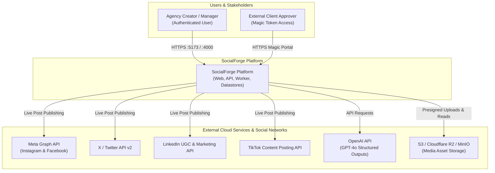
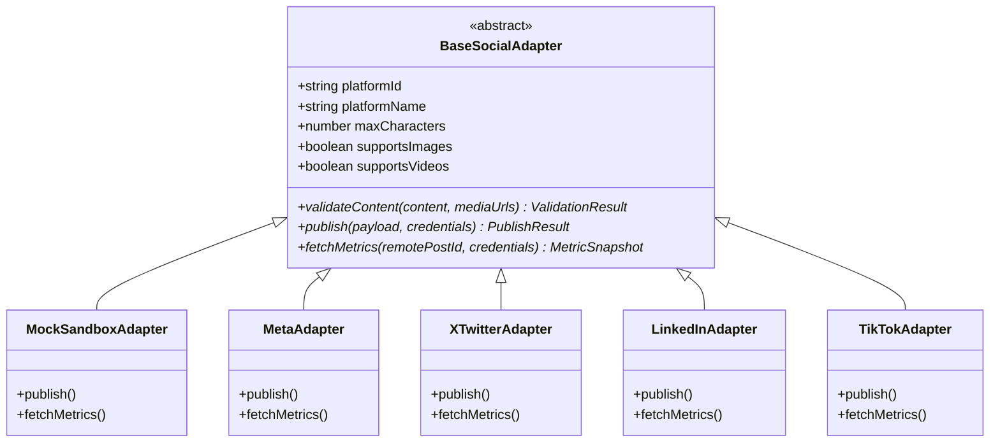
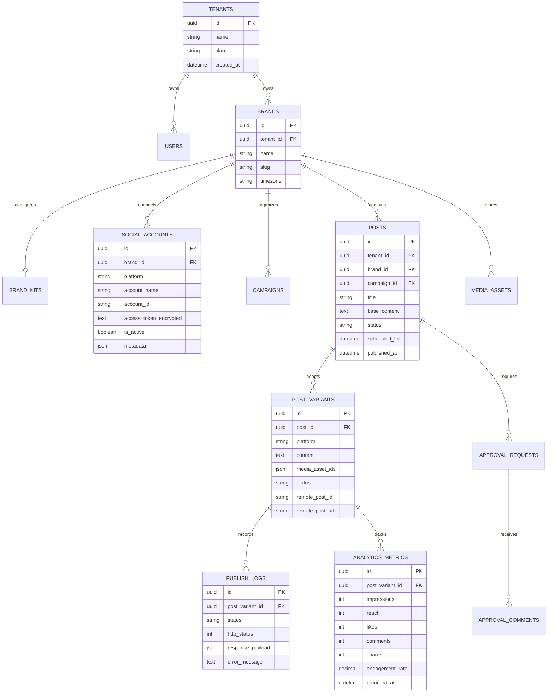
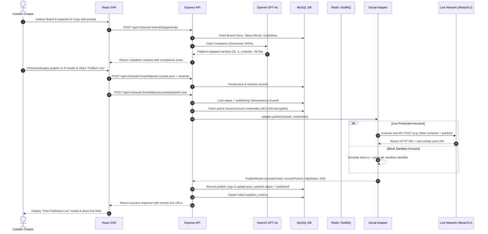

# SocialForge — High-Level Design (HLD) Document

**Document Version:** 1.0.0  
**System Name:** SocialForge (Multi-Tenant AI Social Media Platform)  
**Architecture Classification:** Enterprise Distributed Modular Monorepo  
**Status:** Approved & Implemented  
**Date:** September 2026  

---

## 1. Executive Summary & Purpose

**SocialForge** is an enterprise-grade, multi-tenant AI social media automation and orchestration platform engineered for marketing agencies, multi-brand holding companies, and digital creators. The platform eliminates content production bottlenecks by consolidating the entire lifecycle into an integrated system:

```
[Brand Identity & Voice Guidelines]
              │
              ▼
[Multimodal AI Generation (Text, Posters, 9:16 Video Reels)]
              │
              ▼
[Internal & External Magic-Link Client Review Engine]
              │
              ▼
[Timezone-Aware Scheduling & Resilient Dispatch]
              │
              ▼
[Multi-Platform Publishing (Real Live APIs & Sandbox Simulator)]
              │
              ▼
[Real-Time Analytics, Performance Telemetry & Reporting]
```

### Key Business Goals
1. **Multi-Brand Tenant Isolation**: Strict segregation of brand kits, creative assets, social accounts, and publishing logs across agency tenants.
2. **High-Velocity AI Content Synthesis**: Automated adaptation of single creative ideas into network-optimized formats for Instagram, X (Twitter), LinkedIn, TikTok, Facebook, and YouTube Shorts.
3. **Zero-Friction Client Approvals**: Cryptographically signed Magic Review Links allowing external brand clients to review, comment, and approve post drafts without requiring user logins.
4. **Resilient Publishing & Hybrid Sandbox**: Production OAuth adapters alongside an instant Mock Sandbox Simulator for safe staging, end-to-end testing, and demoing.

---

## 2. High-Level Architecture (C4 Model)

### 2.1 System Context Diagram (C4 Level 1)



---

### 2.2 Container Topology (C4 Level 2)

The system is organized into a modular monorepo partitioned into decoupled services communicating over internal Docker networks:

```mermaid
graph TB
    subgraph "Client Layer"
        BrowserSPA["apps/web (React 18 + Vite)\nPort: 5173\nGlassmorphic UI & Live Feed Previews"]
    end

    subgraph "Application Services Layer"
        ExpressAPI["apps/api (Node.js + Express)\nPort: 4000\nREST Endpoints, Auth, Scheduling, Adapters"]
        BullWorker["apps/worker (BullMQ Queue Worker)\nFFmpeg Video Engine, AI Pipelines, Analytics Sync"]
    end

    subgraph "Shared Foundation"
        SharedLib["packages/shared\nUniversal TypeScript Types, Zod Schemas, Domain Contracts"]
    end

    subgraph "Data & Persistence Layer"
        MySQLDB[("MySQL 9.x / 8.4 Database\nPort: 3308 / 3306\nSchema: socialforge_db")]
        RedisStore[("Redis 7.2 Cache & Broker\nPort: 6379\nBullMQ Queues & Fast Token Cache")]
        MinIOStore[("MinIO Object Storage (S3-Compatible)\nPort: 9000 / 9001\nBucket: socialforge-media")]
    end

    BrowserSPA -->|REST API Calls (JWT Bearer)| ExpressAPI
    BrowserSPA -.->|Direct Browser Uploads| MinIOStore

    ExpressAPI -->|Read / Write SQL| MySQLDB
    ExpressAPI -->|Enqueue Jobs & Token Invalidation| RedisStore
    ExpressAPI -->|Sign Presigned URLs & Read Assets| MinIOStore

    BullWorker -->|Consume Queued Jobs| RedisStore
    BullWorker -->|Update Status & Metrics| MySQLDB
    BullWorker -->|Read Raw / Write Rendered Media| MinIOStore

    ExpressAPI -.-> SharedLib
    BullWorker -.-> SharedLib
    BrowserSPA -.-> SharedLib
```

---

## 3. Core Subsystems & Component Design

### 3.1 Frontend Presentation Layer (`apps/web`)
* **Technology**: React 18, TypeScript, Vite, Vanilla CSS Design System with dark mode glassmorphism (`backdrop-filter: blur(12px)`).
* **Key Modules**:
  * **Content Studio & Composer**: Multi-channel composer with real-time character counters, brand voice compliance meters, and live device mockups for Instagram, X, LinkedIn, and TikTok.
  * **AI Design Studio (Canva-like Visual Editor)**: Canvas visual layer editor allowing text, shapes, badges, and image layers with drag-and-drop, aspect-ratio switching (1:1, 4:5, 9:16), and SVG rasterization.
  * **Reel Motion Studio**: 9:16 vertical short-form video creator with AI storyboarding, subtitle styling, and audio track pairing.
  * **Calendar & Timeline Engine**: Interactive visual planner supporting week/month views, drag-and-drop rescheduling, and timezone localization.
  * **Channels & Sandbox Manager**: Secure OAuth credential management, token health checking, and sandbox seeding.

---

### 3.2 Backend REST API Service (`apps/api`)
* **Technology**: Node.js, Express, TypeScript, Knex.js SQL query builder.
* **Security & Isolation Architecture**:
  * **TenantContext Middleware**: Extracts and verifies JWT on every request; enforces `tenant_id` scoping across all database operations.
  * **CryptoVault Service**: AES-256-GCM authenticated encryption for OAuth access tokens and client secrets stored in MySQL.
  * **SSRF Shield**: Validates all incoming external asset URLs, enforcing public IP resolution and blocking access to loopback (`127.0.0.1`), private RFC1918 subnets (`10.0.0.0/8`, `192.168.0.0/16`), and cloud metadata IP (`169.254.169.254`).
  * **In-Memory Sliding-Window Rate Limiter**: Brute-force protection returning `HTTP 429` with standard `RateLimit-*` and `Retry-After` headers.
  * **Hardened Security Headers**: Helmet configuration masking `X-Powered-By`, enforcing `X-Frame-Options: DENY`, `X-Content-Type-Options: nosniff`, and restrictive CORS.

---

### 3.3 AI Brain & Generation Engine (`AiCopyService` & `BrandBrainService`)
* **Technology**: OpenAI API (GPT-4o) with Structured JSON Output enforcement.
* **Core Capabilities**:
  * **Brand Kit Compliance**: Automatically injects brand tone (e.g., Clinical Radiance, Luxury Minimalist), target personas, prohibited taboo words, and mandatory legal disclaimers into LLM system prompts.
  * **10 Specialized Content Formats**: Instagram captions, X posts, X threads, LinkedIn strategic thought leadership, TikTok hooks, carousel scripts, stories, and ad copies.
  * **11 Smart AI Transformation Actions**: Rewrite, Shorten, Expand, Professional, Friendly, Funny, Educational, Persuasive, Luxury, Conversational, and Multilingual Translation (Spanish, French, German, Japanese, Portuguese, Italian).

---

### 3.4 Dynamic Graphic & Video Rendering Subsystem
1. **SVG & Image Template Engine**:
   * Generates production-ready vector graphics dynamically across 4 standard aspect ratios: `1:1` (Square), `4:5` (Portrait), `1.91:1` (Landscape), and `9:16` (Story/Reel).
   * Renders high-resolution raster previews with brand primary/accent color blending, typography, and badges.
2. **Native FFmpeg 9:16 Video Engine (`apps/worker`)**:
   * Fully automated video rendering pipeline generating 1080×1920 (9:16) portrait MP4 files with H.264 video and AAC audio codecs.
   * Dynamic Gaussian boxblur backdrops for non-vertical assets.
   * Hardcoded ASS subtitle burn-in synchronized to scene timing.
   * Dynamic sidechain audio ducking (lowering background music volume automatically during voiceover/speech).

---

### 3.5 Asynchronous Scheduling & Timezone Engine
* **Technology**: BullMQ, Redis 7, Luxon timezone calculations.
* **Architecture**:
  * Brands define individual timezones (e.g. `America/New_York`, `Asia/Tokyo`, `Europe/London`).
  * Posts scheduled at local times are converted to UTC timestamps for deterministic execution.
  * Delayed BullMQ jobs trigger at the exact target execution second.
  * Idempotency guards lock post status to `publishing` before adapter execution to prevent double-posting race conditions.

---

### 3.6 Multi-Platform Publishing Engine (`socialAdapterRegistry`)
* All network adapters implement the unified `BaseSocialAdapter` contract:



* **Production Adapters**:
  * **MetaAdapter**: Meta Graph API v19.0 container creation (`POST /{ig-user-id}/media`) and container publish (`POST /{ig-user-id}/media_publish`), fetching real permalinks.
  * **XTwitterAdapter**: X (Twitter) API v2 (`POST https://api.twitter.com/2/tweets`).
  * **LinkedInAdapter**: LinkedIn UGC Post API (`POST https://api.linkedin.com/v2/ugcPosts`).
  * **TikTokAdapter**: TikTok Content Posting API v2.
* **Mock Sandbox Adapter**:
  * Zero-credential testing engine simulating realistic network latency (150–350ms), character constraints, simulated remote post IDs, audit logs, and synthetic initial telemetry.

---

### 3.7 Magic Review & Approval Portal
* Allows agencies to share post drafts with external stakeholders without requiring them to register an account.
* **Cryptographic Token Lifecycle**:
  1. Internal creator submits post for review -> API generates cryptographically secure, random 256-bit `magic_token` with an expiration timestamp (e.g. 7 days).
  2. External client visits `https://socialforge.app/review/:magicToken`.
  3. Client can view full multi-platform previews, approve in 1 click, or request specific revisions with feedback comments.

---

## 4. Data Architecture & Schema Model

The database is built on MySQL 9.x/8.4 (`socialforge_db`) enforcing relational integrity, foreign key cascades, and tenant isolation:



---

## 5. End-to-End Execution Workflows

### 5.1 Content Creation to Multi-Channel Dispatch



---

## 6. Non-Functional Requirements & Security Architecture

| Category | Requirement | Architectural Implementation |
| :--- | :--- | :--- |
| **Data Isolation** | Strict Multi-Tenant Separation | Every SQL query enforces `tenant_id` and `brand_id`. Knex database migrations enforce relational foreign key cascading. |
| **Secret Management** | Zero Plaintext Credentials | Social tokens (OAuth access & refresh tokens) encrypted with **AES-256-GCM** with unique initialization vectors (`iv`) and auth tags. |
| **SSRF Prevention** | Defense Against Cloud Metadata Leakage | URL validation service resolves hostnames, checks IP ranges, and blocks loopback, private IPv4 subnets, and `169.254.169.254`. |
| **Rate Limiting** | Brute-force & Denial of Service Protection | In-memory sliding-window limiter on sensitive endpoints (`/auth/*`, `/publish-now`). Returns `HTTP 429 Rate Limit Exceeded`. |
| **Timezone Precision** | Deterministic Multi-Timezone Scheduling | All internal schedules computed via `Luxon` brand-local conversion and stored in UTC; executed via delayed BullMQ queue timers. |
| **Publishing Idempotency**| Zero Duplicate Posts | Status locks prevent race conditions during parallel publish triggers or retry attempts. |
| **Fault Tolerance** | Resilient Publishing | Failed variants do not halt successful platforms; failed variants record HTTP error payloads to `publish_logs` with a 1-click retry action. |

---

## 7. Deployment & Infrastructure Matrix

### Services & Port Allocation:

| Container / Service | Image / Runtime | Port (Host:Container) | Function |
| :--- | :--- | :--- | :--- |
| **`socialforge-web`** | Node.js 20 / Nginx (Alpine) | `5173:5173` (Dev) / `80:80` (Prod) | Single Page Application frontend |
| **`socialforge-api`** | Node.js 20 LTS | `4000:4000` | REST API service, Auth & Orchestration |
| **`socialforge-worker`**| Node.js 20 + Native FFmpeg | N/A (Internal Queue Consumer) | Video rendering, BullMQ jobs, Analytics ingestion |
| **`socialforge-mysql`** | MySQL 9.x / 8.4 Community | `3308:3306` | Primary relational transactional database |
| **`socialforge-redis`** | Redis 7.2 Alpine | `6379:6379` | Queue broker, sliding-window cache, pub/sub |
| **`socialforge-minio`** | MinIO RELEASE (S3 API) | `9000:9000` / `9001:9001` (Console)| Media object storage & presigned URL provider |

---

## 8. Summary & Reference

This High-Level Design defines the operational architecture of SocialForge. Detailed low-level documentation for individual modules can be found in the repository:
* Product Requirements Document: [01-product-requirements.md](file:///f:/SocialAgent/docs/01-product-requirements.md)
* System Topology & Networks: [02-system-architecture.md](file:///f:/SocialAgent/docs/02-system-architecture.md)
* Relational Database Design: [03-database-design.md](file:///f:/SocialAgent/docs/03-database-design.md)
* REST API Endpoint Directory: [04-api-design.md](file:///f:/SocialAgent/docs/04-api-design.md)
* Satori / Sharp Template Engine: [05-template-engine.md](file:///f:/SocialAgent/docs/05-template-engine.md)
* OpenAI System & Prompts: [06-ai-system.md](file:///f:/SocialAgent/docs/06-ai-system.md)
* FFmpeg Video Rendering Pipeline: [07-video-rendering.md](file:///f:/SocialAgent/docs/07-video-rendering.md)
* Social Platform Integrations: [08-social-integrations.md](file:///f:/SocialAgent/docs/08-social-integrations.md)
* Security & SSRF Hardening: [09-security.md](file:///f:/SocialAgent/docs/09-security.md)
